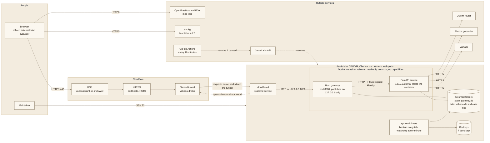
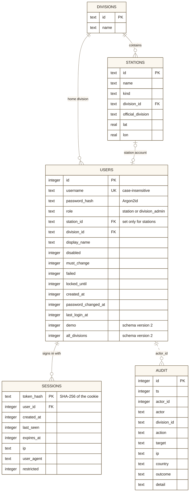
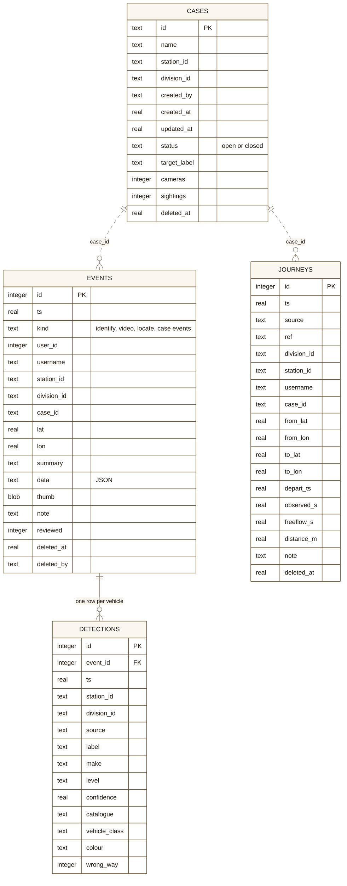
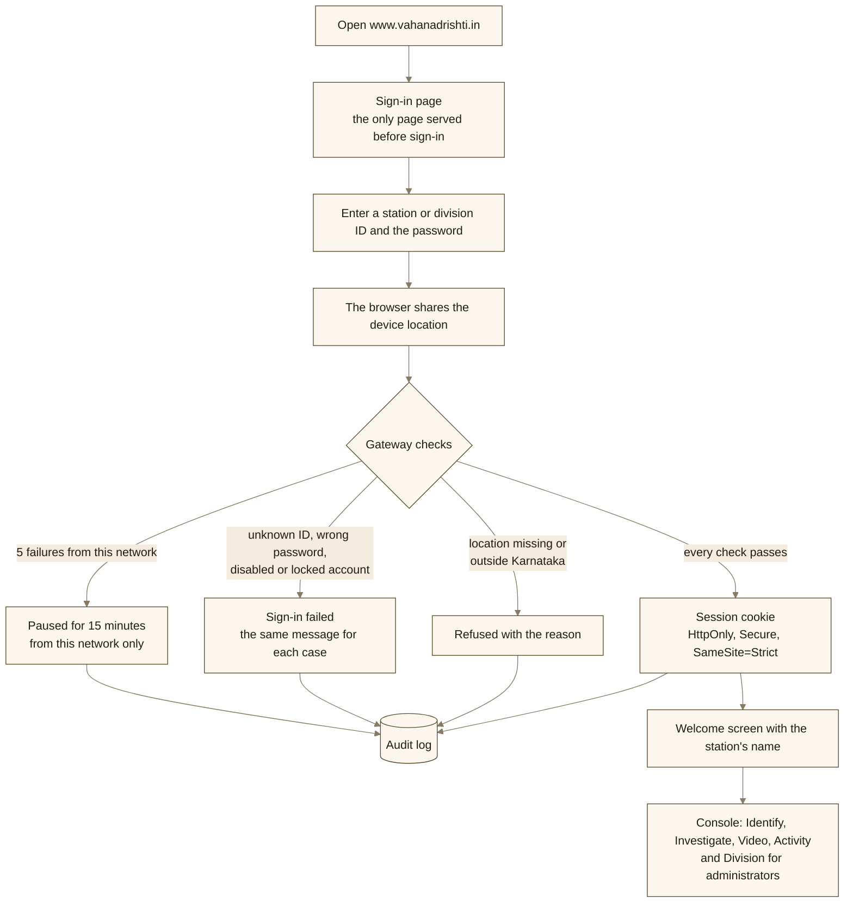
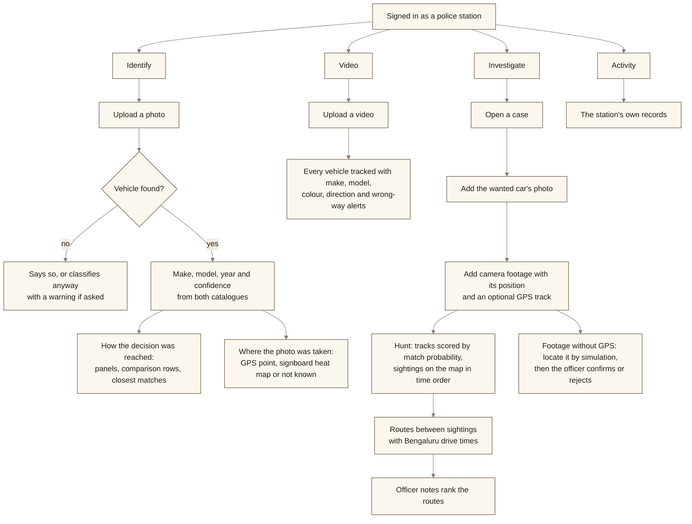
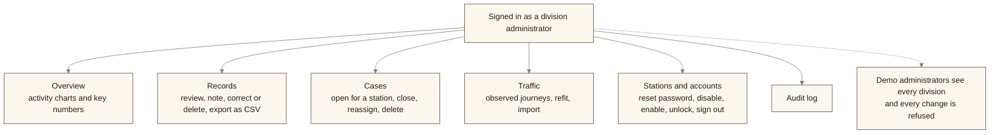
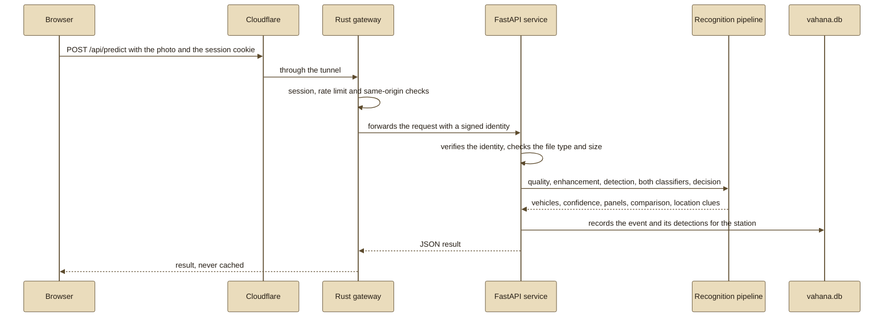

# Vahana Drishti: project documents

Team ATLAS (T55) · Computer Vision Hackathon 2026 · Problem P5 · Live at https://www.vahanadrishti.in

This file gathers the engineering and planning documents that do not fit in the README: how the network is laid out, how the data is stored, how people move through the console, and the agile records we kept while building it. The architecture of the software itself is in the README and in [docs/architecture.md](docs/architecture.md), the design decisions in [docs/DESIGN.md](docs/DESIGN.md), and the measured results in [eval_P5_T55.md](eval_P5_T55.md).

| Section | What it covers |
| :--- | :--- |
| [1. Network architecture](#1-network-architecture) | Every machine, service and connection, with ports and what protects each one |
| [2. Database design](#2-database-design) | The two SQLite databases, the case files on disk, scoping and backups |
| [3. User flows](#3-user-flows) | Sign-in, the station officer's work, the division administrator's work, and one request end to end |
| [4. Agile documents](#4-agile-documents) | Vision, personas, user stories, iteration log, definition of done, risks, release notes and retrospective |

---

## 1. Network architecture

The VM accepts no web traffic from the internet. `cloudflared` opens the tunnel from inside the machine, Cloudflare sends requests back down it, and only the gateway's port is reachable, on the loopback address. The Python service is bound to loopback inside the container and accepts a request only if the gateway signed the identity in it.

| From | To | Protocol and port | Purpose | What protects it |
| :--- | :--- | :--- | :--- | :--- |
| Browser | Cloudflare | HTTPS 443 (HTTP is redirected) | The console and its API | TLS, HSTS, Cloudflare's country header, which the gateway checks against India |
| cloudflared on the VM | Cloudflare | Outbound tunnel connection | Carries every public request | No inbound web port is opened. A quick tunnel runs as a fallback |
| cloudflared | Rust gateway | HTTP, 127.0.0.1:8080 | Hands each request to the gateway | Loopback only |
| Rust gateway | FastAPI service | HTTP, 127.0.0.1:8001 inside the container | Every `/api` call | HMAC-SHA256 identity that expires after 30 minutes, same-origin check on every change |
| FastAPI service | OSRM, Photon, Valhalla | HTTPS 443 | Map matching and routes, geocoding of notes and signboards, reachable areas | Outbound only, with a generic user agent. Listed as a known limit for real casework |
| Browser | OpenFreeMap, EOX, unpkg | HTTPS 443 | Map tiles and the map library | The content security policy allows only these hosts, and MapLibre loads with an integrity hash |
| GitHub Actions | JarvisLabs API | HTTPS 443 | Resumes the VM if the provider pauses it | The API key is a repository secret |
| Maintainer | VM | SSH 22 | Deployment and recovery | SSH key |

**Inside the container:** the root filesystem is read-only, temporary files go to a 1 GB in-memory `/tmp`, every Linux capability is dropped, privilege escalation is blocked, memory is capped at 24 GB and processes at 512. Only `state/` and `data/` are writable, as mounted folders.

---

## 2. Database design

Two SQLite databases and one folder of files hold everything. The gateway owns accounts and security, the analysis service owns records and cases, and the two meet only through the station and division IDs of the police station register (`assets/bengaluru/police_stations.json`, plus `demo_accounts.json` for the two demo stations).

### 2.1 `gateway.db`: accounts, sessions and the audit log

* A user is either a station account (with a `station_id`) or a division administrator (without one), and a check constraint enforces it.
* Session tokens never touch the disk. Only their SHA-256 hash is stored, so a copy of the database cannot be used to sign in, and deleting the rows signs people out.
* `demo` marks the four shared evaluator accounts, and `all_divisions` lets the two demo administrators read every division. Both columns were added by the schema migration to version 2, which runs when the gateway starts.
* Indexes: `users(division_id)`, `sessions(user_id)` and `audit(division_id, id)`, which serve the per-division account list and the audit log.

### 2.2 `vahana.db`: records, detections, cases and journeys

* **events** is the activity record of every identification, video analysis and case action, with a small thumbnail. Administrators can mark a record as reviewed, add a note or delete it, and a deletion only sets `deleted_at` and `deleted_by`, so the history stays complete.
* **detections** keeps one row per vehicle found, which is what the charts of the division overview count.
* **cases** is an index of the case folders, so lists and the administrator view load without opening every file.
* **journeys** holds observed trips (from sightings of the same car, dashcam GPS or imported data) that correct the Bengaluru drive-time profile. `UNIQUE (source, ref)` stops the same trip from being counted twice.
* Indexes follow the queries: `(division_id, ts)` and `(station_id, ts)` on events, `(division_id, ts)` and `event_id` on detections, `(division_id, updated_at)` and `(station_id, updated_at)` on cases, and `(division_id, depart_ts)` on journeys.

### 2.3 Case files and footage

Each case is a folder: `data/cases/<case id>/case.json` holds the target photo's result, the cameras, sightings, notes and routes, and `data/cases/<case id>/cameras/<camera id>.<ext>` holds each uploaded video. `case.json` is written to a temporary file first and then renamed, so a crash cannot leave half a case behind.

### 2.4 Who can see which rows

| Signed in as | Sees | Rule in the code |
| :--- | :--- | :--- |
| Station account | Its own records and cases only | `station_id` equals the station |
| Division administrator | Every record, case and account of the stations in its division | `division_id` equals the division |
| Demo administrator | Every division, read only, with IP addresses hidden in the audit log | All divisions match, and every change is refused by the gateway and by the service |

### 2.5 Backups

Every 6 hours a systemd timer copies both databases with SQLite's online backup while the service runs, checks each copy with `pragma integrity_check`, and copies the case folder with unchanged files hard-linked to the previous backup. Seven days of backups are kept. Restoring is described in [docs/OPERATIONS.md](docs/OPERATIONS.md).

---

## 3. User flows

### 3.1 Signing in

Sessions end after 60 idle minutes or 12 hours. After 50 failures from all networks together an ordinary account locks for 15 minutes, and a division administrator can unlock it sooner. Demo accounts are never locked this way, so nobody can shut evaluators out.

### 3.2 The station officer's work

### 3.3 The division administrator's work

### 3.4 One identification, end to end

---

## 4. Agile documents

### 4.1 Product vision

A police officer in Bengaluru should be able to photograph or upload a vehicle and learn its make, model and year with an honest confidence, see why the system thinks so, and follow that vehicle across camera footage to a likely route, without the system ever pretending to know more than its evidence shows.

### 4.2 Personas

| Persona | Who they are | What they need from the console |
| :--- | :--- | :--- |
| Station officer | Works at one of the 184 police stations, often on a phone, with little time per case | A quick, clear answer about a vehicle, and a way to follow it across camera footage |
| Division administrator | Supervises the stations of one division | Oversight of every record and case, control of station accounts, and a record of who signed in |
| Evaluator | A hackathon judge testing the live site with photos of their own choosing | Shared demo accounts that work at once, visible reasoning, and measured results to compare against |
| Maintainer | A team member running the server | One container, backups, a watchdog, and documentation for every setting |

### 4.3 Epics and user stories

| ID | User story | Acceptance criteria | Status | Evidence |
| :--- | :--- | :--- | :--- | :--- |
| US1 | As a station officer, I want to upload a vehicle photo and get its make, model, year and confidence, so that I can describe the vehicle accurately. | A box is drawn around the vehicle, make, model and year are shown separately, the confidence is calibrated, and the answer arrives within seconds on a CPU | Done | `eval_P5_T55.md` §1, §4 and §6 |
| US2 | As a station officer, I want the system to say when it is unsure, so that I do not act on a wrong model. | Model with a range of years, make only, not sure, outside the catalogue and no vehicle are all possible answers, with thresholds fitted on validation | Done | `eval_P5_T55.md` §6, `tests/` |
| US3 | As an evaluator, I want to see how each answer was reached, so that I can judge the classical and deep parts. | Corrected input, GrabCut region, edges, activation map, colour profile and saliency box are shown, with the classical, deep and hybrid answers side by side | Done | Report Figures 3 and 4 |
| US4 | As a station officer in Bengaluru, I want cars sold in India recognised, so that the answer fits our roads. | A second catalogue of 282 Indian-market models, production years from Wikipedia when no model year exists, and the other catalogue's answer shown beside it | Done (59 models still missing) | E18, `eval_P5_T55.md` §10 |
| US5 | As a station officer, I want to know where a photo was taken when the photo itself can show it. | The GPS position in the file when present, a heat map of matched signboard names otherwise, and "not known" when there is neither | Done | `src/p5/geo/where.py`, `tests/test_where.py` |
| US6 | As a station officer, I want to analyse traffic video, so that I see every vehicle in it. | Each vehicle tracked with colour and direction, wrong-way alerts, make and model for vehicles large enough in the frame | Done (runs inside the request) | `src/p5/video/` |
| US7 | As an investigator, I want to find a wanted car across several cameras. | A calibrated match probability for each track and the sightings on the map in time order | Done | E19, `eval_P5_T55.md` §11 |
| US8 | As an investigator, I want likely routes between sightings with realistic Bengaluru drive times. | Drive times by hour of day checked on held-out wards, and routes ranked by the officers' notes | Done | E20 |
| US9 | As an investigator, I want to know where moving footage without GPS was filmed. | A candidate route only when it is 99 times more likely than every alternative and decoy, and only after the officer confirms it | Done (often declines) | E21 |
| US10 | As a division administrator, I want to oversee my division. | Overview, records, cases, traffic, accounts and the audit log, all limited to the division, with a CSV export | Done | `tests/test_access.py`, `tests/test_api_access.py` |
| US11 | As the team, we want only police accounts to sign in, and only from Karnataka. | Station and division accounts, a device location check, lockouts, revocable sessions and an audit log | Done (the browser reports the location) | README Security, `docs/OPERATIONS.md` |
| US12 | As an evaluator, I want shared demo accounts that nobody can break. | Two demo stations and two demo administrators who read every division, with passwords that cannot be changed and accounts that cannot be locked | Done | README demo table, `tests/` |
| US13 | As a judge, I want the site to stay up during judging. | HTTPS on our own domain, backups every 6 hours, a watchdog, and an automatic resume if the provider pauses the server | Done | `deploy/host/`, `.github/workflows/` |
| US14 | As an officer, I want number plates read. | | Out of scope | The problem statement does not require it, and the system identifies vehicle models, not people |

### 4.4 Iteration log

We worked in short iterations, each ending with a commit that left the system working. The dates and counts come from the git history.

| Iteration | When | Commits | What it delivered |
| :--- | :--- | :---: | :--- |
| 1. Plan | 6 Nov, 11:31 to 13:08 | 2 | Repository and experiment tracking, literature survey (178 references), final approach and architecture |
| 2. Recognition | 6 Nov, 16:38 | 1 | The hybrid recognition system and its full test evaluation |
| 3. Console | 6 Nov, 17:29 to 21:46 | 6 | Investigation backend and vehicle hunt (E19), the Rust gateway and web console, station and division accounts, the police station register, the operations runbook |
| 4. Extensions | 6 Nov 23:05 to 7 Nov 04:59 | 7 | The evaluation file, Bengaluru drive times (E20), the Indian catalogue (E18), footage location (E21) |
| 5. Production | 7 Nov, 09:06 to 11:12 | 10 | Live deployment with backups and a watchdog, our own domain through a Cloudflare tunnel, HTTPS redirect, the identification facts, cache and script safety, automatic resume |
| 6. Hardening | 7 Nov, 11:15 to 12:13 | 5 | Photo location from evidence with a heat map, fixes from end-to-end and security testing, production years, the design document, the Karnataka sign-in area |
| 7. Release | 7 Nov, 12:44 to 14:00 | 7 | Licence, contributor guide and README, app fixes found while writing the report, the solution report, demo accounts, and this document |

### 4.5 Definition of done

A change is done when:

* it works on unseen input in the running console, not only in a notebook;
* `pytest` and `cargo test` pass;
* every new tunable value is in `configs/` and `docs/PARAMETERS.md`, with where it comes from;
* any result it reports was measured, and test labels were read only through `scripts/eval_test.py`;
* the console says "not known" when the evidence is missing;
* screens work in light and dark mode and at phone width, without blue;
* the README, `docs/architecture.md` and `docs/OPERATIONS.md` describe it;
* no credentials, real case data, datasets or model weights are committed;
* it is deployed and the live site reports healthy.

### 4.6 Risk register

| Risk | Likelihood | Impact | Response | Status |
| :--- | :---: | :---: | :--- | :--- |
| Test results leak into tuning | Low | High | One script reads test labels, and every read is logged | Closed |
| A confident answer for a car outside both catalogues | Medium | High | Back-off levels, a second catalogue, both answers shown, officer confirmation for locations | Open: the out-of-catalogue threshold was fitted without outside cars (report §4) |
| The provider pauses the server during judging | Medium | High | Scheduled GitHub job resumes it through the JarvisLabs API | Mitigated |
| Some Indian networks do not resolve `trycloudflare.com` | Happened | High | Moved to our own domain with a named tunnel | Closed |
| Browsers keep old scripts for 4 hours behind Cloudflare | Happened | Medium | Version numbers on every script and stylesheet | Closed |
| Password guessing, or lockouts used to block officers | Medium | High | Pause per network, account lock only after 50 failures from all networks, rate limits | Closed |
| Shared demo accounts are misused | Medium | Medium | Read-only demo administrators, fixed passwords, no account lock, hidden IP addresses | Mitigated |
| The device location is faked at sign-in | Medium | Low | Treated as a convenience check, with accounts, sessions and the audit log as the real controls | Accepted |
| Public routing and geocoding services see case data | Medium | Medium | Self-hosting is documented through `P5_OSRM_URL`, `P5_PHOTON_URL` and `P5_VALHALLA_URL` | Open |
| Several large videos at once slow everyone down | Medium | Medium | Upload limits under Cloudflare's 100 MB cap, a job queue planned | Open |

### 4.7 Release notes: version 1.0, 7 November 2026

* Identify: vehicle detection, make, model and year from two catalogues (196 Stanford Cars models and 282 Indian-market models), calibrated confidence with back-off, every intermediate step, and where the photo was taken.
* Video: tracking, colour, direction, wrong-way alerts and make and model per vehicle.
* Investigate: cases, vehicle hunt across cameras, routes between sightings with Bengaluru drive times, officer notes, and footage location by simulation.
* Division: overview, records, cases, traffic, accounts and audit log.
* Security: Rust gateway, Argon2id passwords, revocable sessions, network-aware lockout, Karnataka sign-in area, strict content security policy, read-only container.
* Operations: Docker image, Cloudflare tunnel on vahanadrishti.in, backups every 6 hours, watchdog, automatic resume.
* Evaluators: four demo accounts listed in the README.

### 4.8 Retrospective

**What worked**

* Cropping to the detected car was worth 2.65 points of top-1 on clean test photos, more than any other single change.
* Letting the detector choose between the original and the corrected photo kept clean accuracy and recovered noisy photos: detection under Gaussian noise went from 45% to 97%.
* Splitting the Indian photos by photographer gave a test score we can trust, instead of one inflated by near-identical shots from the same person.
* Writing every threshold into a config file with its source made the report quick to check and hard to fudge.

**What did not work, and what we did about it**

* Score fusion of the classical and deep models looked promising on paper and gained 0.12 points with p = 1.00, so we switched it off.
* INT8 was slower than FP32 on the first server CPU we measured, because it lacked integer dot-product instructions. We now report the speed on both kinds of CPU.
* The free quick tunnel did not resolve on some Indian networks, which would have hidden the site from judges, so we bought a domain and moved to a named tunnel.
* Spectral residual saliency often picks a headlight instead of the car, which is one reason the classical-only result is 2.96%.

**What we would do next**

* Fit the out-of-catalogue check with real outside cars, starting with the held-out Indian photos.
* Add the 59 Indian models that had too few free photos.
* Move video analysis into a job queue with per-user limits.
* Host OSRM, Photon and Valhalla ourselves before any real casework.
