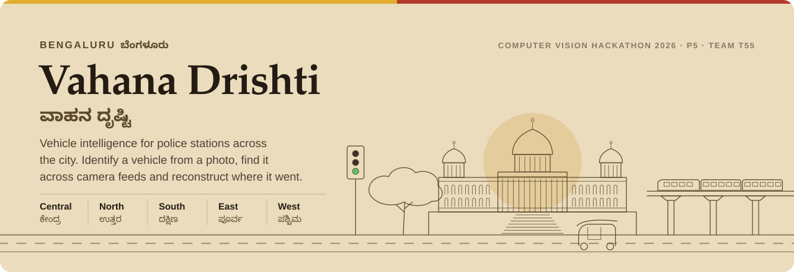
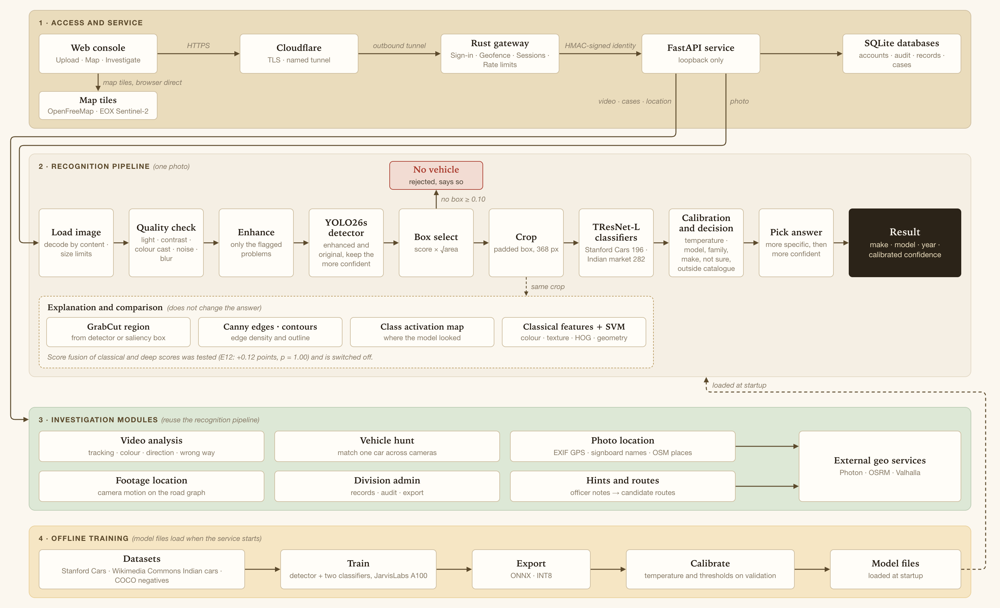
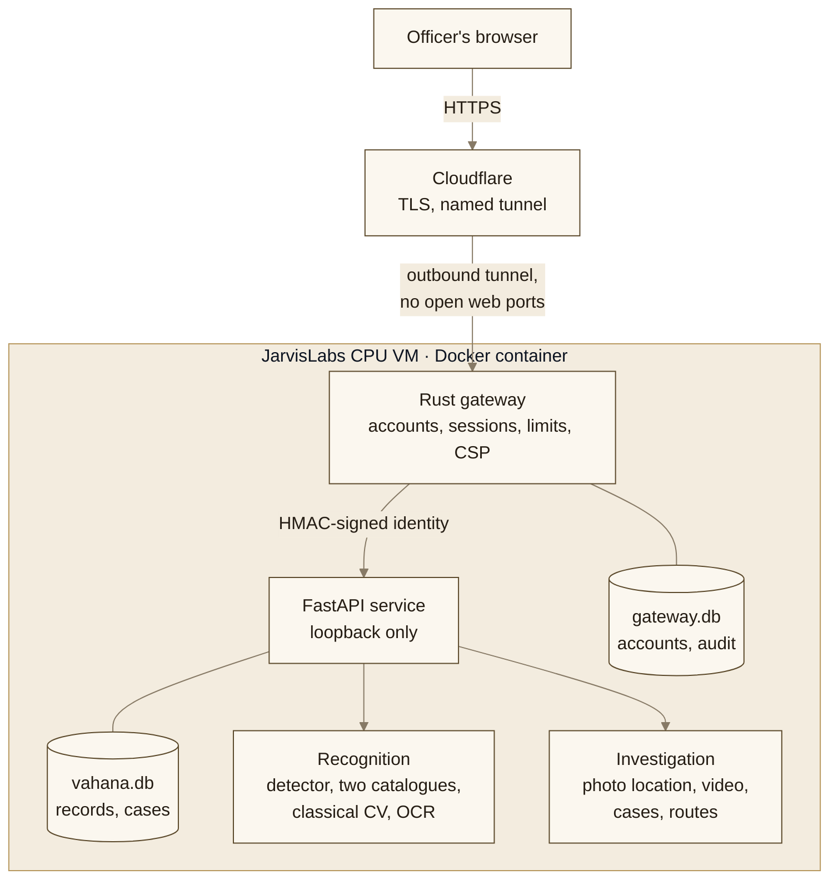

<div align="center">

<picture>
  <source media="(prefers-color-scheme: dark)" srcset="docs/assets/banner-dark.svg">
  
</picture>

<br>

<a href="https://www.vahanadrishti.in">
  <picture>
    <source media="(prefers-color-scheme: dark)" srcset="docs/assets/live-demo-dark.svg">
    
  </picture>
</a>

### P5 · Intelligent Fine-Grained Vehicle Recognition and Analysis System

Computer Vision Hackathon 2026 · Team T55<br>
<sub>1RUA24CSE0216 · 1RUA24CSE0228 · 1RUA24CSE0229 · 1RUA24CSE0275 · 1RUA24CSE0244</sub>

[](eval_P5_T55.md)
[](eval_P5_T55.md)
[](eval_P5_T55.md)
[](eval_P5_T55.md)
[](eval_P5_T55.md)
[](LICENSE)

[](gateway/)
[](app/server.py)
[](src/p5/)
[](web/)
[](Dockerfile)
[](docs/OPERATIONS.md)

[](docs/DESIGN.md)
[](docs/architecture.md)
[](eval_P5_T55.md)
[](docs/OPERATIONS.md)
[](PROJECT_DOCS.md)
[](CONTRIBUTING.md)

</div>

<br>

The system detects a vehicle in an uploaded image, identifies its make, model and year among the 196 Stanford Cars classes, and gives a calibrated confidence with every answer. Classical computer vision (quality analysis, quality-gated enhancement, GrabCut ROI refinement, Canny edges and contours, colour/texture/geometry features) works alongside deep learning (a fine-tuned YOLO26s detector and a fine-tuned TResNet-L classifier). A decision policy answers at the model, family or make level, flags cars outside the catalogue, and reports "no vehicle" when there is none.

## Demo accounts for evaluators

> [!TIP]
> Open **https://www.vahanadrishti.in**, allow the browser to share its location (sign-in works from inside Karnataka) and sign in with any account below.

| Account | Username | Password | What it shows |
| :--- | :--- | :--- | :--- |
| Demo division administrator 1 | `demo-admin-1` | `My2W-Eayp-LH5L` | Every division: all stations, records, cases, accounts, charts and the audit log. Read only, so nothing can be changed or deleted |
| Demo division administrator 2 | `demo-admin-2` | `QRHy-M5sh-Nsyg` | The same all-division view as administrator 1 |
| Demo police station 1 | `demo-station-1` | `W6jG-VLNb-3Wry` | A station near MG Road, Central division: identify photos, analyse video, open cases and investigate |
| Demo police station 2 | `demo-station-2` | `bnKG-rt3k-M6VR` | A station in Koramangala, South division, with the same features |

Demo passwords cannot be changed, and the two demo stations are not real police stations. Everything uploaded with a demo account can be seen by the other demo users, so please upload car photos only.

## Deliverables

| Deliverable | Where |
|---|---|
| Live hosted application | **https://vahanadrishti.in** (station and division accounts, sign-in from Karnataka) |
| Complete source code | This repository. See [Repository layout](#repository-layout) |
| System architecture diagram | [docs/architecture.md](docs/architecture.md) |
| Design document | [docs/DESIGN.md](docs/DESIGN.md) |
| Comparative evaluation results | [eval_P5_T55.md](eval_P5_T55.md) |
| Solution report | [report_P5_T55.pdf](report_P5_T55.pdf) (Markdown source: [report_P5_T55.md](report_P5_T55.md)) |
| Ablation study | [eval_P5_T55.md §8](eval_P5_T55.md#8-ablation-study) |
| Failure-case analysis | [eval_P5_T55.md §9](eval_P5_T55.md#9-failure-case-analysis) |

## System architecture

<p align="center"></p>

The four layers of the deployed system. Module responsibilities, interfaces and the full deployment diagram are in [docs/architecture.md](docs/architecture.md), and the design choices behind them in [docs/DESIGN.md](docs/DESIGN.md).

### How a request is served

The simpler view of the same system, from the officer's browser to the models:



Network architecture, database design, user flows and the project's agile documents are in [PROJECT_DOCS.md](PROJECT_DOCS.md).

## Results (Stanford Cars test, n = 8,041)

| Metric | Value |
|---|---|
| **Top-1 / Top-5, deployed system** | **94.69% / 98.94%** (make level 98.37%) |
| Classical only / classical on detector crop | 2.96% / 14.74% |
| Deep only, full image (no detection) | 91.88% |
| Detection mean IoU / IoU ≥ 0.5 | 0.949 / 99.03% |
| mAP@0.5 / mAP@0.5:0.95 | 0.976 / 0.926 |
| No-vehicle images correctly rejected | 99 / 100 |
| Calibration error (ECE) | 10.4% → 1.1% after temperature scaling |
| Classifier size, INT8 | 52.9 MB (3.9× smaller, −0.37 points on val) |
| Full pipeline latency, 2 CPU threads (Apple M3, INT8) | p50 0.59 s, p95 1.10 s |
| Robustness, Gaussian noise s1 / speckle s3 / contrast s5 | 81.9 → 90.9 / 78.9 → 88.3 / 83.9 → 91.2 with the classical enhancement |

Full tables, ablations and failure cases: [eval_P5_T55.md](eval_P5_T55.md). Per-experiment records: [experiments/INDEX.md](experiments/INDEX.md).

## Beyond the brief: an investigation console for traffic police

The recognition system is the core of **Vahana Drishti**, a web console designed around the needs of the Bengaluru Traffic Police. Everything runs on open data and open-source maps (no Google services).

**Live console: [https://vahanadrishti.in](https://vahanadrishti.in)** (also at `www.vahanadrishti.in`). It is open to station and division accounts only, and sign-in needs the browser to share a location inside Karnataka.

| Feature | What it does |
|---|---|
| **Identify**<br><sub>`src/p5/pipeline.py`</sub> | Upload a photo: vehicle, make, model and year with calibrated confidence (for the Indian catalogue, whose photos carry no model year, the years the model was made, from Wikipedia), every classical and deep intermediate step, and the classical, deep and hybrid answers side by side |
| **Indian-market catalogue**<br><sub>`src/p5/catalogue.py`, E18</sub> | A second classifier for 282 car models sold or made in India, trained on 27,382 free-licensed Wikimedia Commons photos. On a test split of 4,298 photos whose photographers appear in no other split it reaches 84.32% top-1 and 89.95% make accuracy. On the 3,043 of those photos whose make is also in Stanford Cars, the Stanford Cars model names the make correctly 29.0% of the time. Both catalogues run on every vehicle, and the more specific and more confident answer is shown with the other one beside it |
| **Where a photo was taken**<br><sub>`src/p5/geo/where.py`</sub> | Shown with every identification. The GPS position recorded in the photo when present, with the camera time and model. Otherwise text read on signboards (RapidOCR) is matched by exact name against 144,027 OpenStreetMap places in Bengaluru and shown as clues, with how many distinct places share the name, and as a heat map over the matched places on the Bengaluru map. When there is neither, the console says the location is not known. Nothing is estimated or scored |
| **Video analysis**<br><sub>`src/p5/video/`</sub> | Detects and tracks every vehicle (Kalman filter with two-stage Hungarian matching), names make and model per track, colour, direction of travel and wrong-way alerts. Signboards and shop names read from key frames describe the surroundings and suggest where the camera is |
| **Route from video**<br><sub>`src/p5/geo/route.py`, `src/p5/geo/videoloc/metadata.py`</sub> | GPS recorded inside the video file is read with ExifTool (GoPro, Novatek-type dashcams, Nextbase, BlackVue, Garmin, 70mai and phone location tags), or a GPX, CSV or NMEA track is uploaded. The track is snapped to the road network with OSRM map matching and drawn on the map |
| **Where was this filmed?**<br><sub>`src/p5/geo/videoloc/`, E21</sub> | For a moving camera without GPS: the camera's turns, stops and speed are measured from the frames and compared with every road in a search area of up to 3 km. 150,000 to 400,000 simulated vehicles drive Bengaluru's OpenStreetMap roads in 8 independent searches, and only those consistent with the footage survive. A candidate route is shown only when one place fits at least 99 times better than the best alternative in the area and than 4 random decoy areas of the city. Signboards read in the footage are checked against 144,027 named OpenStreetMap places along the route. On KITTI driving video every candidate route was within 50 m when the footage came from the search area (27 of 27 development clips, median error 4 m, largest 40 m). Footage from elsewhere still produced a wrong candidate in 7 of 40 KITTI tests and 3 of 20 simulated wrong-area tests, so every candidate must be confirmed by the investigator before it is used |
| **Vehicle hunt**<br><sub>`src/p5/investigate/hunt.py`, E19</sub> | Upload a photo of the wanted car and the feeds of several cameras: every track is scored with a calibrated match probability and the sightings are placed on the map in time order |
| **Blind-spot reasoning**<br><sub>`src/p5/investigate/hints.py`, `routes.py`</sub> | Free-text notes from officers ("seen near Brigade Road heading to Indiranagar, may stop for fuel, avoided Silk Board") are parsed into places, roles, times and activities. Candidate routes between sightings and onward are ranked by consistency with the notes, with travel-time feasibility and cameras that did not see the car. Reachable areas are drawn as isochrones |
| **Traffic-calibrated drive times**<br><sub>`src/p5/geo/traffic.py`, E20</sub> | Free-flow drive times are scaled by a Bengaluru profile by hour of day and distance, fitted on 630,003 Uber Movement 2019 trips. On 155,667 trips between held-out wards the median error falls from 52.5% to 15.2% and the stated range holds 80.0% of trips. Each route shows its usual time range and the chance that it fits the gap between sightings. Sightings of the same car, dashcam GPS and imported journeys then correct the profile towards current traffic, with a held-out check once 20 exist |
| **Map**<br><sub>`web/`</sub> | MapLibre with OpenFreeMap streets, Sentinel-2 cloudless satellite imagery and extruded 3D buildings from OpenStreetMap |

Every tunable value is in a config file, and [docs/PARAMETERS.md](docs/PARAMETERS.md) states whether it was fitted on validation data, is an operational constant, or is a documented assumption.

### Access model

* **One account per police station**, created from the station register in `assets/bengaluru/police_stations.json`. Stations sit in five divisions: Central, North, South, East and West.
* **One administrator per division.** An administrator sees every record, case and account of the stations in the division. The admin can correct or delete records, open, close, reassign and delete cases, reset station passwords, disable or unlock accounts, read the security audit log, and see charts of everything the system predicted. A station sees only its own records and cases.
* **A Bengaluru console with a regional sign-in.** Sign-in requires the device to report a location inside the sign-in area, currently Karnataka (the OpenStreetMap state boundary built by `scripts/build_signin_area.py`, with a 2 km margin). The gateway refuses requests that Cloudflare marks as coming from outside India. The console itself covers Bengaluru: camera locations must fall inside the city, and the map cannot leave it.
* **Demo accounts for evaluators.** Two demo stations and two demo administrators who see every division, listed in `assets/bengaluru/demo_accounts.json` and created on the server with `vahana-gateway demo-accounts`, which reads the passwords from stdin. Their passwords cannot be changed or reset from the console, failed sign-ins cannot lock them for everyone, and the demo administrators can look at everything but change nothing.
* **Nothing is visible before sign-in.** The gateway serves only the sign-in page and its assets to anonymous visitors. The console's HTML and scripts, and every API call, require a valid session.

### Security

* A Rust gateway (`gateway/`, axum) is the only public entry point. The Python service listens on loopback only and accepts a request only with an identity that the gateway signed with HMAC-SHA256 seconds earlier.
* Accounts, sessions and the audit log live in SQLite (the C library is compiled into the gateway, WAL mode). Passwords are Argon2id hashes. Every account starts with a one-time password. With `P5_REQUIRE_PASSWORD_CHANGE=true` it must be changed at the first sign-in. The setting is off by default and is currently off on the live console as well, so the one-time password signs in directly.
* Sessions are random 256-bit tokens stored only as SHA-256 hashes, so they can be revoked server side. They expire after 60 idle minutes or 12 hours. Changing a password or a reset by an administrator signs out every other session.
* After 5 failed attempts from one network (an IPv4 address or an IPv6 /64), sign-in for that ID is paused from that network for 15 minutes, so someone guessing elsewhere cannot lock officers out. After 50 failures from all networks together the account itself locks. Attempts are counted before the password is checked, so parallel guesses cannot exceed the limit. Sign-in is also rate limited per network, and unknown IDs, disabled accounts and wrong passwords all get the same answer.
* Every state-changing request needs a same-origin marker header and is refused when the browser reports a cross-site origin. Cookies are HttpOnly, Secure and SameSite=Strict.
* A strict Content-Security-Policy, `X-Frame-Options: DENY`, `nosniff`, `no-referrer`, a Permissions-Policy, COOP/CORP and HSTS.
* Uploads are checked by content (image decoding, video file signatures) and size. The frontend builds the DOM with `textContent` only.
* The container runs as a non-root user on a read-only filesystem with all Linux capabilities dropped.

## Documentation

| Document | Contents |
|---|---|
| [eval_P5_T55.md](eval_P5_T55.md) | Comparative evaluation in the required metric order, ablation and failure-case analysis |
| [report_P5_T55.pdf](report_P5_T55.pdf), [Markdown](report_P5_T55.md) | Solution report: approach, evaluation, screenshots, ablation, failure cases, deployment and demo accounts |
| [docs/DESIGN.md](docs/DESIGN.md) | Design document of the system as built: requirements, recognition, console, security, deployment, trade-offs |
| [docs/IMPLEMENTATION_NOTES.md](docs/IMPLEMENTATION_NOTES.md) | What was built and every deviation from the plan |
| [docs/PARAMETERS.md](docs/PARAMETERS.md) | Every configurable value and where it comes from |
| [docs/OPERATIONS.md](docs/OPERATIONS.md) | Deployment, accounts, settings, updates and backups |
| [assets/bengaluru/SOURCES.md](assets/bengaluru/SOURCES.md) | Where the police station register and the city boundary come from |
| [docs/FINAL_APPROACH.md](docs/FINAL_APPROACH.md) | Execution plan: requirement coverage, components, experiments, timeline, risks, viva prep |
| [docs/architecture.md](docs/architecture.md) | Architecture diagrams, module responsibilities and interfaces |
| [docs/LITERATURE_SURVEY.md](docs/LITERATURE_SURVEY.md) | Literature survey (178 references) |
| [docs/research/](docs/research/), [docs/pipeline/](docs/pipeline/) | Research reports and the synthesis, critique and revision of the approach |
| [experiments/](experiments/) | One timestamped folder per experiment with config, logs, metrics and write-up |
| [PROJECT_DOCS.md](PROJECT_DOCS.md) | Network architecture, database design, user flow diagrams, and the agile documents: vision, personas, user stories, iteration log, definition of done, risks and retrospective |
| [CONTRIBUTING.md](CONTRIBUTING.md) | Principles, setup, tests, code style, commit messages and the pull request checklist |
| [NOTICE.md](NOTICE.md) | Copyright, what the licence covers, and the terms of third-party data and services |

## Repository layout

<details>
<summary>Folders and what they hold</summary>

```
src/p5/
  classical/       quality analysis, enhancement, saliency ROI, GrabCut refinement, geometry, features, SVM, colour naming
  detection/       ONNX detector, box selection, YOLO training
  classification/  crops, dataset, model factory (timm and I-JEPA), training, export, ONNX classifier, CAM
  confidence/      temperature scaling, selective thresholds, decision policy
  hybrid/          late fusion
  eval/            classification, detection, robustness, statistics
  video/           vehicle tracker and video analysis
  geo/             EXIF and OCR geolocation, geocoding, GPS tracks, map matching, routing and drive times
  geo/videoloc/    locating moving-camera footage: road graph, camera motion, particle filter, decoys, signboards
  investigate/     cases, vehicle hunt, note parsing and route inference
  catalogue.py     several classifiers (US and Indian market) behind one decision
  pipeline.py      end-to-end image inference used by the API
app/server.py      FastAPI service (loopback only behind the gateway)
gateway/           Rust gateway: auth, rate limits, security headers, static files, proxy
web/               web console (HTML, CSS, JavaScript, MapLibre)
assets/            class lists, data splits, Bengaluru map data and station register, Indian catalogue lists
configs/           app, investigation and hunt settings
deploy/            container entrypoint and host services (tunnel, backups, watchdog)
scripts/           data preparation, training launchers, calibration, evaluation, packaging
tests/             pytest suite
docs/              design, architecture, parameters, operations, research and README artwork
experiments/       experiment records
.github/           scheduled job that resumes the server, pull request checklist
```

</details>

## Quick start

```bash
python3 -m venv .venv && .venv/bin/pip install -r requirements-train.txt fastapi "uvicorn[standard]" python-multipart pillow-heif
python3 scripts/build_assets.py        # validates the dataset, writes taxonomy and the val split
python3 scripts/build_cache.py         # GT crops and downscaled full images
```

Run the recognition pipeline on a folder of `.jpg` photos once `models/` is populated (see Reproduction). It writes one JSON line per photo:

```bash
.venv/bin/python scripts/run_pipeline.py --images ./samples --out ./results/predictions.jsonl
```

The API answers only requests signed by the gateway, so the console itself runs from the Docker image, which holds the gateway and the API together:

```bash
docker build -t vahana-drishti .
docker run -d --name vahana -p 127.0.0.1:8080:8080 -v "$PWD/state:/app/state" -v "$PWD/cases:/app/data" --read-only --tmpfs /tmp --cap-drop ALL --security-opt no-new-privileges vahana-drishti
docker exec vahana vahana-gateway provision --stations /app/assets/bengaluru/police_stations.json --credentials /app/state/credentials.csv
```

`provision` creates the divisions, the stations, one account per station and one administrator per division, and writes their one-time passwords to a new file readable only by its owner. Rerunning it adds new stations and leaves existing accounts alone. `vahana-gateway reset-password <id>` issues a new one-time password from the server console.

Serve it behind HTTPS and set `P5_TRUST_PROXY=true` when a reverse proxy or tunnel sets the client IP and country headers. Other settings: `P5_DEVICE_GEOFENCE` (`required` or `off`), `P5_ALLOWED_COUNTRIES` (default `IN`), `P5_IDLE_MINUTES`, `P5_SESSION_HOURS`, `P5_LOCKOUT_AFTER`, `P5_LOCKOUT_MINUTES`.

## Reproduction

GPU jobs are plain scripts launched on a JarvisLabs A100 (`scripts/remote/*.sh`); everything they produce is synced to `runs/remote/` (git-ignored).

<details>
<summary>Commands for every training, calibration, packaging and evaluation step</summary>

| Step | Command |
|---|---|
| Classifier (E05) | `bash scripts/remote/train_classifier.sh e05_tresnet_l_368 --backbone tresnet_l.miil_in1k_448 --size 368 --epochs 40` |
| Detector (E03, E06) | `bash scripts/remote/train_detector.sh --epochs 30 --batch 32` |
| Ablations (E09, E10) | `bash scripts/remote/ablations.sh` |
| Logits, INT8, robustness | `bash scripts/remote/predict_logits.sh`, `bash scripts/remote/quantize.sh`, `bash scripts/remote/robustness.sh` |
| I-JEPA (E17) | `bash scripts/remote/jepa.sh` |
| Classical baseline (E08) | `python3 scripts/train_classical.py` |
| Calibration (E13) | `python3 scripts/calibrate.py --logits <INT8 val logits> --out runs/e13_calibration` |
| Package models | `python3 scripts/package_models.py --classifier <export_int8> --detector <detector.onnx> --classical <classical_global.npz> --thresholds <thresholds.yaml>` |
| Test evaluation (E15) | `python3 scripts/eval_test.py ...` (the only script that reads test labels; calls are logged) |
| Indian-market dataset (E18) | `python3 scripts/build_india_dataset.py --min-images 15 --min-holdout 2` |
| Indian-market classifier (E18) | `PREFIX=e18v3 bash scripts/remote/india_train_arms.sh`, then `scripts/calibrate.py` on each arm's INT8 val logits with `--assets assets/india` |
| Indian test evaluation (E18) | `python3 scripts/eval_india.py --runs <arms> --thresholds <thresholds.yaml per arm> --us-models models --out runs/e18_test --tag ...` (logged in `experiments/test_log.csv`) |
| Package the Indian catalogue | `python3 scripts/package_catalogue.py --export <export_int8> --thresholds <thresholds.yaml> --taxonomy assets/india/taxonomy --report runs/e18_test/test_report.json --out models/india` |
| Travel-time profile (E20) | `python3 scripts/build_traffic_prior.py` |
| Road graph and place names (E21) | `python3 scripts/build_road_graph.py` and `python3 scripts/build_place_index.py` (Geofabrik southern India extract, needs `pip install osmium shapely`) |
| Footage location evaluation (E21) | `scripts/videoloc/kitti_fetch.py`, `kitti_motion.py`, `evaluate_clips.py`, `simulate_bengaluru.py`, `summarize.py`, run as described in the E21 record |
| Evaluation file | `python3 scripts/make_tables.py --team T55 --usns 1RUA24CSE0216,1RUA24CSE0228,1RUA24CSE0229,1RUA24CSE0275,1RUA24CSE0244` |

</details>

## Datasets

| Dataset | Size | How we got it | What it is used for |
| :--- | :--- | :--- | :--- |
| **Stanford Cars** (Krause et al., 2013) | 16,185 images of 196 classes with one box each: 8,144 for training (7,329 to train and 815 held out for validation) and 8,041 for testing | The torchvision-layout Kaggle mirror [`rickyyyyyyy/torchvision-stanford-cars`](https://www.kaggle.com/datasets/rickyyyyyyy/torchvision-stanford-cars), which includes test labels, because the official host is offline. Extract to `data/stanford_cars/` | Training, validating and testing the detector and the main 196-class classifier. Only `scripts/eval_test.py` reads the test labels, and every read is logged |
| **Indian-market cars** (E18), collected by us | **27,382 photos of 282 car models** sold or made in India: 18,585 for training, 4,499 for validation and 4,298 for testing, split so that no photographer appears in two splits | Scraped automatically from Wikimedia Commons by `scripts/build_india_dataset.py`. The list of models comes from Wikidata and from Wikipedia articles on the Indian car industry, the photos are found through the Commons API, at most 150 per model are downloaded as 500 px thumbnails, and only free licences are kept (mostly CC BY-SA and CC BY, also CC0, public domain, GFDL and the Free Art Licence). Of 33,647 photos checked, 27,822 passed the cleaning (the COCO detector must find one car or truck covering at least 18% of the frame, and near-duplicates are removed), and 27,382 of them belong to the 282 models with enough photos | The second classifier for cars on Indian roads: 84.32% top-1 on its own test split. `assets/india/split.csv` lists the licence, author and source page of every photo. The photos are not stored in the repository, and the script downloads them again |
| **COCO** (Lin et al., 2014) | 700 val2017 images with no car, bus, truck or motorcycle: 500 for training, 100 for development and 100 held out for testing | Listed in `assets/splits/coco_neg_*.txt` | Teaching the detector to stay silent on empty scenes and testing the "no vehicle" answer (99 of 100 correct) |
| **Uber Movement, Bangalore** | 2019 Q3 weekday hourly travel times between wards: 630,003 trips to fit the profile and 155,667 trips between held-out wards to test it | The archived copy published with the QGIS tutorials, read by `scripts/build_traffic_prior.py`, because Uber Movement has been discontinued. (c) 2019 Uber Technologies, Inc., Creative Commons Attribution Non-Commercial | The Bengaluru drive-time profile by hour of day and distance (E20) |
| **OpenStreetMap, Bengaluru** | 405,925 road edges (780,055 directed, 53,814 km of road), 144,027 named places, the city boundary and the Karnataka sign-in area | The Geofabrik southern India extract, the Overpass API and Nominatim (`scripts/build_road_graph.py`, `build_place_index.py`, `build_signin_area.py`) | Maps, routing, photo location from signboards, footage location and the sign-in area |
| **KITTI raw** (Geiger et al., 2013) | 15 drives, using only the grey left camera and the GPS and IMU files | Fetched with HTTP range requests by `scripts/videoloc/kitti_fetch.py` | Testing footage location against real GPS (E21): 27 of 27 candidate routes within 50 m |
| **Simulated Bengaluru drives** (E21), generated by us | 30 drives in a first round and 20 new drives in the final round, plus wrong-area tests on 20 drives searched 4 to 8 km away from where they were driven | `scripts/videoloc/simulate_bengaluru.py` on the Bengaluru road graph (see below) | Testing footage location inside Bengaluru: in the final round 10 of 20 drives got a candidate route and all 10 were correct, and searched in the wrong area 3 of 20 still gave a wrong one |
| **Bengaluru police station register** | 184 stations in five divisions | Official Bengaluru City Police, Bengaluru Traffic Police and Karnataka State Police pages, with positions from OpenStreetMap ([SOURCES.md](assets/bengaluru/SOURCES.md)) | Station accounts, the map and division scoping |
| **Demo stations** | 2 stations | Written by us in `assets/bengaluru/demo_accounts.json` | The shared evaluator accounts |

The licence and attribution of every source are in [NOTICE.md](NOTICE.md).

### Simulation inside Bengaluru: following a car's route from video

When a moving camera's footage has no GPS, the console works out where it was filmed by simulation. It measures the camera's turns, stops and speed from the frames, then lets 150,000 to 400,000 simulated vehicles (one per metre of road in a search area of up to 3 km) drive Bengaluru's real OpenStreetMap roads, respecting one-way streets. Each simulated vehicle turns at junctions by chance and is kept or dropped according to how well its path matches the measured motion. Six independent searches run, two challenge searches look for the best alternative away from the winner, and four decoy searches run in random parts of the city. A candidate route is shown only when it is at least 99 times more likely than every alternative and every decoy, and the investigator must confirm it before it is used (`src/p5/geo/videoloc/`).

To test this where no recorded drive with GPS was available, `scripts/videoloc/simulate_bengaluru.py` generates drives on the same road graph: shortest-path routes between random places, KITTI speed profiles, headings that follow the road with an 8 to 20 m turning arc, and turn and speed errors copied frame by frame from real KITTI videos. The full method and results are in the E21 record under `experiments/`.

## Limitations

- Stanford Cars covers mostly US-market cars up to 2012. The Indian-market catalogue (E18) adds 282 models, but 59 candidate models have fewer than 15 usable free photos on Commons and are not in it, among them the Tata Punch, Tiago and Harrier, the Mahindra XUV700 and XUV300 and the Hyundai Exter. Such cars can only receive a make-level or "not a known model" answer.
- The Indian catalogue was trained and tested on enthusiast photos, mostly in daylight. Accuracy on night-time traffic camera crops has not been measured and is expected to be lower.
- Low light at high severity, strong blur and car regions under ~60 px remain weak points (see the robustness table).
- The out-of-catalogue threshold was set on in-distribution validation data only.
- The system identifies vehicle models only; it does not read number plates or identify people.

## Licence

Vahana Drishti is free software under the [GNU Affero General Public License v3.0 or later](LICENSE). Anyone may use, study, change and share it, and anyone who distributes it or runs a changed version as a service for others must make that version's complete source code available under the same licence. Data files, map services and model weights keep their own terms, listed in [NOTICE.md](NOTICE.md).

## Contributing

Contributions are welcome. [CONTRIBUTING.md](CONTRIBUTING.md) explains the four principles every change is reviewed against, the setup, tests, code style, commit messages and the pull request checklist. Please report security problems privately, as described there, and not in a public issue.

<br>

<div align="center">


<sub>Prototype built for the Computer Vision Hackathon 2026 by Team T55. Not an official Government of Karnataka service.</sub>

</div>
