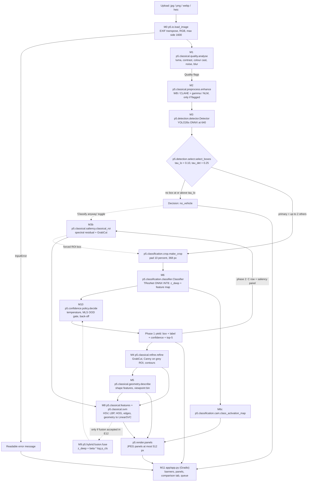
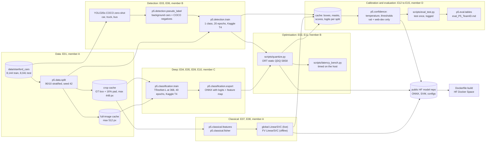

# P5 Final Approach: Fine-Grained Vehicle Recognition (Stanford Cars)

*Stage 5 of 5 (research → synthesise → critique → revise → **final**). Written 2026-11-06. This is the team's authoritative execution plan. It supersedes `docs/pipeline/01–03` wherever they differ; Appendix A lists every inconsistency in `03_revision.md` that this document resolves. The companion `docs/architecture.md` is the architecture-diagram deliverable and holds the interface contracts.*

**Tags.** `[01]`–`[05]` = `docs/research/0x_*.md`. `[P]` = primary source, `[S]` = secondary, `[V]`/`[V2]` = re-checked in stages 3/4, `[V3]` = re-checked for this document against the local data. **(est.)** = our planning estimate, to be replaced by a measurement.

---

## 0. Summary and requirement coverage

### 0.1 Summary

We build a two-phase hybrid pipeline served as a CPU-only ONNX Runtime app in one Docker image on a Hugging Face Docker Space. **Phase 1** returns the answer fast:
- classical quality analysis (M1) and conditional enhancement (M2);
- YOLO26s vehicle detection (M3);
- a padded crop classified by a fine-tuned TResNet-L@368, INT8 (M6);
- a calibrated decision policy (M10) that answers at class, year-merged family or make level, or abstains, with an OOD gate and an explicit "No vehicle detected" state.

**Phase 2** streams the explanation:
- GrabCut ROI refinement with Canny edges and contours (M4);
- geometric viewpoint analysis (M5);
- a classical colour/texture/shape SVM (M8);
- a fully classical saliency ROI (M3b);
- a CAM heat-map (M6c);
- a live classical-vs-deep-vs-hybrid comparison.

Late fusion of the classical SVM (M9) is deployed only if it passes a pre-registered significance test.

Training runs on free Kaggle T4s, about 6.5 T4-hours across four accounts. Every stage output is cached, so all calibration, fusion and ablation work reruns on CPU in seconds.

Expected results (est.):
- deployed Top-1 94–95%;
- detector mean IoU ≥ 0.85;
- classical FV row 50–65%;
- server p95 ≤ 6 s, phone end-to-end ≤ 10 s.

The defensible hybrid claim: on clean images classical CV adds about 0 pt Top-1. It adds robustness on dark and noisy inputs, selective accuracy, correct no-vehicle behaviour and interpretability, and every Δ comes with a Holm-corrected McNemar p-value.

### 0.2 Requirement-coverage matrix

| Requirement (hackathon PDF) | Component(s) | Evidence produced by |
|---|---|---|
| **A1** Preprocessing and normalisation | M0 resize/EXIF, M1 quality stats, M2 WB/CLAHE/gamma/NLM, crop normalisation | E12, ablation A5, before/after panel |
| **A2** Edge detection and contour analysis | M4 Canny on grey ROI (median thresholds) + `findContours` on GrabCut mask | Edge-map and contour panels, E07 |
| **A3** Colour and texture features | M8: fg-mask HSV histogram, colour moments, uniform LBP, HOG; offline dense RootSIFT-FV | E08, colour-histogram panel |
| **A4** ROI extraction | M3b spectral-residual saliency + GrabCut; M4 box-initialised GrabCut | E07, E08 input columns (GT / YOLO / ROI) |
| **A5** Geometric feature analysis | M5 aspect, extent, solidity, Hu moments, L-R symmetry → viewpoint bin + body-shape note | UI "view: front-¾", E14 viewpoint table |
| **B1** CNN/ViT fine-grained classification | M6 TResNet-L@368 | E05 |
| **B2** YOLO/R-CNN detection | M3 YOLO26s (COCO zero-shot baseline, 1-class fine-tune) | E03, E06 |
| **B3** Transfer learning and fine-tuning | M6 full fine-tune from IN-1k weights; M3 fine-tune from COCO | E04, E05, E06 |
| **B4** 196-way classification | M6 196-way head; `p5.taxonomy` | E05, E15 |
| **C1** Integrate classical with deep | M2 → M3/M6; M4/M5/M8 panels; M3b "classify anyway"; M9 fusion (gated) | E12, ablations A5/A7 |
| **C2** Use detected regions for classification | M3 box → `make_crop` → M6 | E09 (A1), crop matrix A2 |
| **C3** Boxes with labels and confidence | M10 decision + `p5.render` | App, every output path |
| **C4** Low-confidence handling | M10 temperature scaling, MLS OOD gate, family/make back-off, abstain | E13, §8 behaviour table |
| **Adv-1** Similar makes/models/years | High-res crop training; family back-off; twin-confusion metrics | E05, E13, E15 twin rates, failure cases |
| **Adv-2** Illumination and viewing angles | M1/M2; illumination augmentation; M5 viewpoint bins | E12, E14 (lowlight, brightness, viewpoint) |
| **Adv-3** Occlusion and resolution | RandomErasing + down-up-scale augmentation; truncation flag | E10, E14 (occlusion 10/25/50%, resolution 112/56/28) |
| **Adv-4** Compare classical / deep / hybrid | Rows C, C+Y, D, H (§7.1); live comparison tab | E08, E15 |
| **Adv-5** Ablation analysis | A1–A12 (§7.2) | E09–E12, E15 |
| **Adv-6** Model optimisation | ORT static INT8 (QDQ S8S8, per-channel); FP16 reduced-precision row | E02, E11 |
| **Adv-7** Unseen test images | Stanford test (8,041, once) + team-collected web-test (once) | E15 |
| **Adv-8** ≥ 3 failure cases with causes | Failure shortlist (§6.3), CAM evidence | E15 |
| **Metric:** Top-1/Top-5 | E15 rows | §6.1 |
| **Metric:** IoU | E03/E06/E07 | §6.2 |
| **Metric:** mAP | E03/E06 (strict + ignore-region), class-aware mAP50 | §6.3 |
| **Metric:** size and inference time | E02/E11 on host | §6.4 |
| **Metric:** robustness | E14 | §6.5 |
| **Metric:** confidence/threshold | E13 | §6.6 |
| **App output 1** Accept upload | M0 + M11 (`gr.Image(type="filepath")`, JPG/PNG/WebP/HEIC) | §8 |
| **App output 2** Detect and draw box | M3 + `p5.render.draw_boxes` | §8 |
| **App output 3** Make, model, year | M6 + M10 via `p5.taxonomy` | §8 |
| **App output 4** Confidence | M10 (calibrated probability; level shown) | §8 |
| **App output 5** Intermediate results | Panels: M1 stats, M2 before/after, M4 edges + contour, M5 view, M8 HSV histogram, M3b saliency, M6c CAM | §8 |
| **App output 6** Compare classical / deep / hybrid | Comparison tab: live C, C+Y, D, H predictions for this image + frozen test table | §7.1 |
| **Deliverable:** live URL | HF Docker Space (fallbacks in §9) | Gate G0 at H1 |
| **Deliverable:** repo with full source | `src/p5`, `app/`, `scripts/`, `notebooks/`, `Dockerfile`, `Makefile` | §3 |
| **Deliverable:** architecture diagram | `docs/architecture.md` (Mermaid), checked by `tests/test_architecture.py` | §1, §3 |
| **Deliverable:** design document | `docs/design_doc.md`, written H22–26 from this file | §10 |
| **Deliverable:** `eval_P5_<TeamID>.md` | Repo root, generated by `make tables` | §6 |
| **Deliverable:** ablation + failure-case analysis | `eval_P5_<TeamID>.md` §8–9 + design doc | §6–7 |
| **Rubric: Implementation** (split, modular code, bad input) | E01 split asserted in code; one file per module; M0 + §8 | — |
| **Rubric: UI/deployment** (phone, ~10 s, loading/error states, Dockerfile, no secrets) | §8, §9; public weights repo, no tokens | Phone tests at H6/H8/H20 |
| **Rubric: Documentation** (diagram matches code, README reproduces) | `test_architecture.py`; `make fetch-cache metrics`; `make eval-subset` | H24–26 clean-clone check |

---

## 1. System architecture

### 1.1 Inference pipeline (deployed app)

Node labels are the module paths in §3. Dotted edges are conditional.



`p5.pipeline.Pipeline.run` orchestrates the graph as a generator. If fusion is accepted, M4 → M8 → M9 move into phase 1 before M10, and the first yield arrives about 0.4–0.7 s later. M3b always runs in phase 2, because it feeds the classical-only (C) comparison row and the saliency panel.

### 1.2 Offline training and evaluation pipeline



### 1.3 Per-stage table (inference)

Latency budgets are server-side p95 on 2 vCPU (est., replaced by E02/E11 measurements).

| # | Stage | Module | Input | Output | Method | Budget |
|---|---|---|---|---|---|---|
| S0 | Guard + decode | M0 `io` | file path | `ImageIn` | Pillow + pillow-heif, EXIF transpose, RGBA on white, grey → 3 ch, first GIF frame, max side 1600, reject < 64 px / > 50 MP | 0.1–0.3 s (HEIC 0.3–0.5) |
| S1 | Quality | M1 `classical.quality` | RGB | `Quality` | Luma stats, RMS contrast, gray-world cast, noise σ, variance of Laplacian | ≤ 0.05 s |
| S2 | Enhance | M2 `classical.preprocess` | RGB, `Quality` | `Enhanced` | Conditional WB / CLAHE + gamma / NLM | 0–0.15 s |
| S3 | Detect | M3 `detection.detector` | RGB | `list[Detection]` | YOLO26s ONNX, letterbox 640, NMS IoU 0.7 | 0.15–0.3 s |
| S4 | Select | `detection.select` | detections | `DetectionResult` | τ_lo / τ_det, primary = argmax(conf·√area), max 5 drawn | < 0.01 s |
| S5 | Classify | M6 `classification.classifier` | RGB, box | `DeepOut` | TResNet INT8 at 368; flip only if gate G1 allows | 0.35–0.9 s |
| S6 | Decide | M10 `confidence.policy` | `DeepOut` (+ fused) | `Decision` | T-scaling, MLS gate, back-off | < 0.01 s |
| — | **Phase 1 yield** | `render` + M11 | — | box + label | — | **≈ 0.7–1.7 s cumulative** |
| S7 | Refine | M4 `classical.refine` | RGB, box | `Roi` | GrabCut 5 iterations at ≤ 320 px, Canny, contours | 0.2–0.35 s |
| S8 | Geometry | M5 `classical.geometry` | `Roi` | `Geometry` | Moments, symmetry, rule-based viewpoint | ≤ 0.05 s |
| S9 | Classical classifier | M8 `classical.features/svm` | crop, `Roi`, `Geometry` | `ClassicalOut` | Global descriptors → PCA → LinearSVC (Platt) | 0.1–0.2 s |
| S10 | Classical ROI (C row) | M3b `classical.saliency` | RGB | `Roi` | Spectral residual → Otsu → GrabCut | 0.2–0.4 s |
| S11 | CAM | M6c `classification.cam` | feature map | heat-map | Feature map · FC weight (NumPy) | ≤ 0.02 s |
| S12 | Extra vehicles | M6 | ≤ 2 boxes | `DeepOut` each | Single forward each | +0.35–0.9 s each |
| S13 | Panels | `render` | all | JPEGs ≤ 512 px | cv2.imencode q85 | 0.1–0.3 s |
| | **Server total p95** | | | | | **≈ 1.5–3.9 s; target ≤ 6 s; cap 8 s** |

---

## 2. Component specification

Everything is frozen at H18 into `configs/*.yaml`. "Tuned" means set on val or web-dev, never on test.

### 2.1 Input, quality, preprocessing (M0–M2)

- **M0.** Accepts JPG/PNG/WebP/HEIC (`pillow-heif`), applying `ImageOps.exif_transpose`. Downscales to max side 1600 with `INTER_AREA`. Rejects < 64 px on the short side, > 50 MP, or undecodable files with a fixed message (§8). Greyscale is replicated to 3 channels, and an `is_grey` flag hides the colour panel.
- **M1.** Computed on a 512-px grey copy:
  - BT.601 luma mean and 5th/95th percentiles;
  - RMS contrast (std of luma / 255);
  - gray-world cast ratio (max/min channel mean);
  - noise σ (Laplacian-kernel estimator, Immerkær 1996; general knowledge);
  - blur = variance of Laplacian.

  Default flag thresholds (est.): `dark` mean < 0.35; `low_contrast` RMS < 0.12; `cast` ratio > 1.25; `noisy` σ > 8; `blurry` var-Lap < 100. **Tuned in E12** by grid search on val corruptions. The objective is to maximise corrupted-val Top-1 subject to a firing rate ≤ 5% on clean val.
- **M2.** Each operation runs only when its flag is set; none runs on clean images. This follows the evidence that unconditional low-light enhancement gives ≤ 0.5 mAP on ExDark [03 B1].
  - `cast`: gray-world white balance.
  - `dark`/`low_contrast`: CLAHE on LAB-L, clip 2.0, 8×8 tiles; plus gamma γ = clip(log 0.45 / log μ, 0.4, 1.0) when dark.
  - `noisy`: `fastNlMeansDenoisingColored` with h = min(15, 0.8σ + 3), template 7, search 21, at ≤ 1024 px.

  The detector and classifier both see the M2 output. Train/test mismatch is avoided by random CLAHE/gamma (p = 0.2) in M6 training. Denoising is prioritised because CNNs are most hurt by blur and noise (Dodge & Karam) [03].

### 2.2 Detection (M3, selection)

- **Model.** Ultralytics **YOLO26s** (COCO 48.6 mAP; CPU-ONNX faster than YOLO11 at equal size [03]). **Fallback:** YOLO11s if YOLO26 tooling breaks. **Licence swap-in:** RF-DETR-Nano (Apache-2.0) [03].
- **Zero-shot baseline (E03).** COCO classes car/truck/bus (2/7/5). Pickups and vans are "truck" in COCO.
- **Fine-tune (E06).**
  - 1 class `vehicle`, imgsz 640, 20 epochs, batch 16, Ultralytics defaults otherwise.
  - Training images: the **train split only** (val ids asserted disjoint).
  - Positives: the Stanford GT box, plus **pseudo-labelled background vehicles**: zero-shot car/truck/bus with conf > 0.5 and IoU < 0.3 to GT.
  - Negatives: **500 COCO val2017 images with no car/truck/bus annotation** as empty labels.
- **Head.** Default one-to-many head with NMS (IoU 0.7) for accuracy. The docs say prediction defaults to it [03]. `detector.py` supports both raw and end-to-end ONNX output layouts; E02 records which one is exported.
- **Thresholds.**
  - Evaluation: conf 0.001, max_det 100 (COCO protocol) [03 A3].
  - App: **τ_lo = 0.10**, **τ_det = 0.25** (defaults). Tuned on web-dev ∪ COCO-neg-dev: τ_det is the lowest value with no-car FPR ≤ 5%; τ_lo is the lowest with FPR ≤ 15%.
  - Primary box = argmax(conf × √area). At most 5 boxes drawn; at most 2 non-primary boxes classified.
- **Deployed detector choice (E06 → A12).** The fine-tuned model ships unless it is worse than zero-shot on web-dev multi-car recall@0.5 or no-car FPR. IoU/mAP on val decide nothing about deployment.

### 2.3 Classical ROI, refinement, geometry (M3b, M4, M5)

- **M3b.**
  - Spectral-residual saliency (Hou & Zhang, CVPR 2007; `cv2.saliency`, opencv-contrib) [03].
  - Otsu threshold, then the largest component's box united with a central rectangle (10% margin), then GrabCut 5 iterations.
  - **Never labels on its own.** It is used for the C row, the saliency panel and the "classify anyway" toggle.
- **M4.**
  - Pad the box 10%, downscale to ≤ 320 px, run box-initialised GrabCut for 5 iterations (Rother 2004; box-GrabCut 38.5 vs 21.6 mAPr for raw rectangles, Khoreva CVPR 2017 [03 B3]).
  - Mask = FG ∪ probable-FG, then 5-px open/close.
  - Contours from the mask (largest external contour + convex hull).
  - **Canny on the grey ROI** after a 5×5 Gaussian, thresholds 0.66·median and 1.33·median. The edge map is shown as a panel.
  - The tight box replaces the detector box only if E07 shows a val mIoU gain (expected: no, because Stanford boxes are loose).
- **M5.**
  - Features: aspect (mask bbox w/h), extent, solidity, 7 log-scaled Hu moments, L-R symmetry (IoU of the mask with its mirror about the centroid column, plus grey-level correlation).
  - Viewpoint rule: symmetry ≥ 0.8 and aspect < 1.6 → *front/rear*; aspect > 2.0 and symmetry < 0.6 → *side*; else *¾*. Thresholds are set by eye on 30 train images.
  - **Validated on 100 hand-labelled val images.** If accuracy is < 60%, the UI shows the bin as "experimental" and E14 omits the viewpoint table.
  - Body-shape note: aspect < 1.3 with extent > 0.75 → "tall body (van/SUV-like)".

### 2.4 Deep classifier (M6, M6c)

| Item | Choice |
|---|---|
| Backbone (main) | `timm` **`tresnet_l.miil_in1k_448`**: 56.0 M params, 43.6 GMACs at 448 → **29.4 GMACs at 368** [V]. IN-1k only, which is the lowest contamination; Kornblith found 0.17% Cars-test overlap with ImageNet [05]. |
| Backbone (MVP / latency fallback) | `tresnet_m.miil_in21k_ft_in1k` at 368 (15.5 GMACs) [V2]. If the organisers allow IN-1k only, use `tresnet_m.miil_in1k_448`. |
| Why | TResNet-L@368 reaches 96.0 on Cars with IN-1k pretraining (Ridnik et al., arXiv 2003.13630) [V], with 80 epochs, 1-cycle and CE + triplet. Our 40-epoch CE recipe targets **94–95% (est.)**. Full fine-tuning of a CNN is cheap and proven on Cars (Kornblith 2019: 93.3 [01]). |
| Resolution | Train and serve at **368** (gate G1 may serve at 320). Resolution is the cheapest FGVC lever (CUB 81.6 → 85.6, 224 → 392 [05]). |
| Input | Box + **10% pad** → square resize 368×368 (bilinear, no letterbox). The same function, `make_crop`, is used in training and serving. Mean/std are **read from the model's `pretrained_cfg`**, never hard-coded: timm's TResNet config uses mean 0 / std 1. E02 asserts the exported metadata. |
| Train-time box jitter | Scale ±10%, shift ±5% of box size, so IoU with GT is ≈ 0.8–0.95. This simulates detector error. Predicted crops ≈ GT crops on Cars, 88.4 vs 89.0 (Krause CVPR'15) [03 A2]. |
| Optimiser | AdamW, base LR **2e-4** (head 2e-3) (est.), weight decay 0.05 (none on BN/bias), batch 32, AMP fp16. If memory runs out, use batch 24 with LR × 0.75. |
| Schedule | **40 epochs**, 2-epoch linear warm-up, cosine to 1e-6. Seed 42. **The last epoch is used**; there is no early stopping, so val stays clean for T and the τ's. |
| Loss | CE with label smoothing 0.1. |
| Augmentation | hflip 0.5; RandAugment n = 2, m = 7; down-then-up-scale p = 0.2 to a random 25–75% size (Peng ICIP'16 [04]); random CLAHE/gamma p = 0.2; RandomErasing p = 0.25 (Zhong AAAI'20 [04]). **No CutMix/Mixup.** |
| Export | ONNX opset 17, dynamic batch, **two outputs**: `logits` (B, 196) and `features` (B, C, h, w). The FC weights are saved to `head.npz` for the CAM. FP32 parity with PyTorch: max abs logit diff ≤ 1e-3 on 10 images. |
| TTA | Horizontal flip **offline always**. Live only if gate G1 measures the flip pair at ≤ 1.0 s. Flip counts (right → wrong, wrong → right) are reported (Shanmugam ICCV'21 [04]). |
| M6c CAM | CAM = Σ_c features[c] · W[top-1, c], ReLU, normalise, upsample, overlay (Zhou et al. CVPR 2016). Visual only; there is no re-classification. |

### 2.5 Classical classifier (M8)

- **Live (global).** Computed on the crop, with the M4 mask where relevant:
  - HSV 8×8×8 histogram on the foreground mask, plus 9 colour moments (Swain & Ballard);
  - uniform LBP (P8R1 + P16R2) on a 2×2 grid, 112-D (Ojala 2002);
  - HOG on a 256×128 resize (16-px cells, 2×2 blocks, 9 bins) (Dalal & Triggs);
  - Canny edge-density 4×4 grid;
  - the M5 geometry vector.

  Then StandardScaler → PCA 256 → LinearSVC with C ∈ {0.01, 0.1, 1} chosen on val, then Platt scaling (sigmoid, 3-fold on train). Stored as `classical_global.npz` (NumPy weights only, so the app needs no sklearn pickle). **Expected 10–30% (est.).**
- **Offline (FV, strongest classical row).**
  - Dense RootSIFT (step 4 px, scales 16/24/32) → PCA-64 → diagonal GMM k = 256 → improved FV (power + L2), 32,768-D → LinearSVC.
  - The published SIFT-FV on Cars is 59.2 / 51.2% [03][04]; the FGComp FV ensemble reaches 82.7% (the ceiling, not a target) [04].
  - **Expected 50–65% (est.).**

### 2.6 Fusion (M9)

- Formula: `z = z_deep + β · log p_cls`, with β on the grid {0, 0.05, 0.1, 0.2, 0.3, 0.5, 1.0}, chosen by val NLL.
- **Deployed only if** all of the following hold (E12):
  1. Top-1 gains significantly (Holm-corrected McNemar p < 0.05) on clean val **or** on the val-corrupted subset.
  2. There is no significant loss on clean val.
  3. The added phase-1 latency is ≤ 0.6 s (M4 + M8 move ahead of the first yield).
- Otherwise β is reported and set to 0 live.
- The honest expectation is ≤ 1 pt, likely ~0, because nothing in the literature measures hand-crafted + CNN fusion on Cars [03 B2].

### 2.7 Calibration, OOD and decision policy (M10)

- **Temperature.**
  - T_d is fit on val z_deep by NLL (LBFGS) (Guo ICML'17; Cars ResNet-50 ECE 4.30 → 2.35% [04]).
  - If fusion is deployed, a separate **T_f** is fit on the fused logits.
  - Probabilities p = softmax(z / T), where z = fused logits if deployed, else z_deep.
- **OOD score.** MLS = max(z_deep) / T_d, always on the deep logits, never the fused ones (Vaze ICLR'22 [04][05]). Energy (Liu 2020) is compared in E13. MLS is kept unless energy beats it by > 0.02 AUROC on web-dev.
- **Groups.** `p5.taxonomy`:
  - 196 classes;
  - **189 year-merged families** (7 same-name year pairs);
  - **49 labelled makes** used for scoring;
  - **47 display-make groups** used for back-off (AM General ∪ HUMMER; Ram ∪ Dodge) [V3].
- **Decision procedure** (Deng et al. CVPR'12 "Hedging your bets"; Geifman & El-Yaniv 2017 [04]). Detection status comes first:
  ```
  if detection.status == "none":           level = no_vehicle   (no make/model shown)
  elif MLS >= tau_ood:
      if p_top1 >= tau_hi:                  level = class
      elif p_family(top) >= tau_fam:        level = family
      elif p_makegroup(top) >= tau_make:    level = make
      else:                                 level = abstain
  else:
      if p_makegroup(top) >= tau_make:      level = ood_make   ("exact model not in our catalogue")
      else:                                 level = ood        ("not in our catalogue")
  detection.status == "weak" adds the "Possible vehicle" banner; forced (toggle) adds "unreliable".
  ```
- **Threshold tuning (E13).** Each threshold is the smallest value that meets its val precision target. Bootstrap 95% CIs (1,000 resamples) are reported for every τ and its coverage.

  | Threshold | Precision target (est.) |
  |---|---|
  | τ_hi | class-level precision ≥ 97% |
  | τ_fam | family-level precision ≥ 97% on items below τ_hi |
  | τ_make | make-group precision ≥ 95% |

  τ_ood = the 5th percentile of val MLS (keeps 95% of in-distribution images). If web-dev out-of-set rejection is < 50%, τ_ood is instead set to the Youden-J optimum on web-dev, where in-distribution = val ∪ web-dev in-class images. The final values and CIs are written to `configs/thresholds.yaml` at H18.

### 2.8 Optimisation

- **Classifier INT8.** ORT `quantize_static`: QDQ, S8S8, per-channel weights. Calibration uses 512 train-split crops, with MinMax vs Percentile-99.999 chosen by val Top-1. If the host CPU lacks VNNI (`lscpu` flags checked in E02), use `reduce_range=True` [05 §2.3]. `qdq_loss_debug` finds sensitive layers to keep FP32. **Ship FP32 if INT8 loses > 1 pt** on val.
- **Detector INT8.** Ultralytics export with `quantize=8` (ORT static, calibration via `data=`/`fraction=`) [05 §2.2]. Ship FP32 YOLO if INT8 is not faster on the host.
- **FP16.** Reported as the reduced-precision row; not shipped (ORT CPU FP16 is usually not faster, est.).
- **Runtime.** One `InferenceSession` per model, created at startup. `intra_op_num_threads=2`, `inter_op_num_threads=1`, `ORT_ENABLE_ALL`. A dummy warm-up forward runs at startup.

---

## 3. Repository structure

Every module ID maps to one file. `tests/test_architecture.py` parses the Mermaid in `docs/architecture.md` and asserts that each referenced `p5.*` path exists, so the diagram cannot drift from the code.

```
CV_Hakcathon_P5/
├── README.md                     quick start, results summary, reproduction commands
├── LICENSE                       AGPL-3.0 (Ultralytics weights; network clause → Source link in UI)
├── eval_P5_<TeamID>.md           comparative evaluation deliverable (generated, §6)
├── Dockerfile                    CPU-only app image (no torch)
├── Makefile                      run, docker, fetch-cache, metrics, tables, eval-subset, test
├── pyproject.toml                package "p5" from src/
├── requirements-app.txt          onnxruntime, opencv-contrib-python-headless, numpy, pillow, pillow-heif, gradio, huggingface_hub, pyyaml
├── requirements-train.txt        + torch, timm, ultralytics, scikit-learn, scikit-image, pyarrow, pycocotools, imagecorruptions, statsmodels
├── configs/
│   ├── app.yaml                  model repo id + revision, file names, latency caps
│   ├── thresholds.yaml           tau_lo, tau_det, tau_hi, tau_fam, tau_make, tau_ood, T_d, T_f, beta, M1 triggers (frozen H18)
│   └── train/                    e05_tresnet_l.yaml, e06_yolo.yaml, …
├── assets/                       committed small metadata (data/ is git-ignored)
│   ├── taxonomy/                 classes.json, makes.json, display_makes.json, families.json, groups.json
│   ├── splits/                   val_ids.txt, robust_subset_ids.txt, coco_neg_{train,dev,test}.txt
│   ├── web/manifest.csv          web-set sources, licences, categories, dev/test split (images kept outside git)
│   └── examples/                 team-shot / CC images for the app (no Stanford Cars images)
├── src/p5/
│   ├── types.py                  dataclass contracts between stages
│   ├── taxonomy.py               class → make/model/year, families, display makes, twins
│   ├── io.py                     M0
│   ├── pipeline.py               orchestration, phases, timings, fast mode
│   ├── render.py                 box drawing, panels → JPEG
│   ├── classical/                quality.py M1 · preprocess.py M2 · saliency.py M3b · refine.py M4 · geometry.py M5 · features.py + svm.py M8 · fisher.py (offline FV)
│   ├── detection/                detector.py M3 · select.py · pseudo_label.py · train.py (offline)
│   ├── classification/           crop.py · classifier.py M6 · cam.py M6c · model.py · train.py · export.py (offline)
│   ├── hybrid/                   fusion.py M9
│   ├── confidence/               temperature.py · ood.py · policy.py M10
│   ├── data/                     stanford.py · split.py · cache.py · corrupt.py · web.py
│   └── eval/                     classification.py · detection.py · calibration.py · stats.py · robustness.py · tables.py
├── app/
│   ├── app.py                    M11 Gradio Blocks
│   └── strings.py                fixed banner/error wording (§8)
├── scripts/
│   ├── new_experiment.py         (exists) timestamped experiment folders
│   ├── build_cache.py            E01 crops / full images / split files
│   ├── export_onnx.py · quantize.py · latency_bench.py
│   ├── run_val_cache.py          writes cache/val/* for a model/config
│   ├── eval_test.py              the only script that reads test labels; logs every call
│   ├── make_tables.py            caches → eval tables (make metrics / make tables)
│   └── eval_subset.py            500-image end-to-end CPU reproduction
├── notebooks/                    thin Kaggle wrappers: pip install the repo at a commit, then call scripts
│   ├── k_e04_e05_classifier.ipynb · k_e06_detector.ipynb · k_e09_e10_ablations.ipynb
│   └── k_e14_e15_test.ipynb · k_e16_clip_lp.ipynb · k_cpu_int8_test.ipynb
├── tests/                        test_contracts.py (synthetic: no-car, grey, tiny, HEIC) · test_architecture.py · test_taxonomy.py
├── cache/                        stage outputs (git-ignored; published to a public HF dataset repo)
├── experiments/                  existing convention (one timestamped folder per run)
└── docs/                         FINAL_APPROACH.md · architecture.md · design_doc.md · pipeline/ · research/
```

**One-command run:** `make docker` (`docker build -t p5 . && docker run -p 7860:7860 p5`) or `make run` locally. The Dockerfile uses `python:3.11-slim`, installs `requirements-app.txt`, runs as UID 1000 (HF requirement), downloads ONNX/NPZ/configs with `hf_hub_download` at **build time** from a pinned revision of the public model repo (no token), and runs `CMD ["python", "app/app.py"]` on port 7860.

**Code style:** minimal comments, typed signatures, pure functions per module. Configuration lives in YAML, not constants.

---

## 4. Data protocol

1. **Source and parsing.**
   - `data/stanford_cars` uses the torchvision layout [V3]: `cars_train/`, `cars_test/`, `devkit/cars_{train_annos,meta}.mat`, `cars_test_annos_withlabels.mat`.
   - `p5.data.stanford.load(split)` returns a table with `id, path, class_id (0–195), x1, y1, x2, y2, width, height`. Labels are the `.mat` 1-based class minus 1. Boxes are converted from 1-based inclusive to 0-based.
2. **E01 assertions.**
   - Counts are 8,144 / 8,041 / 196.
   - `class_id` follows `cars_meta` order (index 0 = "AM General Hummer SUV 2000") [V3].
   - Every box is inside its image and has positive area.
   - The parser yields 49 labelled makes and 47 display groups.
3. **Name parsing.**
   - Year = last token.
   - Make = **longest-prefix match** against the 49-make list, which gives "AM General", "Aston Martin", "Land Rover" (a first-token split also yields 49 distinct tokens, but truncated: "AM", "Aston", "Land") [V3].
   - Model/body = the remainder.
4. **Split.**
   - Stratified 90/10 of train with `StratifiedShuffleSplit(test_size=0.1, random_state=42)`: ≈ 7,329 train / 815 val (~4 val images per class). Saved to `assets/splits/val_ids.txt`.
   - The classifier, detector and SVM loaders all assert that val ids are disjoint from their training ids.
   - The val SE is ≈ ±0.9 pt at 93%, so differences < 1.5 pt are ties unless McNemar says otherwise.
   - No retraining on train+val.
5. **Test hygiene.**
   - Test **labels** are read only by `scripts/eval_test.py`, which appends each call (time, commit, config hash, user) to `experiments/test_log.csv`.
   - Test **inputs** may be featurised or detected before the freeze (no labels involved).
   - Test is evaluated once, after G5. The web-test split is evaluated once.
6. **Evaluation groups** (`assets/taxonomy/groups.json`, 1-based meta indices, verified against `cars_meta.mat` [V3]):
   - `year_twins` (7): 23/24 Audi S4 2012/2007, 42/43 Bentley Continental GT, 83/84 Dodge Caliber, 94/95 Dodge Durango, 113/114 Ford F-150 Regular Cab, 126/127 Honda Odyssey, 190/191 VW Golf 2012/1991.
   - `rebadge_twins`: Express/Savana (64, 71, 119), Sprinter (88, 166), Tahoe/Yukon Hybrid (62, 120), Aspen/Durango (76, 95), GMT360 (48, 68, 143), Town & Country/Ram C/V (78, 174).
   - Metrics: group Top-1 and the twin-confusion rate (% predicted as the twin).
7. **Robustness subset.**
   - `robust_subset_ids.txt`: 10 test images per class = **1,960**, seed 42.
   - **Eight corruption families**, each at severities {1, 3, 5}: `gaussian_noise`, `motion_blur`, `defocus_blur`, `lowlight` (custom: gamma 2/3/4 + Poisson-Gaussian noise), `contrast`, `jpeg_compression`, `pixelate`, `fog`. These follow the ImageNet-C protocol (Hendrycks & Dietterich [04]).
   - **Held-out families**, never used for M2 tuning: `speckle_noise`, `gaussian_blur`.
   - Resolution sweep: crop downscaled to 112/56/28 px and back up to 368.
   - Occlusion: a seeded grey rectangle covering 10/25/50% of the box.
   - Every corruption is applied to the **full image**, which is then run end to end. A GT-crop column isolates the classifier.
   - Val corruptions for E12 use the same generator on val ids.
8. **Web set (unseen, licence-clean).**
   - Target **120 images**:

     | Category | Images |
     |---|---|
     | In-class Stanford models photographed fresh or CC-licensed | 20 |
     | Post-2013 models of in-set makes | 25 |
     | Indian-market (Maruti Suzuki, Hyundai, Honda, Toyota; Tata, Mahindra, Kia, MG) | 30 |
     | Multi-car street scenes, boxes annotated | 20 |
     | No-car scenes | 25 |

   - Split **40% web-dev (tuning) / 60% web-test (reported once)**, stratified by category, seed 42.
   - `assets/web/manifest.csv` records source URL, licence, category, label/make and box count. Images stay in a private team drive; plates are not published.
9. **COCO negatives.** COCO val2017 images with no car/truck/bus annotation, sampled with seed 42 into three disjoint lists: **500 train** (detector negatives), **100 dev** (τ_det tuning), **100 test** (no-car evaluation).
10. **Caching.**
    - Layout: `cache/{split}/{stage}.{parquet|npz}`, keyed by image id. Each file's header records its producing experiment folder and commit.

      | Stage file | Contents |
      |---|---|
      | `det_zs`, `det_ft` | boxes at conf 0.001 |
      | `roi_classical`, `mask_rle`, `tightbox` | M3b ROI, GrabCut masks, M4 boxes |
      | `quality_flags` | M1 stats and flags |
      | `cls_feats_{global,fv}`, `cls_scores_{global,fv}_{input}` | classical features and SVM scores |
      | `logits_{model}_{prec}_{input}_{flip}` | prec ∈ fp32/int8; input ∈ gt/pred/full/roi; flip ∈ 0/1 |
      | `corrupt/{name}_s{k}/…` | corrupted-subset outputs |

    - `make fetch-cache` downloads the published caches; `make metrics` rebuilds every table in seconds.
    - The crop cache stores **16% padding** so that ±10% jitter plus the 10% train/serve pad stays inside the cached pixels.

---

## 5. Experiment plan

Each run is created with `python3 scripts/new_experiment.py --type <type> --title "E05: TResNet-L@368 main run" --author <role>`. The logical ID goes in the title, the folder is the timestamp, and `INDEX.md` maps the two. Every `config.yaml` **must override the template defaults** where they differ: `image_size: 368` (template 384), `crop_padding: 0.10` (template 0.10, cache 0.16), `epochs: 40` (template 30), and `augment` **without** `cutmix` and `random_resized_crop` (box jitter replaces it).

The `metrics.json` keys from the template are kept, plus:
- `family_top1`, `rebadge_twin_confusion`, `year_twin_confusion`;
- `aurc`, `fpr95`, `tta_flips`;
- `robustness.<name>_s<k>_top1`;
- `latency_ms.<stage>.{p50,p95}`;
- `input` (gt/pred/full/roi);
- `map_ignore_50_95`.

Accounts: **K-A, K-B, K-C, K-D**, one Kaggle account per member, each launched by its owner. T4 times are estimates.

| ID | Type | Hypothesis (pass criterion) | Config delta | Metric (split) | T4 h (account) | Owner | Depends on |
|---|---|---|---|---|---|---|---|
| E01 | data | Counts 8,144/8,041/196; labels in meta order; boxes in bounds; 49 makes / 47 display groups / 189 families | crop cache 16% pad ≤ 448 px; full ≤ 512 px | assertions (all) | 0 (Mac ~20 min + upload) | A | — |
| E02 | optimisation | INT8 L@368 single forward ≤ 0.8 s p50 on host; INT8 ≥ 1.5× FP32 | untrained L@368, L@320, M@368, YOLO26s; FP32/INT8; VNNI check | p50/p95 ms on Space; ORT parity | 0 | B | Space live (G0) |
| E03 | detection | Zero-shot car/truck/bus mean IoU ≥ 0.85 | no training | mIoU, IoU ≥ .5/.75, mAP50/50-95 strict (val) | 0.1 (K-B) | B | E01 |
| E04 | deep | M@368, 6 epochs ≥ 80% val; export + CAM output path works | `tresnet_m.miil_in21k_ft_in1k`, 6 ep | Top-1/5 (val), ORT parity | 0.25 (K-C) | C | E01 |
| E05 | deep | **Main**: L@368, 40 epochs → 94–95% val | §2.4 recipe; backbone per gate G1 | Top-1/5, make, family (val) | 2.0–2.5 (K-C) | C | E01, G1 |
| E06 | detection | FT beats E03 on mIoU/mAP without worse web-dev multi-car recall / no-car FPR | 1 class, 20 ep, + pseudo-labels + 500 negatives | val IoU, mAP strict + ignore; web-dev recall, FPR | 0.7 (K-B) | B | E03; web-dev boxes for selection |
| E07 | hybrid | GrabCut tight box beats the detector box on IoU (expect no) | M4 on/off | mIoU (val) | 0 (CPU) | A | E06 |
| E08 | classical | Global 10–30%, FV 50–65%; GT > YOLO > ROI input | input ∈ {gt, yolo, roi} | Top-1/5 (val) | 0 (CPU 2–3 h) | A | E01; E06 boxes (E03 boxes until then) |
| E09 | ablation | Crop training ≥ +1 pt over full-image training on matched inputs | M, 15 ep: crops (control) vs full images | Top-1 (val) | 0.8 (K-A + K-D) | C | E04 |
| E10 | ablation | Robustness-aug bundle off: clean within 0.5 pt, worse on corrupted | M, 15 ep, bundle off | Top-1 clean + corrupted (val) | 0.4 (K-B) | C | E09 control |
| E11 | optimisation | INT8 loses ≤ 1 pt, ~4× smaller, faster on host | FP32 / FP16 / INT8 for M6 and M3 | Top-1, MB, p50/p95 on host (val) | 0.2 (K-C) | B | E05, E06 |
| E12 | hybrid | M2 helps dark/noise sev ≥ 3 (incl. held-out) and is neutral on clean; β > 0 helps only on corrupted | M1 trigger grid; M2 on/off; β grid | Top-1 per subset, NLL, McNemar-Holm (val) | 0.2 (K-D) | A + D | E05, E08, E11 |
| E13 | calibration | TS lowers ECE; τ's with CIs; MLS ≥ energy | — | ECE/MCE, AURC, acc@cov, AUROC/FPR95 (val, web-dev) | 0 | D | E11/E12 caches, web-dev |
| E14 | robustness | End-to-end degradation is driven by the detector at dark/blur sev 5 | 1,960 subset × 8 × {1,3,5} + 2 held-out; resolution; occlusion; viewpoint | Top-1 e2e + GT-crop, relative mCE (test, frozen) | 0.5 (K-D) | D | G5 freeze |
| E15 | hybrid / failure-analysis | Final comparison (§7.1), ablations (§7.2), ≥ 3 failure cases | frozen | all §6 metrics (test once; web-test once) | 0.3 (K-D) + 1–2 h Kaggle CPU for the INT8 ranked row | D | G5 freeze |
| E16 | deep | CLIP-L/14@336 linear probe ≈ 91.5 ± 3 on crops (sanity, web-exposed) | frozen + logistic regression | Top-1 (val → test) | 0.3 (K-A) | C | E01; idle GPU |

**Total ≈ 6.5 T4-h**: K-C 2.7, K-B 1.2, K-D 1.4, K-A 1.2.

**Deferred stretch,** in order, only after G5 or with 48 h:
- S1 label-noise audit (top-50 student/CLIP disagreements);
- S2 train↔test near-duplicate check (CLIP cos > 0.95);
- S3 batch-hard triplet arm;
- S4 49-way make head;
- S5 client-side JS downscale (if H8 upload > 3 s);
- S6 5-fold out-of-fold calibration.

---

## 6. Evaluation plan and `eval_P5_<TeamID>.md`

### 6.1 Metrics in the rubric's order

1. **Top-1 / Top-5** (196-way, test, n = 8,041).
   - Rows from §7.1.
   - Secondary columns: make Top-1, family Top-1, year-twin and rebadge-twin confusion.
   - Crop matrix: full / GT / predicted crop.
2. **IoU.** Mean IoU, IoU ≥ 0.5, IoU ≥ 0.75 of the **primary** box vs GT. Columns: zero-shot, fine-tuned, GrabCut-tightened, classical ROI.
3. **mAP.**
   - Single-class mAP50 and mAP50-95 (pycocotools, max_det 100).
   - **Strict** (Stanford GT only) is the headline. **Ignore-region** (pseudo-labelled background vehicles marked `iscrowd`) is a diagnostic.
   - Class-aware mAP50 over 196 classes: boxes with conf ≥ 0.05 (≤ 5 per image), score = det_conf × p_cls.
4. **Efficiency.**
   - Params; MB on disk; GMACs (counted with fvcore at the served resolution, labelled as MACs).
   - p50/p95 per stage and end-to-end on the **host**: 5 warm-ups then 50 runs, plus cold start.
   - FP32 vs FP16 vs INT8. The headline is the deployed INT8.
5. **Robustness.**
   - E14 Top-1 vs severity per family (end-to-end and GT-crop);
   - relative mCE vs our clean D row;
   - held-out families;
   - resolution and occlusion curves;
   - M2 on/off;
   - viewpoint bins.
6. **Confidence.**
   - Reliability diagrams; ECE/MCE before/after TS;
   - risk–coverage and AURC;
   - chosen τ's with bootstrap CIs and test accuracy/coverage;
   - back-off level distribution (test, web-test);
   - OOD AUROC/FPR95 (web-test);
   - flip counts.

### 6.2 Exact file layout (repo root; generated by `make tables`, then hand-edited prose)

```markdown
USN1,USN2,USN3,USN4
# eval_P5_<TeamID>: Intelligent Fine-Grained Vehicle Recognition and Analysis System
Live URL: <url> · Repo: <github url> · Commit: <sha> (tag freeze-v1) · Test run: <experiment id> · Date

## 0. Headline: deployed system (Hybrid, INT8), Stanford Cars test, n = 8,041
| Top-1 | Top-5 | Mean IoU | mAP50 | mAP50-95 | Model size (MB) | p95 latency (s, host) | ECE (after TS) | Sel. acc @ 90% cov |

## 1. Classification performance: Top-1 and Top-5
### 1.1 Classical vs deep vs hybrid (§7.1 table)
### 1.2 Hierarchy and twins: make, family, year-twin and rebadge-twin confusion
### 1.3 Crop matrix: full image / GT crop / predicted crop
## 2. Object localisation: IoU
## 3. Object detection: mAP (strict, ignore-region, class-aware)
## 4. Model efficiency: size and inference time (per stage, FP32 / FP16 / INT8, cold start)
## 5. Robustness: corruptions × severity, held-out families, resolution, occlusion, illumination, viewpoint
## 6. Confidence and threshold analysis: ECE, reliability, risk–coverage, thresholds + CIs, back-off levels, OOD
## 7. Unseen images: web-test (n ≈ 72): behaviour by category, back-off distribution
## 8. Ablation study (§7.2 table, Holm-corrected)
## 9. Failure-case analysis (≥ 3 cases: image, prediction, CAM, cause, mitigation)
## 10. Reproduction: commands, caches, experiment folders
```

Every table caption states split, resolution, input crop and precision. Placeholders are `TXX` and `USN1…USN4` until the team supplies them (§11.3).

### 6.3 Failure-case shortlist

Pick the ≥ 3 best-evidenced cases from E15:
- Express ↔ Savana rebadge;
- Caliber 2007 ↔ 2012 year twin;
- a post-2013 in-set-make car confidently mapped to its ancestor;
- an Indian-market out-of-set make;
- a multi-car or off-centre image;
- extreme low light.

Each case gets: the image, the top-5, the CAM, the back-off level, the cause (taxonomy: data, model, localisation or out of scope), and the mitigation.

---

## 7. Comparison and ablation skeletons

### 7.1 Classical vs deep vs hybrid (each row adds one family of components)

| Row | Localisation | Recognition | Policy |
|---|---|---|---|
| **C** Classical | M3b saliency + GrabCut | M8 FV (offline) / global (live) | argmax |
| **C+Y** Classical on detected ROI | M3 box | M8 | argmax |
| **D** Deep | M3 box (padded); no box → full image | M6 z_deep, no M2, no fusion | argmax |
| **H** Hybrid (deployed) | M3 (+ M4 if E07 passes) | M2 → M6 (+ M9 if E12 passes) | M10 |
| *D-full* (ablation) | none | M6 trained on full images | argmax |
| *CLIP-LP* (flagged, web-exposed) | M3 box | frozen CLIP-L/14@336 + LR | argmax |

| Row | Top-1 | Top-5 | Make | Family | Sel. acc @ 90% cov | AURC | Top-1 corrupted (sev 3) | Top-1 lowlight (sev 3) | No-car images given a make/model (%) | Size MB | p50/p95 ms |
|---|---|---|---|---|---|---|---|---|---|---|---|
| C (FV) | | | | | | | | | | | offline |
| C (global, live) | | | | | | | | | | | |
| C+Y (FV / global) | | | | | | | | | | | |
| D FP32 | | | | | | | | | | | |
| H FP32 | | | | | | | | | | | |
| **H INT8 (deployed, ranked)** | | | | | | | | | | | |
| CLIP-LP | | | | | | | | | | | offline |

- The no-car column uses COCO-neg-test ∪ web-test no-car images.
- Diagnostic columns for the classical rows: Top-1 on GT crop / YOLO crop / classical ROI. These separate descriptor weakness from localisation weakness.
- Reading order for the viva:
  - C → C+Y is the value of deep localisation;
  - C+Y → D is deep vs classical features on identical crops;
  - D → H is what classical preprocessing, fusion and the policy add;
  - D-full → D is the value of crop training.
- Expected (est.): C (FV) 50–65; C (global) 10–30; D 94–95. H − D ≈ 0 clean; positive on lowlight/noise, selective accuracy and no-car.

### 7.2 Ablation table (single factor; McNemar with Holm correction across rows)

| # | Change | Arm | Δ Top-1 (val) | Δ on target subset | p (Holm) | Δ latency |
|---|---|---|---|---|---|---|
| A1 | Crop training → full-image training (E09) | M, 15 ep | | full-image inputs | | — |
| A2 | Predicted crop → GT crop at test | L final, cached | | — | | — |
| A3 | Box jitter off (stretch) | M, 15 ep | | predicted crops | | — |
| A4 | Robustness-aug bundle off (E10) | M, 15 ep | | corrupted sev 3/5 | | — |
| A5 | M2 off (E12) | L final, cached | | lowlight/noise + held-out | | |
| A6 | M4 tight box → detector box (E07) | L final | IoU Δ | — | | |
| A7 | Fusion off, β = 0 (E12) | L final, cached | | clean + corrupted | | |
| A8 | Flip TTA off (+ flip counts) | L final, cached | | — | | |
| A9 | Temperature scaling off | cached | ECE Δ | — | — | — |
| A10 | Family/make back-off off | cached | — | web-test selective acc | — | — |
| A11 | INT8 → FP32 (E11) | L final | | — | | |
| A12 | Fine-tuned → zero-shot detector | — | IoU/mAP Δ | web-dev multi-car/no-car | | |

A1, A3 and A4 use TResNet-M at a matched 15 epochs as a declared proxy (a limitation). All other rows rerun from caches.

---

## 8. Low-confidence, OOD and judge-input behaviour

Every path returns a page, never a stack trace: a top-level try/except shows "Something went wrong (error id …)" and logs the id. Wording lives in `app/strings.py`. The scope note is always visible: *"Recognises 196 US-market car models from 1991–2012."*

| Input | Pipeline outcome | Exact UI |
|---|---|---|
| Stanford-like car, p ≥ τ_hi | `class` | Box + **"Audi S4 Sedan 2012 — 93%"**, top-5 bars, "view: front-¾", panels |
| Year-pair uncertainty | `family` (Σ pair ≥ τ_fam) | **"Dodge Caliber Wagon — 2007 or 2012 (88%)"** + "The model can't separate these model years." |
| Uncertain model, confident make | `make` | **"Chevrolet — model uncertain (make 91%)"** + top-3 models |
| Modern in-set make (2020 Audi A4, Honda City) | MLS < τ_ood, make group ≥ τ_make → `ood_make` | **"Audi — exact model not in our catalogue (closest known: Audi S4 Sedan 2012, low confidence)"** |
| Maruti Suzuki (Swift, Baleno) | `ood_make` if Suzuki ≥ τ_make, else `ood` | "Suzuki — exact model not in our catalogue" or the `ood` text |
| Tata, Mahindra, Kia, MG | `ood` | **"Vehicle detected — make/model not in our catalogue."** Collapsed "Closest known models (not a prediction)" with top-3 |
| Low confidence, in-distribution | `abstain` | **"Vehicle detected — not confident enough to name the model."** + top-3 collapsed |
| Multiple cars | ≤ 5 boxes ≥ τ_det; primary = argmax(conf·√area) gets the full pipeline; ≤ 2 others get a single forward | Primary box thick with full label; others thin with short labels; "3 vehicles found — details for the largest; select another:" dropdown re-runs on that box |
| No car (cat, selfie, landscape) | No box ≥ τ_lo → `no_vehicle` | **"No vehicle detected."** No make/model. M1 + saliency panels. Checkbox **"Classify anyway"** runs M3b ROI → M6, labelled "Forced classification — unreliable" |
| Weak detection (τ_lo ≤ conf < τ_det) | Classify with `weak` status | **"Possible vehicle (detection confidence 0.18) — result may be unreliable"** |
| Close-up / truncated (box > 90% of frame or touching ≥ 2 borders) | Normal + truncation flag | "Car is cropped or very close — accuracy is lower for partial views" |
| Phone 12 MP JPEG / HEIC | M0 EXIF + downscale | Normal; the Gradio loading state shows "Analysing…" at once |
| Dark photo | M1 `dark` → M2 | **"Low light detected — image enhanced (see panel); confidence may be lower"** + before/after |
| Blurry / noisy | M1 flags (NLM if noisy) | "Image is blurry/noisy — confidence may be lower" |
| Tiny, huge, corrupt, non-image | M0 `InputError` | "Image too small (min 64 px)" / "Image too large (max 50 MP)" / "Couldn't read this file — please upload JPG, PNG, WebP or HEIC" |
| Greyscale | 3-channel copy | "Greyscale image — colour features unavailable"; the colour panel is hidden |
| Two users at once | Queue (`default_concurrency_limit=1`) | "You are #2 in the queue (~4 s)" |
| Server over 6 s in phase 2 | Fast mode | Skip extra vehicles, then M3b/M4 panels; note "Fast mode: some panels skipped" |

All thresholds are frozen at H18 in `configs/thresholds.yaml`. Web-test behaviour is reported once.

---

## 9. Optimisation, deployment and latency

**Optimisation path:** PyTorch → ONNX FP32 (parity check) → ORT static INT8 (§2.8) → E11 on host. Expected INT8 sizes (est.): L ~57 MB, M ~32 MB, YOLO26s ~10 MB. Live classical weights are < 5 MB; FV is offline only.

**Host plan**

| | Default | Fallback 1 | Fallback 2 |
|---|---|---|---|
| Host | HF **Docker Space, CPU Basic** (2 vCPU / 16 GB); one member buys PRO ($9/month [V]) at H0 | Google Cloud Run, same image, 2 vCPU / 4 GB, min-instances 1 during judging (needs billing; unverified) | Team laptop + Cloudflare quick tunnel |
| Trigger | — | PRO not bought by H1, or the Space build fails | No billing account |
| Judges' URL | Direct `https://<space>.hf.space` (lighter on phones) | `*.run.app` | `*.trycloudflare.com` (changes on restart; laptop kept awake) |

ZeroGPU is not used: it needs torch-CUDA, and our image is ONNX-CPU. The fallback decision is made **before H6**, not at H20.

**Gradio specifics.**
- `gr.Blocks(delete_cache=(1800, 3600))`; no flagging.
- `demo.queue(default_concurrency_limit=1, max_size=20)`.
- `gr.Image(type="filepath")` input. The generator handler yields phase 1, then phase 2.
- Panels are JPEG ≤ 512 px in a collapsed accordion.
- Footer: Source link (AGPL) and the scope note. Uploads are not stored.

**Latency budget.** Server stages are in §1.3. Phone-side additions:

| Item | Budget (est.) |
|---|---|
| Phone upload of 3–6 MB on 4G | 1–4 s (iOS Safari usually transcodes HEIC → JPEG) |
| Queue wait when two judges click at once | +3–4 s |
| **Phone end-to-end** | **≈ 3–8 s; target ≤ 10 s** |
| Cold start (container + sessions + warm-up) | 20–60 s |

- Measurements: phone smoke test at **H6**, measurement #1 at **H8**, #2 at **H20** (two phones, 4G and Wi-Fi).
- Pre-warm at **T−30 min and T−5 min** before judging. CPU Basic sleeps after 48 h idle [05].

**Gate G1 (H3) decision rule** (E02, measured on the Space):

| Measured on host | Decision |
|---|---|
| INT8 L@368 single forward ≤ 0.8 s | Main = L@368 |
| ≤ 0.8 s only at 320 | Train L at 368, serve at 320 (verify on val) |
| Otherwise | Main = M@368, 40 epochs |
| Flip pair ≤ 1.0 s | Flip TTA also live |

---

## 10. Execution timeline (default: 4 members, 30 h)

**Roles:**
- **A** Data + Classical;
- **B** Detection + Optimisation + Deploy;
- **C** Deep;
- **D** Policy + UI + Eval + Docs.

**Rules:**
- `main` is always deployable.
- After every app version: rebuild the Space and re-run the phone smoke test (one Stanford-like car, one non-car, one 12 MP photo).
- Rest blocks are staggered so at least three people are awake: C H10–12, B H13–15, A H15–17, D H20.5–22.5.

| Hours | A | B | C | D | Gate (go / no-go) |
|---|---|---|---|---|---|
| H0–1 | E01: parser, assertions, taxonomy/groups | Buy PRO; hello-world Docker Space; Dockerfile skeleton | Kaggle quota check (all four); training env (timm, ultralytics) | Repo skeleton: `src/p5`, `types.py` contracts, Makefile, stub app | **G0 (H1):** URL opens on a phone over 4G. No → Fallback 1 now |
| H1–2 | Split, crop + full caches → private Kaggle Dataset | E02: export untrained L/M + YOLO26s, INT8; bench tab on Space | `classification.train` CPU smoke test (10 images) | M0 `io`, `render`, streaming layout with stubs | — |
| H2–3 | M1 quality, M2 preprocess | E02 timings on host, VNNI check; launch E03 (K-B) | Launch E04 (K-C, ~15 min) | Web-set manifest; start collecting (everyone adds ≥ 30 by H10) | **G1 (H3):** latency rule (§9) → E05 config fixed |
| H3–4 | M3b saliency, M4 refine | E06 prep: pseudo-labels from E03, COCO negatives | **Launch E05 (K-C)**; export E04 with CAM output, parity check | Pipeline: M0 → M1 → M2 → COCO YOLO → M6 (E04) → argmax | — |
| H4–5 | M5 geometry; 4 classical panels | Launch E06 (K-B); real Dockerfile, weights from HF repo | Hand E04 ONNX + meta to D; write export/quantize scripts | No-vehicle/error states, queue, scope note, footer | — |
| H5–6 | Integrate panels | Deploy app v1 | Monitor E05 | Integrate, smoke tests | **G2 (H6): MVP live** end-to-end on phone. No → switch host now |
| H6–7 | E07 IoU (CPU); start E08 global features | E06 val metrics; app v1 latency | E05 done (~H5.5–6.5): ONNX export, parity, INT8 | TS + policy code on E04 val logits | — |
| H7–8 | E08 FV extraction (CPU, background) | E11 val INT8 Top-1; YOLO INT8 | Prepare E09/E10 notebooks; A/D launch E09 (K-A, K-D), B launches E10 (K-B) | App v2 integration (E05 INT8), multi-car UI | — |
| H8–9 | Viewpoint labels (100 val) | **Phone measurement #1** with D | Val caches: E05 FP32/INT8 × GT/pred × flip | Phone #1; deploy app v2 | **G3 (H9):** app v2 live; E05 val ≥ 92% (else R6); phone p95 ≤ 10 s (else fast-mode defaults) |
| H9–12 | E08 SVMs (global + FV); export `classical_global.npz` | Web-dev multi-car boxes; detector val metrics (strict/ignore) | Rest H10–12; E16 on K-A if GPU idle | Comparison tab; judge-input states; web split at H10 | **G4 (H12):** all val caches exist; web-dev annotated |
| H12–15 | E12 M1/M2 trigger grid | Detector choice on web-dev (A12); E11 host latency; rest H13–15 | Val corruption logits (K-D, 0.2 h); E09/E10 write-ups | E13 calibration, τ's + CIs, OOD | — |
| H15–17 | Rest H15–17 | E14 corruption generation for the test subset (inputs only) | Prepare Kaggle-CPU INT8 test notebook; app v3 help | E12 fusion decision with A; `thresholds.yaml`; **app v3 deployed by H17** | — |
| H17–18 | Dry run of §8 on web-dev | Dry run on phone | Bug fixes | Bug fixes | **G5 (H18): FREEZE.** Tag `freeze-v1`; Space rebuilt from the tag; smoke test passes |
| H18–20 | Classical rows on test via `eval_test.py` | Launch E14 (K-D GPU) | Launch the INT8 ranked run (Kaggle CPU, 1–2 h) | E15 GPU rows (K-D); web-test once | — |
| H20–22 | Failure cases with C | **Phone measurement #2**; host latency final | Failure cases (CAMs, causes) | Rest H20.5–22.5 (B covers tables) | **G6 (H22):** all test numbers in caches |
| H22–24 | Design doc: classical sections | Design doc: detection, optimisation, deployment | Design doc: deep, training | `make tables` → eval file; architecture check | — |
| H24–26 | Limitations + ethics | **Clean-clone reproduction** (`make fetch-cache metrics`, `make docker`) | README results | eval file final; design-doc assembly | **G7 (H26):** clean clone reproduces tables; eval file complete |
| H26–28 | Demo + viva drills | Demo + viva drills | Demo + viva drills | Demo script; 3 timed dry runs with web-test images | — |
| H28–29 | Bug fixes only | Final deploy from tag; submit URL + GitHub | Final checks | Submit deliverables | **G8 (H29): submitted** (≥ 60 min margin; late = −5 per 15 min) |
| H29–30 | Pre-warm T−30 / T−5; judging | | | | — |

**24 h compression.**
- Drop E09/E10; ablations fall back to cached test-time arms (A2, A5–A12).
- E05 runs 30 epochs; E16 is optional.
- Revised gates:

  | Gate | Hour |
  |---|---|
  | G0 | H1 |
  | G1 | H2.5 |
  | G2 (MVP) | H5 |
  | G3 | H8 |
  | G5 (freeze) | H15 |
  | Test runs | H15–17 |
  | Docs | H17–21 |
  | Demo prep | H21–23 |
  | Submit | H23 |

- Single rest block per person, about 1.5 h.

**48 h expansion.**
- Freeze at H34.
- Add stretch S1–S6 in order.
- Optionally run a second L@368 seed or a 60-epoch run (better Top-1 within the same latency).
- Run E14 on all 8,041 test images for the GT-crop column.
- Two extra phone measurements.

**Team size.**
- With 3 members, D's UI goes to A and D's evaluation/docs go to B.
- With 5, D splits into UI/deploy and eval/docs.

---

## 11. Risks, limitations, ethics, decision points

### 11.1 Risk register

| # | Risk | L | Impact | Mitigation / trigger |
|---|---|---|---|---|
| R1 | No host / Space build fails | Med | Critical (UI → 0) | PRO at H0; G0 at H1; fallback decided before H6 |
| R2 | TResNet-L too slow on 2 vCPU | Med-High | UI band | E02 gate G1 before the main run; serve at 320 or train M |
| R3 | ONNX export/INT8 breaks (SpaceToDepth, BlurPool, non-VNNI saturation) | Low-Med | Metrics/latency | E02 export at H1–3 with parity; S8S8 + `reduce_range`; `qdq_loss_debug`; ship FP32 if Δ > 1 pt |
| R4 | Judge's modern/Indian car gets a confident wrong label | High | Demo | OOD gate + make back-off tuned on web-dev; scope note; rehearsed explanation |
| R5 | Fine-tuned detector regresses on multi-car/no-car | Med | Demo | Negatives + pseudo-labels; selection on web-dev; zero-shot fallback |
| R6 | E05 < 92% val or crashes | Low-Med | Metrics | Checkpoint every epoch to the HF repo; resume script; E04 model live meanwhile; M@368 40-ep rerun |
| R7 | Kaggle quota/session shorter than assumed (~9–12 h, unverified) | Med | Schedule | The longest run is ~2.5 h; work spread over 4 accounts |
| R8 | Phone end-to-end > 10 s | Med | UI band | Streaming label; JPEG panels; fast mode; S5 JS downscale |
| R9 | Cold start at judging | Med | UI band | Startup warm-up; pre-warm T−30/T−5; Cloud Run min-instances |
| R10 | Test leakage | Low-Med | Credibility | `eval_test.py` log; τ's from val/web-dev only; web-test once |
| R11 | Scope creep after MVP | Med | Docs/viva | Gates; freeze at H18; ordered stretch list |
| R12 | A member cannot explain their part | Med | Viva, tie-break | §12 talking points; each owner writes their design-doc section |
| R13 | AGPL/dataset-terms objection | Low | Docs | AGPL repo + Source link; RF-DETR swap-in; no Stanford images distributed |
| R14 | Web set too small/biased for τ_ood | Med | Demo | ≥ 120 images, 5 categories; CIs reported; behaviour reported per category |
| R15 | Diagram drifts from code | Low | Docs cap | `tests/test_architecture.py` in `make test`; final check at H22 |
| R16 | Slow venue upload of the data cache to Kaggle | Med | Schedule | Caches ≤ 2 GB (JPEG q95); upload starts at H1; fallback: upload raw data and build the cache on Kaggle CPU |

### 11.2 Limitations and ethics (stated in the design doc)

**Limitations**
- Stanford Cars covers 196 US-market models from 1991–2012. Recent and Indian-market cars are out of scope, and the app backs off or abstains rather than guessing.
- The val set is ~815 images (±0.9 pt). It is reused for T, the τ's, M2 triggers and β, which gives mild optimism.
- The ablation arms use a TResNet-M proxy.
- The 40-epoch CE recipe is not the paper's 96.0 recipe.
- Make labels are kept as labelled for scoring (AM General vs HUMMER, Ram vs Dodge).
- The dataset has label noise ("hundreds" of errors per the Cleanlab blog, uncounted [04]).
- Viewpoint bins are heuristic.
- Fusion is expected to add about 0 pt on clean data.

**Ethics**
- No uploads are stored (`delete_cache`, no flagging).
- Number plates are visible in uploads but are never read or stored.
- There is a dataset geographic/temporal bias.
- No Stanford Cars images are redistributed (repo, image and examples use team-shot or CC images).
- Web-scale weights appear only in a flagged comparison row.
- Contamination: the deployed model is IN-1k only (Kornblith: 0.17% overlap [05]).

### 11.3 Decision points (open questions, defaults, consequences)

| # | Question | Default | Consequence if different |
|---|---|---|---|
| Q1 (blocking) | Will a member buy HF PRO at H0? | Yes | No → Cloud Run (needs billing) or laptop tunnel, decided before H6 |
| Q2 (blocking) | Real duration and team size? | 30 h, 4 | 24 h/48 h/3/5 variants in §10 |
| Q3 | Team ID and USNs | `TXX`, `USN1…` placeholders | Blocks only the eval file name and first line |
| Q4 | Design-doc template? | Problem, requirements traceability, architecture, data, methods, experiments, results, limitations, ethics, deployment, team roles | Re-map sections at H22 |
| Q5 | Which metrics enter the "average", and must the ranked row be the deployed one? | Deployed INT8 hybrid row; efficiency as headline columns | If Top-1 only: an offline multi-scale TTA row may be added; the ranked row stays the deployed one |
| Q6 | Pretraining rules | IN-1k/21k allowed; web-scale only as a flagged row | Web-scale banned → drop E16. IN-1k only → M fallback uses `tresnet_m.miil_in1k_448` |
| Q7 | Rubric weights | "Max" column (25/20/15/15/25) | No plan change |

---

## 12. Demo script and viva preparation

### 12.1 Three-minute demo (live URL on a phone, mirrored to a screen)

| Time | Presenter | Action / words |
|---|---|---|
| 0:00–0:20 | D | "Upload a car photo; we detect it, name make, model and year, and show how we got there." Open the URL on the phone: it is pre-warmed. |
| 0:20–0:55 | C | Upload a team-shot Stanford-class car. The box and "Make Model Year — 9x%" appear in ~2 s; panels stream in. Point at the top-5 and the CAM: "the network looks at the grille and headlights". |
| 0:55–1:25 | A | Open the panels: CLAHE before/after, Canny edges, GrabCut contour, HSV histogram, "view: front-¾". Then upload a dark photo: low-light banner, enhanced panel. |
| 1:25–2:00 | B | **Invite the judge's image** (or our Indian-market example): make-level or not-in-catalogue answer. "We'd rather say 'Suzuki, model unknown' than invent a 2012 model." Then a cat photo: "No vehicle detected." |
| 2:00–2:40 | D | Comparison tab: this image under C / C+Y / D / H, then the frozen test table. "Deep wins Top-1; the hybrid's value is robustness and knowing when it doesn't know. Here are the McNemar p-values." |
| 2:40–3:00 | C | One failure case (Express ↔ Savana, the same van rebadged), with INT8 size and latency. Close. |

The script is rehearsed three times with a timer at H26–28. A backup screen recording of the full flow is kept locally in case the venue network fails.

### 12.2 "Explain your part" talking points

- **A (Data + Classical).**
  - The split and why val is never retrained on.
  - The longest-prefix make parser and the taxonomy (189 families, 47 display makes).
  - Conditional preprocessing: why it is off on clean images, how the triggers were tuned, and the held-out-family result.
  - GrabCut vs the detector box (E07).
  - Canny on the grey ROI vs the mask.
  - Viewpoint rules and their measured accuracy.
  - Classical features and why FV ≫ global descriptors.
  - Diagnostic columns showing descriptor vs localisation weakness.
- **B (Detection + Optimisation + Deploy).**
  - Why YOLO26s.
  - Zero-shot vs fine-tuned, and the pseudo-labels/negatives fix for "one box per image" data.
  - Strict vs ignore-region mAP.
  - τ_lo/τ_det tuning.
  - INT8 static QDQ, VNNI, `reduce_range`, measured Δ.
  - Latency budget and fast mode; host choice and fallbacks; no secrets.
- **C (Deep).**
  - Why TResNet-L@368 over EVA/ViT: latency, IN-1k contamination, and the 96.0 paper number with its recipe gap.
  - Recipe choices; crop + jitter training (E09); robustness augmentation (E10).
  - Export with a feature-map output for a free CAM; flip TTA counts; the CLIP-LP sanity row.
- **D (Policy + UI + Eval).**
  - Temperature scaling and ECE; MLS vs energy.
  - The back-off ladder and threshold CIs.
  - Why the OOD score uses z_deep and not the fused logits.
  - The comparison design (each row adds one component family); Holm correction.
  - The judge-input table; streaming UI and queue.
  - Test hygiene (`eval_test.py` log).

### 12.3 Likely judge questions

| Question | Answer (owner) |
|---|---|
| What does the classical part actually add? | On clean test about 0 pt Top-1 (McNemar p shown). It adds measured gains on lowlight/noise subsets, correct "no vehicle" behaviour, the fully classical baseline, and interpretable panels. We report this honestly. (A/D) |
| Why not a ViT or CLIP? | EVA-02-B is 107 GMACs, 3.6× our model, and too slow on 2 vCPU. The CLIP-L linear probe is our sanity row (≈ 91.5 published) but web-exposed. TResNet-L is IN-1k only and reaches 96.0 in its paper. (C) |
| How do you know the test set wasn't tuned on? | Every τ, T and β comes from val/web-dev. Test labels are read only by `eval_test.py`, which logs each call; the log is in the repo. (D) |
| How do you separate 2007 vs 2012 of the same model? | Often we can't; Krause notes the year is a representative appearance. Year pairs are merged into families, and the UI says "2007 or 2012" when that mass is confident. Twin-confusion rates are reported. (C/D) |
| What happens with my Kia/Tata photo? | The MLS gate fires: "Vehicle detected — not in our catalogue", with closest models collapsed and labelled as not a prediction. (D) |
| Why fine-tune the detector if zero-shot works? | IoU/mAP are scored against Stanford's box style. We added negatives and pseudo-labelled background cars so multi-car/no-car behaviour doesn't regress, and picked the deployed model on web-dev behaviour. (B) |
| Quantisation impact? | Static INT8 QDQ, per-channel: Δ Top-1 X pt, size ÷ ~4, p95 Y ms on the host (E11). FP32 would have shipped if Δ > 1 pt. (B) |
| Why is mAP lower than IoU suggests? | Strict mAP counts real background cars as false positives because Stanford labels one box per image; the ignore-region mAP shows the difference. (B) |
| Failure case you can't fix? | Express ↔ Savana: identical body, badge-level difference; the CAM shows attention on the grille. Mitigation would be part crops at higher resolution; out of scope at our latency. (C) |
| Is your val set big enough? | ~815 images, ±0.9 pt SE. We use paired McNemar tests with Holm correction and bootstrap CIs on thresholds, and treat < 1.5 pt as ties. (A/D) |
| Why Canny if you have a mask? | Canny on a binary mask only retraces it. We run Canny on the grey ROI (shown) and take contours from the mask; edge density feeds the classical SVM. (A) |
| Where does the latency go? | Per-stage table from the host: classifier forward ≈ X ms, detector Y ms; the label arrives first, then panels. (B) |

---

## Appendix A. Inconsistencies in `03_revision.md` resolved here

1. **Package layout.** The flat `p5/*.py` list is replaced by `src/p5/{classical,detection,classification,hybrid,confidence,data,eval}`, keeping one file per module (§3).
2. **Committed metadata.** `data/groups.json` would be git-ignored (`.gitignore` ignores `data/`). Taxonomy, splits and the web manifest move to `assets/`.
3. **Detection thresholds.** "No box ≥ τ_det (0.25) → no vehicle" contradicted "0.10 ≤ conf < 0.25 → classify with warning". Now there are two thresholds, τ_lo = 0.10 and τ_det = 0.25, both tuned on web-dev ∪ COCO-neg-dev.
4. **τ_fam.** It was used by the UI but missing from E13's threshold list. Added, with a tuning rule (§2.7).
5. **Policy order.** "OOD gate → class → … → abstain" contradicted the judge table (MLS < τ_ood can still give a make). Replaced by an explicit decision procedure with `ood_make` and `ood` levels (§2.7).
6. **Temperature.** TS was fit on z_deep while decisions used fused logits. A separate T_f is fit when fusion is deployed; the OOD gate stays on z_deep/T_d.
7. **E14 timing.** E14 runs on *test* but was scheduled H12–18, before the freeze. It now runs after G5 (H18–20); only corruption generation (inputs) happens earlier.
8. **ID collisions.** Deferred item "E02 near-duplicate check" collided with the new E02 latency gate; it is now S2. "P2" CLIP-LP is now **E16**, and the remaining stretch items are S1–S6.
9. **Crop padding.** E01's 16% vs 10% elsewhere (synthesis, template). Now the cache uses 16% (headroom) and train/serve use 10% plus jitter.
10. **Template defaults.** 384 px, 30 epochs and CutMix contradict the plan. Every `config.yaml` must override them (§5). The template itself is unchanged.
11. **M3b latency.** M3b runs live for the C row and the saliency panel but was missing from the latency budget. Added (0.2–0.4 s, phase 2).
12. **"Year twins look nearly identical."** This is factually wrong for several pairs (VW Golf 1991 vs 2012; Audi S4 B7 vs B8) [V3]. The UI text becomes "can't separate these model years"; the family merge is kept.
13. **mAP and pseudo-labels.** Pseudo-labelled background cars make the fine-tuned detector fire on cars that strict single-GT mAP counts as false positives. Strict (headline) and ignore-region (diagnostic) mAP are both reported.
14. **COCO negatives.** They were needed both for training and for no-car evaluation. Now there are disjoint 500 / 100 / 100 lists (train / dev / test).
15. **E12 GPU time.** E12 was costed at 0 T4-h ("cached") but needs val-corrupted logits with M2 on/off. Budgeted at 0.2 T4-h.
16. **Phone measurements.** H8/H20 in one place and H6/H8/H20 in another. Now an H6 smoke test plus measurements at H8 and H20.
17. **Ranked INT8 test row.** Its CPU cost (8,041 images end-to-end) was not budgeted. It now runs in a Kaggle CPU session for 1–2 h from H18.
18. **"MVP model doubles as the latency fallback."** Clarified: E04 proves the TResNet-M export path; the fallback is a 40-epoch M run decided at G1.
19. **Test hygiene.** Detecting or featurising test *inputs* before the freeze is explicitly allowed; only `eval_test.py` reads labels.
20. **Abstain wording.** In-distribution low confidence and OOD had no separate UI text. Separate `abstain` and `ood` messages are added (§8).
