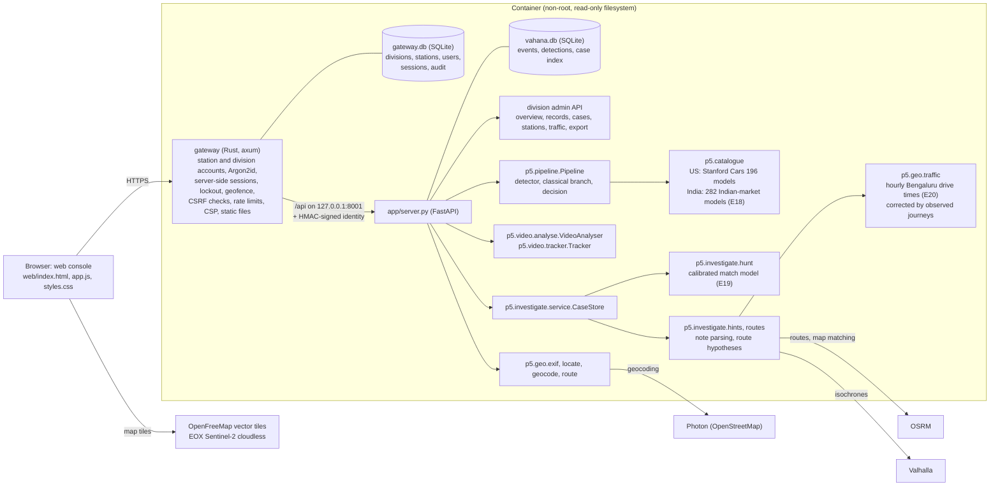
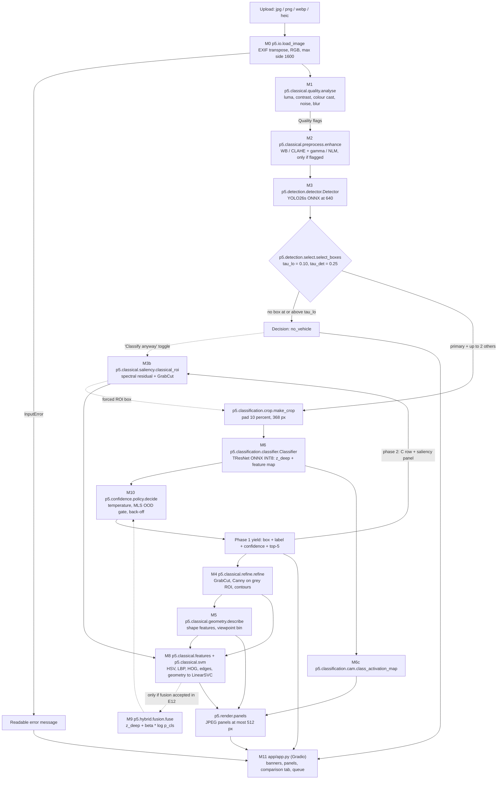
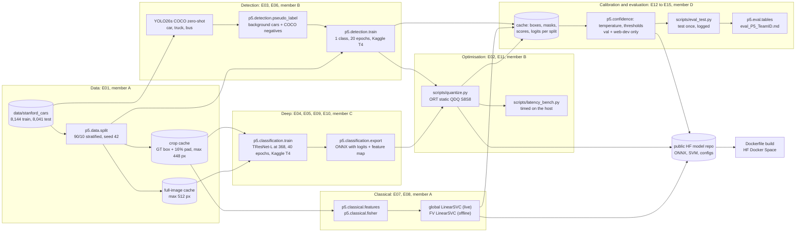

# P5 System Architecture

*The architecture-diagram deliverable for P5 (fine-grained vehicle recognition on Stanford Cars). The diagrams, module names and interfaces here are the contract the code implements. `tests/test_architecture.py` checks that every `p5.*` path named in the diagrams exists in `src/`, so a renamed module fails `make test` until this file is updated. The rationale for each choice is in `docs/FINAL_APPROACH.md`.*

---

## 0. As built (deployment and product extensions)

Sections 1 to 10 are the design contract written before implementation. They still describe the recognition pipeline accurately. Three things changed when it was built. The Gradio app was replaced by a JSON API behind a Rust gateway with a custom web console. The GPU work ran on JarvisLabs instead of Kaggle. And the system grew into an investigation console for traffic police. The deployed system looks like this:



| Component | Responsibility | Key interfaces |
|---|---|---|
| `gateway/src/` | Only public entry point. `auth.rs`: sign-in with device geofence, lockout, server-side sessions, password changes. `admin.rs`: division administrators manage station accounts and read the audit log. `web.rs`: serves the sign-in page publicly and the console only to signed-in users. `proxy.rs`: forwards `/api/*` with an HMAC-signed identity. `cli.rs`: provisions accounts from the station register | `/login`, `/auth/login`, `/auth/password`, `/auth/logout`, `/auth/me`, `/auth/admin/*`, `/api/*` |
| `p5.identity`, `p5.store`, `p5.region` | Verify the gateway's signed identity, record every prediction as a scoped event with per-vehicle detections, store observed journeys, and hold the Bengaluru boundary and station register | `verify`, `Store.record`, `Store.events`, `Store.overview`, `Store.add_journeys`, `region.inside` |
| `app/server.py` | JSON API, upload validation, background jobs | `/api/predict`, `/api/locate`, `/api/video`, `/api/cases/*`, `/api/jobs/*`, `/api/admin/*` (including `/api/admin/traffic`), `/api/meta`, `/api/health` |
| `p5.catalogue` | Runs every catalogue's classifier on the same crops. Each catalogue has its own temperature, thresholds and OOD gate. The more specific answer wins, then the more confident one | `Catalogue.load`, `primary` |
| `p5.video` | Detection every 1/8 s, two-stage IoU tracking, per-track best crops, make and model, colour, direction and wrong-way check | `VideoAnalyser.run(path, VideoOptions)` |
| `p5.investigate` | Cases with a target photo and camera feeds, hunt scoring, note parsing, route hypotheses, and journeys observed between sightings or along dashcam tracks | `CaseStore`, `hunt.rank`, `hints.parse_places`, `routes.infer`, `routes.osrm_routes`, `routes.isochrone`, `journeys.from_sightings`, `journeys.from_track` |
| `p5.geo` | EXIF GPS, OCR plus geocoding, GPS track parsing and map matching, and drive times by hour of day with a learned local correction | `locate`, `parse_track`, `map_match`, `mp4_location`, `TrafficModel.predict`, `TrafficModel.prob_within` |

Every tunable value is in `configs/` or in the calibrated files under `models/`. See `docs/PARAMETERS.md`.

---

## 1. Overview

The system has two halves.

- **Online app** (CPU only, ONNX Runtime, no PyTorch), served by Gradio from one Docker image on a Hugging Face Docker Space. For each upload it runs:
  - classical quality analysis and conditional enhancement;
  - YOLO26s detection;
  - a fine-tuned TResNet classifier on the padded crop;
  - a calibrated decision policy.

  It returns the label first (phase 1), then streams the classical analysis, the CAM and the classical/deep/hybrid comparison (phase 2).
- **Offline pipeline** (Kaggle T4 + CPU). It does five things:
  - prepares the data;
  - trains the detector and the classifier;
  - fits the classical models;
  - exports and quantises to ONNX;
  - writes per-stage caches, from which all calibration, thresholds and evaluation tables are computed.

  The finished artefacts go to a public HF model repo, and the Docker build pulls them from there.

Module IDs M0–M11 are used across the code, docs and experiments. M7 (part-crop re-classification) was cut and the ID is retired.

---

## 2. Inference pipeline



**Phases.**
- **Phase 1** runs M0 → M1 → M2 → M3 → select → crop → M6 → M10 and yields the annotated image, the label, the confidence and the top-5.
- **Phase 2** runs:
  - M4 → M5 → M8 on the primary box;
  - M3b → M8 on the classical ROI (the C comparison row and the saliency panel);
  - M6c CAM;
  - single forwards for up to 2 extra vehicles;
  - panel rendering.

  It yields the full result.
- If `fusion: true` in `configs/app.yaml` (set only when E12 accepts fusion), M4 → M5 → M8 → M9 move into phase 1 before M10.

---

## 3. Offline training and evaluation pipeline



---

## 4. Module responsibilities

| ID | File (`src/p5/…`) | Responsibility | Used | Owner |
|---|---|---|---|---|
| M0 | `io.py` | Decode, EXIF transpose, colour-mode normalisation, resize, input rejection | online | A |
| M1 | `classical/quality.py` | Image statistics and quality flags | online + E12 | A |
| M2 | `classical/preprocess.py` | Conditional WB / CLAHE + gamma / NLM | online + E12 | A |
| M3 | `detection/detector.py` | YOLO ONNX inference: letterbox, decode, NMS, back-projection | online + caches | B |
| — | `detection/select.py` | Thresholds, primary-box rule, detection status, truncation flag | online | B |
| M3b | `classical/saliency.py` | Spectral-residual saliency → GrabCut classical ROI (never labels by itself) | online + E08 | A |
| M4 | `classical/refine.py` | Box-initialised GrabCut mask, Canny on grey ROI, contours, tight box | online + E07 | A |
| M5 | `classical/geometry.py` | Shape descriptors, viewpoint bin, body-shape note | online + E14 | A |
| M6 | `classification/crop.py`, `classification/classifier.py` | Crop + normalise; TResNet ONNX → z_deep + feature map; optional flip | online + caches | C |
| M6c | `classification/cam.py` | Class activation map from the feature map and FC weights | online | C |
| M8 | `classical/features.py`, `classical/svm.py` | Global colour/texture/shape descriptor; PCA + LinearSVC + Platt (NumPy) | online + E08 | A |
| M8-FV | `classical/fisher.py` | Dense RootSIFT → Fisher vector → LinearSVC (strongest classical row) | offline | A |
| M9 | `hybrid/fusion.py` | Late fusion z_deep + β·log p_cls; β fitting | online (gated) + E12 | D |
| M10 | `confidence/temperature.py`, `confidence/ood.py`, `confidence/policy.py` | Temperature, MLS/energy, back-off decision | online + E13 | D |
| M11 | `app/app.py`, `app/strings.py` | Gradio UI, streaming, queue, banners, comparison tab | online | D |
| — | `pipeline.py` | Orchestration, phases, timings, fast mode, error capture | online | D |
| — | `render.py` | Box drawing, panel images, JPEG encoding | online | D |
| — | `taxonomy.py` | Class names → make/model/year, families, display makes, twin groups | both | A |
| — | `types.py` | Dataclass contracts (§5) | both | D |
| — | `data/*` | Loading, split, caches, corruptions, web set | offline | A |
| — | `detection/pseudo_label.py`, `detection/train.py` | Pseudo-labels + negatives; Ultralytics fine-tune and export | offline | B |
| — | `classification/model.py`, `train.py`, `export.py` | timm model, training loop, ONNX export with two outputs | offline | C |
| — | `eval/*` | Metrics, statistics, robustness, table generation | offline | D |

---

## 5. Data contracts (`src/p5/types.py`)

These are pixel coordinates in the M0-resized image (`ImageIn.rgb`) unless stated. Arrays are NumPy.

```python
from dataclasses import dataclass, field
from typing import Literal
import numpy as np

Box = tuple[float, float, float, float]  # x1, y1, x2, y2

QualityFlag = Literal["dark", "low_contrast", "cast", "noisy", "blurry"]
Level = Literal["class", "family", "make", "abstain", "ood_make", "ood", "no_vehicle"]


@dataclass(frozen=True)
class ImageIn:
    rgb: np.ndarray                  # (H, W, 3) uint8
    original_size: tuple[int, int]   # (W, H) before resize
    scale: float
    is_grey: bool
    source_format: str


@dataclass(frozen=True)
class Quality:
    mean_luma: float
    p5_luma: float
    p95_luma: float
    rms_contrast: float
    cast_ratio: float
    noise_sigma: float
    blur_var: float
    flags: frozenset[QualityFlag]


@dataclass(frozen=True)
class Enhanced:
    rgb: np.ndarray                  # same shape as input; identical object if nothing applied
    applied: tuple[str, ...]         # subset of ("gray_world", "clahe", "gamma", "nlm")


@dataclass(frozen=True)
class Detection:
    box: Box
    conf: float
    label: str                       # "vehicle" (fine-tuned) or "car" / "truck" / "bus" (zero-shot)
    source: Literal["yolo_ft", "yolo_zs", "classical_roi"]


@dataclass(frozen=True)
class DetectionResult:
    detections: list[Detection]      # sorted by conf * sqrt(area), at most 5
    primary: Detection | None
    status: Literal["ok", "weak", "none"]
    truncated: bool


@dataclass(frozen=True)
class Roi:
    crop_box: Box                    # padded region in image coords
    mask: np.ndarray                 # (h, w) uint8 {0, 1}, crop coords
    contour: np.ndarray              # (N, 1, 2) int32, crop coords
    hull: np.ndarray
    edges: np.ndarray                # (h, w) uint8 Canny map of the grey crop
    tight_box: Box
    saliency: np.ndarray | None = None


@dataclass(frozen=True)
class Geometry:
    aspect: float
    extent: float
    solidity: float
    hu: np.ndarray                   # (7,) log-scaled
    symmetry: float
    viewpoint: Literal["front_rear", "side", "three_quarter"]
    experimental: bool
    body_note: str | None

    def vector(self) -> np.ndarray: ...   # (12,) float32 for M8


@dataclass(frozen=True)
class DeepOut:
    logits: np.ndarray               # (196,) float32 z_deep, flip-averaged if flipped
    features: np.ndarray | None      # (C, h, w) float32 for CAM
    flipped: bool


@dataclass(frozen=True)
class ClassicalOut:
    proba: np.ndarray                # (196,) float32, Platt-scaled
    source: Literal["yolo", "roi", "gt"]


@dataclass(frozen=True)
class Decision:
    level: Level
    text: str                        # exact UI wording from app/strings.py
    confidence: float | None         # probability mass at the chosen level
    class_id: int | None
    family_id: int | None
    make_group: str | None
    top5: list[tuple[str, float]]
    mls: float | None
    forced: bool
    banners: list[str] = field(default_factory=list)


@dataclass
class VehicleResult:
    detection: Detection
    deep: DeepOut
    decision: Decision
    roi: Roi | None = None
    geometry: Geometry | None = None
    classical: ClassicalOut | None = None
    cam: np.ndarray | None = None    # (H, W) float32 in [0, 1], crop coords


@dataclass
class PipelineResult:
    phase: Literal[1, 2]
    annotated: np.ndarray | None     # RGB with boxes and labels
    vehicles: list[VehicleResult]
    primary_index: int | None
    quality: Quality | None
    enhanced: Enhanced | None
    panels: dict[str, bytes]         # name -> JPEG bytes, max side 512
    comparison: dict[str, str]       # "C" / "C+Y" / "D" / "H" -> label text for this image
    timings_ms: dict[str, float]
    fast_mode: bool
    error: str | None                # user-facing message; never a traceback
```

**Rules.**
- A `Decision` with level `no_vehicle` always has `class_id = family_id = make_group = None` and an empty `top5`.
- `forced=True` exists only on the "classify anyway" path and always carries the banner "Forced classification — unreliable".

---

## 6. Stage interfaces

Signatures are binding. Keyword defaults are the frozen values from `configs/*.yaml`; the pipeline passes them explicitly.

```python
# M0  p5/io.py
class InputError(Exception):
    code: Literal["too_small", "too_large", "unreadable"]
def load_image(path: str | Path, max_side: int = 1600, min_side: int = 64,
               max_pixels: int = 50_000_000) -> ImageIn: ...

# M1  p5/classical/quality.py
def analyse(rgb: np.ndarray, cfg: QualityCfg) -> Quality: ...

# M2  p5/classical/preprocess.py
def enhance(rgb: np.ndarray, quality: Quality, cfg: PreprocessCfg) -> Enhanced: ...

# M3  p5/detection/detector.py
class Detector:
    def __init__(self, onnx_path: Path, kind: Literal["ft", "zs"], imgsz: int = 640,
                 nms_iou: float = 0.7, threads: int = 2): ...
    def detect(self, rgb: np.ndarray, conf: float = 0.10, max_det: int = 100) -> list[Detection]: ...

# p5/detection/select.py
def select_boxes(dets: list[Detection], image_wh: tuple[int, int], tau_lo: float,
                 tau_det: float, max_boxes: int = 5) -> DetectionResult: ...

# M3b p5/classical/saliency.py
def classical_roi(rgb: np.ndarray, iters: int = 5, max_side: int = 320) -> Roi: ...

# M4  p5/classical/refine.py
def refine(rgb: np.ndarray, box: Box, pad: float = 0.10, max_side: int = 320,
           iters: int = 5) -> Roi: ...

# M5  p5/classical/geometry.py
def describe(roi: Roi, cfg: GeometryCfg) -> Geometry: ...

# M6  p5/classification/crop.py, classifier.py
def make_crop(rgb: np.ndarray, box: Box, size: int, mean: tuple[float, float, float],
              std: tuple[float, float, float], pad: float = 0.10) -> np.ndarray: ...  # (3, size, size) float32
def jitter_box(box: Box, rng: np.random.Generator, scale: float = 0.10,
               shift: float = 0.05) -> Box: ...                                      # training only
class Classifier:
    def __init__(self, onnx_path: Path, meta_path: Path, threads: int = 2): ...
    def predict(self, rgb: np.ndarray, boxes: list[Box], flip: bool = False) -> list[DeepOut]: ...

# M6c p5/classification/cam.py
def class_activation_map(features: np.ndarray, fc_weight: np.ndarray, class_id: int,
                         out_hw: tuple[int, int]) -> np.ndarray: ...

# M8  p5/classical/features.py, svm.py
def extract(crop_rgb: np.ndarray, roi: Roi, geometry: Geometry) -> np.ndarray: ...   # (D,) float32
class GlobalSVM:
    @classmethod
    def load(cls, npz_path: Path) -> "GlobalSVM": ...
    def predict_proba(self, x: np.ndarray, source: str) -> ClassicalOut: ...

# M9  p5/hybrid/fusion.py
def fuse(z_deep: np.ndarray, p_cls: np.ndarray, beta: float, eps: float = 1e-6) -> np.ndarray: ...
def fit_beta(z_deep: np.ndarray, p_cls: np.ndarray, y: np.ndarray,
             grid: tuple[float, ...] = (0, .05, .1, .2, .3, .5, 1.0)) -> float: ...

# M10 p5/confidence/*.py
def fit_temperature(logits: np.ndarray, y: np.ndarray) -> float: ...
def softmax_t(z: np.ndarray, t: float) -> np.ndarray: ...
def mls(z_deep: np.ndarray, t_d: float) -> float: ...
def energy(z_deep: np.ndarray, t_d: float) -> float: ...
@dataclass(frozen=True)
class Thresholds:
    tau_lo: float; tau_det: float; tau_hi: float; tau_fam: float; tau_make: float
    tau_ood: float; t_d: float; t_f: float | None; beta: float
def decide(z_deep: np.ndarray, z_fused: np.ndarray | None, status: str, taxonomy: Taxonomy,
           th: Thresholds, forced: bool = False) -> Decision: ...

# p5/taxonomy.py
class Taxonomy:
    names: list[str]; make_of: list[str]; display_make_of: list[str]; family_of: list[int]
    year_twins: list[tuple[int, int]]; rebadge_twins: dict[str, list[int]]
    @classmethod
    def load(cls, directory: Path) -> "Taxonomy": ...
    @staticmethod
    def parse_name(name: str, makes: list[str]) -> tuple[str, str, int]: ...   # make, model/body, year

# p5/render.py
def draw_boxes(rgb: np.ndarray, vehicles: list[VehicleResult], primary_index: int | None) -> np.ndarray: ...
def panels(image: ImageIn, quality: Quality, enhanced: Enhanced, vehicles: list[VehicleResult],
           classical_roi: Roi | None, max_side: int = 512, jpeg_quality: int = 85) -> dict[str, bytes]: ...

# p5/pipeline.py
class Pipeline:
    @classmethod
    def from_config(cls, app_yaml: Path, thresholds_yaml: Path) -> "Pipeline": ...
    def run(self, path: str, classify_anyway: bool = False,
            focus_index: int | None = None) -> Iterator[PipelineResult]: ...
```

**Policy semantics (`decide`).** Probabilities p = softmax_t(z, T), where z = `z_fused` with `t_f` when fusion is on, else `z_deep` with `t_d`.

| Condition | Level |
|---|---|
| `status == "none"` and not forced | `no_vehicle` |
| `mls(z_deep) ≥ tau_ood`, top-1 p ≥ tau_hi | `class` |
| `mls(z_deep) ≥ tau_ood`, family mass of the top class ≥ tau_fam | `family` |
| `mls(z_deep) ≥ tau_ood`, display-make mass ≥ tau_make | `make` |
| `mls(z_deep) ≥ tau_ood`, none of the above | `abstain` |
| `mls(z_deep) < tau_ood`, display-make mass ≥ tau_make | `ood_make` |
| `mls(z_deep) < tau_ood`, otherwise | `ood` |

The rows under `mls(z_deep) ≥ tau_ood` are tried in order. A `weak` status adds the "Possible vehicle" banner.

**Pipeline behaviour.**
- `run` yields exactly one phase-1 result and then one phase-2 result. An `InputError` or an unexpected exception yields a single result with `error` set, an error id logged, and no traceback in the UI.
- `timings_ms` has one key per stage (`io`, `quality`, `enhance`, `detect`, `classify`, `decide`, `refine`, `geometry`, `classical`, `classical_roi`, `cam`, `extra`, `panels`, `total`).
- **Fast mode.** When cumulative time passes `fast_mode_ms` (6000), extra vehicles are skipped. If time still passes the cap, M3b and M4 panels are skipped too and `fast_mode=True` is set.
- `focus_index` re-runs phase 2 on another detected vehicle (the multi-car dropdown).

---

## 7. Model artefacts, ONNX I/O and configuration

All artefacts live in a public HF model repo pinned by revision in `configs/app.yaml`, and are downloaded at Docker build time. No token is needed.

| File | Producer | Content |
|---|---|---|
| `detector.onnx` | `p5.detection.train` + `scripts/quantize.py` (E06/E11) | Input `images` (1, 3, 640, 640) float32 RGB in [0, 1], letterboxed. Output is either raw (1, 4 + nc, N), which needs NMS, or end-to-end (1, 300, 6); `Detector` detects the layout from the shape |
| `classifier.onnx` | `p5.classification.export` + `scripts/quantize.py` (E05/E11) | Input `input` (B, 3, S, S) float32 normalised. Outputs `logits` (B, 196) and `features` (B, C, h, w) |
| `classifier_meta.json` | export | `size`, `pad`, `mean`, `std`, `interpolation`, `feature_dim` C, `feature_hw`, `backbone`, `precision`, `sha256` |
| `head.npz` | export | `fc_weight` (196, C), `fc_bias` (196,) for the CAM |
| `classical_global.npz` | E08 | Scaler mean/scale, PCA mean/components, SVM W (196, 256), b, Platt A/B |
| `taxonomy/*.json` | E01 (copied from `assets/taxonomy`) | Classes, makes, display makes, families, groups |

**`configs/app.yaml` keys:**
- `model_repo`, `revision`, `files.*`;
- `detector_kind` (`ft`/`zs`);
- `serve_size` (368 or 320 per gate G1);
- `flip_tta`, `fusion`;
- `max_side`, `max_extra_vehicles` (2), `max_boxes` (5);
- `fast_mode_ms` (6000), `hard_cap_ms` (8000);
- `ort_threads` (2).

**`configs/thresholds.yaml` keys** (frozen at H18, with bootstrap CIs):
- `tau_lo`, `tau_det`, `tau_hi`, `tau_fam`, `tau_make`, `tau_ood`;
- `t_d`, `t_f`, `beta`;
- `quality.{dark, low_contrast, cast, noisy, blurry}`;
- `preprocess.{clahe_clip, clahe_tile, nlm_h_scale}`;
- `geometry.{sym_front, aspect_front, aspect_side, sym_side}`.

---

## 8. Offline interfaces

```python
# p5/data/stanford.py
def load(root: Path, split: Literal["train", "test"]) -> pd.DataFrame: ...
# columns: id, path, class_id (0-195), x1, y1, x2, y2, width, height
# test class_id is read only through scripts/eval_test.py

# p5/data/split.py
def make_split(df: pd.DataFrame, val_frac: float = 0.1, seed: int = 42) -> tuple[list[int], list[int]]: ...
def assert_disjoint(train_ids: Iterable[int], val_ids: Iterable[int]) -> None: ...

# p5/data/cache.py
def write(split: str, stage: str, frame_or_arrays, producer: str) -> Path: ...  # cache/{split}/{stage}.{parquet|npz}
def read(split: str, stage: str): ...

# p5/data/corrupt.py
FAMILIES = ("gaussian_noise", "motion_blur", "defocus_blur", "lowlight", "contrast",
            "jpeg_compression", "pixelate", "fog")
HELD_OUT = ("speckle_noise", "gaussian_blur")
def corrupt(rgb: np.ndarray, name: str, severity: int, seed: int) -> np.ndarray: ...
def occlude(rgb: np.ndarray, box: Box, fraction: float, seed: int) -> np.ndarray: ...
```

**Cache schemas** (`cache/{split}/…`, keyed by `image_id`; every file records `producer` = experiment folder and commit):

| File | Columns / arrays |
|---|---|
| `det_zs.parquet`, `det_ft.parquet` | `image_id, rank, x1, y1, x2, y2, conf, cls` (conf ≥ 0.001, max 100) |
| `quality_flags.parquet` | `image_id`, the `Quality` fields, `flags` |
| `roi_classical.parquet`, `tightbox.parquet`, `mask_rle.parquet` | `image_id`, box columns / COCO RLE |
| `cls_feats_{global,fv}.npz` | `ids` (N,), `x` (N, D) float32 |
| `cls_scores_{global,fv}_{input}.npz` | `ids`, `proba` (N, 196) float16 |
| `logits_{model}_{prec}_{input}_{flip}.npz` | `ids`, `logits` (N, 196) float32, plus `features_pooled` only for val |
| `corrupt/{name}_s{k}/…` | the same files for the corrupted 1,960-image subset |

Cache files never contain test labels. Labels are joined only inside `scripts/eval_test.py`.

**Command-line entry points** (also called by the Kaggle notebooks):

| Command | Purpose | Experiment |
|---|---|---|
| `python scripts/build_cache.py --root data/stanford_cars` | Data cache and split | E01 |
| `python -m p5.classification.train --config configs/train/e05_tresnet_l.yaml` | Classifier training | E04/E05/E09/E10 |
| `python -m p5.classification.export --ckpt … --size 368` | ONNX export | E04/E05 |
| `python -m p5.detection.train --config configs/train/e06_yolo.yaml` | Detector fine-tune | E06 |
| `python scripts/quantize.py --model classifier --calib 512` | INT8 quantisation | E11 |
| `python scripts/latency_bench.py --runs 50 --warmup 5` | Host latency | E02/E11 |
| `python scripts/run_val_cache.py --config …` | Write val caches | E05–E13 |
| `python scripts/eval_test.py --config configs/app.yaml --tag freeze-v1` | Test evaluation; appends to `experiments/test_log.csv` | E14/E15 |
| `make metrics` / `make tables` | Rebuild tables / `eval_P5_<TeamID>.md` from caches | — |
| `make eval-subset` | 500-image end-to-end CPU reproduction | — |

---

## 9. Mapping to the repository

| Diagram node | Code location | Experiments | Panel / UI element |
|---|---|---|---|
| M0 | `src/p5/io.py` | E01 (shared parsing helpers) | Error messages |
| M1 | `src/p5/classical/quality.py` | E12 | "Image quality" panel |
| M2 | `src/p5/classical/preprocess.py` | E12, A5 | Before/after panel, low-light banner |
| M3 + select | `src/p5/detection/{detector,select}.py` | E03, E06, A12 | Boxes, "No vehicle", "Possible vehicle" |
| M3b | `src/p5/classical/saliency.py` | E08 | Saliency panel, C row, classify-anyway |
| M4 | `src/p5/classical/refine.py` | E07, A6 | Edge-map and contour panels |
| M5 | `src/p5/classical/geometry.py` | E14 | "view: …", body note |
| M6 | `src/p5/classification/{crop,classifier}.py` | E04, E05, E09–E11 | Label, top-5 |
| M6c | `src/p5/classification/cam.py` | E15 failure cases | CAM panel |
| M8 | `src/p5/classical/{features,svm,fisher}.py` | E08 | HSV histogram panel, C/C+Y rows |
| M9 | `src/p5/hybrid/fusion.py` | E12, A7 | β shown in the comparison tab |
| M10 | `src/p5/confidence/{temperature,ood,policy}.py` | E13, A9, A10 | Confidence, level, banners |
| M11 | `app/app.py`, `app/strings.py` | phone tests H6/H8/H20 | Whole UI |
| Offline nodes | `src/p5/{data,eval}/`, `scripts/`, `notebooks/` | E01–E16 | `eval_P5_<TeamID>.md` |
| HF Docker Space | `Dockerfile`, `requirements-app.txt`, `configs/app.yaml` | E02, E11 | Live URL |

---

## 10. Invariants enforced by tests

| Test | What it checks |
|---|---|
| `tests/test_architecture.py` | Extracts every `p5.<module>[.<attr>]` path from the Mermaid blocks in this file. Each module must resolve with `importlib.util.find_spec` (no import, so offline modules that need torch still pass in the app environment). Each attribute must be defined at module top level, checked by AST parsing. |
| `tests/test_contracts.py` | Uses synthetic inputs and the real pipeline with the shipped ONNX files. A 32×32 image raises `InputError("too_small")`. A uniform-noise image gives `status == "none"` and a `no_vehicle` decision with no class. Greyscale sets `is_grey`. RGBA and a small HEIC fixture decode. `run` yields phase 1 then phase 2. Every decision text exists in `app/strings.py`. |
| `tests/test_taxonomy.py` | 196 classes, 49 labelled makes, 47 display groups, 189 families. The year-twin and rebadge indices match the class names. |
| Loader assertions | The val ids are disjoint from the classifier, detector and SVM training ids. |
