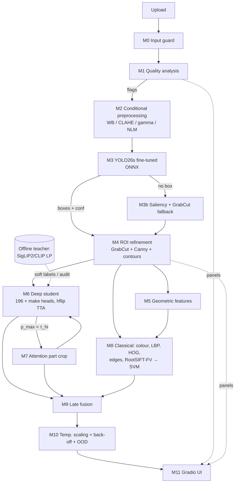

# 01 — Synthesis: candidate approach for P5 (Stanford Cars fine-grained vehicle recognition)

*Stage 2 of the pipeline (research → **synthesise** → critique → revise → final). Written 2026-11-06 from `docs/research/01–05`, the v1 draft (since removed, superseded by `docs/LITERATURE_SURVEY.md` and `docs/FINAL_APPROACH.md`), the hackathon PDF text, and `experiments/README.md`.*

**How to read the evidence tags**
- `[01]`…`[05]` point to the research file the number comes from. `[P]` / `[S]` / `(unverified)` keep that file's verification grade.
- **(est.)** is our own planning estimate. No paper measured it.
- **Weak** means the literature gives no direct support on Stanford Cars, so the component is kept because the rubric requires it or because the demo needs it, not because we expect accuracy from it.

---

## 0. What the design is optimising for

| Rubric item | Design consequence |
|---|---|
| Evaluation metrics, ranked against other teams ("average of performance metrics") | Top-1/Top-5 come first, but IoU and mAP are scored too. So the **detector is fine-tuned** rather than used zero-shot, and the classifier is the strongest one we can still deploy. |
| "Proper train/validation split" | Stratified val split carved from train. Test is used only for frozen configs (§5). |
| Public URL, works from a phone, responds in about 10 s | The deployed path must run on CPU in **≤ 4 s p95 warm (est.)** on 2 vCPU. Anything slower is offline-only. |
| "Repo runs with one command / Dockerfile", architecture diagram matches the code | Every module in §2 maps to one Python package. A single Dockerfile serves the app. |
| Demo: a judge uploads an unseen image, probably a post-2012 car | **Low-confidence handling is a demo-survival feature.** The app needs year-merged / make-level back-off and an "unknown model" state. Car-1000 [02] confirms Stanford Cars has only pre-2013 models. |

Note that the rubric table is internally inconsistent: the "Max" column says 25/20 for Metrics/Implementation, while the text says 15 each. See Open Questions.

---

## 1. Alternative overall designs and the decision

| | **A. Frozen web-scale ViT + linear head** | **B. Full fine-tune of a strong IN-21k-class backbone on crops** | **C. ImageNet-1k CNN at high res (+ FGVC module)** |
|---|---|---|---|
| Example | CLIP ViT-L/14@336 or SigLIP2-SO400M@384 features → logistic regression | EVA-02-B/14@448 (`timm/eva02_base_patch14_448.mim_in22k_ft_in22k_in1k`, name verified [01]) | TResNet-L@368 (plain), or ResNet-50@448 + PMG |
| Evidence for Top-1 | CLIP-L/14@336 LP **91.5** [P]. SigLIP-g/16 and PE-G LP **96.5** [P]. OpenCLIP-G LP **96.1** [P]. L/SO400M-size **92–95 (est., extrapolated in [01])**. | **No verified Cars number** at T4 scale. Analogues: TransFG ViT-B/16 IN-21k@448 **94.8** [P], DeiT-B↑384 **93.3** [P], EfficientNet-B7 **94.7** [P]. Plain modern backbones land at **92–94** [05 §2.1]. | **TResNet-L@368, IN-1k only: 96.0** [P] (CE + triplet). R50+PMG@448 **95.0** [P]. PMD 97.3 [P] but needs 200 epochs. |
| GPU-hours (T4) | 0.5–1 h (feature extraction + flips) (est.) | 1.5–3 h per run (est.) | 1.5–3 h plain (est.). PMG/PMD multi-stage: 6–12 h+ (est.) |
| CPU latency, 2 vCPU | L/14@336 ≈ 577 tokens × 300M params → **~4–8 s FP32 (est.)**, too slow. A ViT-B/16 is fast but LP gives only 86.7 [P]. | ViT-B at 1024 tokens: **~1.5–4 s FP32, ~1–2 s INT8 (est.)** | TResNet-L@368 ≈ 29 GFLOPs (est., scaled from 224) → **~0.6–1.5 s FP32 (est.)** |
| Contamination / rules risk | **High.** Web data is not de-duplicated against Cars test, and EVA-CLIP-E reaches 94.6 *zero-shot* [P]. "Transfer learning **and fine-tuning**" is mandatory, so an LP alone is a weak claim. | Medium-low. IN-22k images, but EVA-02's MIM targets come from EVA-CLIP, so web exposure is indirect. | **Lowest.** Kornblith found 14 Cars test images (0.17%) in ImageNet [05]. |
| Demo risk | Low accuracy risk, high latency risk | Medium: ViT INT8 behaviour is unmeasured | Low latency. The training recipe is the main risk (the triplet loss and schedule behind 96.0 are not reproduced). |

**Decision: D = "deployable student + offline teacher", i.e. B/C for deployment and A offline.**

1. **Deployed classifier (student).** Fine-tune on detector-style crops. A val bake-off (E07) picks between **TResNet-L@368** (C-type, IN-1k) and **EVA-02-B@448** (B-type).
   - Decision rule: take the higher val Top-1. If the gap is < 1.0 pt, which is within about 1 SE on ~815 val images, take **TResNet-L**. Reasons: lowest contamination, CNN-friendly static INT8 [03 B5], and faster CPU.
   - Default before the bake-off is TResNet-L, because it is the only option with a **verified ≥ 96% Cars number using IN-1k pretraining only**.
2. **Offline teacher.** Frozen SigLIP2-SO400M@384 (hub name unverified) and CLIP-L/14@336 features with a logistic-regression head. It is used for:
   - (a) the "foundation-model" comparison row, flagged for contamination;
   - (b) cross-fitted soft labels for an optional distillation run;
   - (c) the label-noise audit;
   - (d) a sanity check: our CLIP-L LP should land near the published **91.5** [P]. If it doesn't, the data pipeline is suspect. Our crops differ from the paper's full images, so expect a few points' deviation (est.).
   The teacher is **not deployed** (CPU latency).
3. **Not chosen:** DINOv2/v3 as the primary. LVD-142M was retrieved using the Cars *train* set as queries [01, P], which is hard to defend in a viva. FGVC modules (PMG/CAL/TransFG) are also out: they add about 1–2 pts at high complexity [05], and ViT-FGVC modules gain little over a stronger backbone [01]. PEFT is out because Cars is where it trails full fine-tuning most (VTAB protocol: VPT-deep 83.6 vs full FT 84.5; SSF 89.2) [01].

---

## 2. System architecture

### 2.1 Text diagram (inference path = deployed app)

```
Upload (jpg/png/webp/heic) ─► [M0 Input guard] EXIF-rotate, RGBA→RGB, max-side 1600, reject non-image / <64px
        │
        ▼
[M1 Image-quality analysis]  luminance mean/percentiles, RMS contrast, gray-world cast, noise σ (Laplacian), blur (var-of-Laplacian)
        │ flags
        ▼
[M2 Conditional preprocessing]  gray-world WB (if cast) · CLAHE on LAB-L (if dark/low-contrast) · gamma (if dark) · NLM denoise (if noisy)
        │ (classifier sees original OR enhanced image per flag; the classical branch always sees the normalised one)
        ▼
[M3 Detector] YOLO26s fine-tuned, 1 class "vehicle", ONNX FP32/INT8 @640 ─► boxes + det_conf
        │  none ≥0.25 → [M3b fallback ROI] spectral-residual saliency → GrabCut(central rect) → "no vehicle detected" warning
        ▼  primary box = argmax(det_conf × √area); up to 3 others listed
[M4 ROI refinement] pad box 10% → GrabCut(GC_INIT_WITH_RECT, 5 it, on ≤320px) → mask → Canny + findContours
        │  → largest external contour, convex hull ─► [M5 Geometric features] aspect, extent, solidity, Hu moments, L-R symmetry
        ├──────────────────────────────┬─────────────────────────────────────────┐
        ▼                              ▼                                         ▼
[M6 Deep classifier]           [M7 Part/attention view]                 [M8 Classical classifier]
student @368/448 on padded box  (only if p_max < τ_hi) CAM/attention    HSV hist (fg mask) + colour moments,
→ 196 logits + 49-make logits   → threshold 15% max → largest CC        uniform LBP 2×2 grid, HOG, edge-density grid,
+ hflip TTA                     → crop → student → logits               M5 geometry, dense RootSIFT→FV → linear SVM
        └──────────────┬───────────────┴─────────────────────────────────────────┘
                       ▼
[M9 Fusion] z = z_deep + α·z_part + β·log p_classical   (α, β fit on val by NLL; β may be 0)
                       ▼
[M10 Calibration + decision policy] softmax(z/T) → class → year-merged family → make → abstain;
                     OOD score (max-logit / energy) → "not one of the 196 known models"
                       ▼
[M11 UI] box + label + confidence, top-5, back-off message, intermediate panels (M1–M5, CAM), comparison tab
```

### 2.2 Mermaid



### 2.3 Module table (I/O and rubric coverage)

| Module | Input → Output | Rubric requirement satisfied |
|---|---|---|
| M0 Input guard | bytes → RGB uint8 + warnings | Implementation: "bad input handled" |
| M1 Quality analysis | RGB → stats + flags | Classical: preprocessing/normalisation; Adv-2 (illumination) |
| M2 Conditional preprocessing | RGB + flags → enhanced RGB | Classical: preprocessing; Hybrid: classical → DL |
| M3 Detector | RGB → boxes, conf | DL: YOLO detection; Hybrid: boxes with labels and confidence; metrics: IoU, mAP |
| M3b Fallback ROI | RGB → box | Classical: ROI extraction; robustness |
| M4 ROI refinement | RGB + box → mask, contour, tight box | Classical: edge detection + contours, ROI extraction |
| M5 Geometry | contour/mask → feature vector | Classical: geometric features |
| M6 Deep student | crop → 196 + 49 logits, embedding | DL: CNN/ViT FGVC, transfer learning, 196-way |
| M7 Part crop | attention map → part crop → logits | Hybrid ROI; Adv-1 (similar classes) |
| M8 Classical classifier | crop + mask → 196 scores | Classical: colour + texture; Adv-4 (classical baseline) |
| M9 Fusion | logits/scores → fused logits | Hybrid integration; Adv-4/5 |
| M10 Policy | fused logits → label, level, conf, OOD flag | Hybrid: low-confidence handling; metrics: confidence/threshold |
| M11 UI | everything → page | Expected outputs 1–6 |

Proposed package layout, so the diagram matches the code: `p5/{io,quality,preprocess,detect,roi,geometry,classify,parts,classical,fusion,policy}.py` and `app/app.py`. Each module has a pure function with the I/O above.

---

## 3. Component choices with evidence

**3.1 Preprocessing (M1/M2): adaptive and conditional, off by default on clean images.**
- Evidence against unconditional enhancement: off-the-shelf low-light enhancement before YOLOv3 on ExDark gives **≤ 0.5 mAP** (76.4 → 76.3–76.9) [03 B1, PE-YOLO]. CLAHE evidence is mixed: one report has ResNet34 dropping 95 → 84 (unverified) [03].
- Evidence for denoising: CNNs are most hurt by blur and noise, much less by contrast/JPEG (Dodge & Karam) [03]. So **NLM denoise is triggered by the noise estimate, and CLAHE/gamma only when mean V < 0.35 or RMS contrast is low.** Both thresholds are tuned on val corruptions.
- To avoid a train/test mismatch when enhancement fires, the student trains with random CLAHE/gamma (p = 0.2) (est.).
- Expected effect: ~0 on clean test; positive only on dark/low-contrast/noisy corruptions (est.). Ablated in E15.

**3.2 Detector (M3): YOLO26s, fine-tuned as a single class.**
- Why YOLO26: highest Ultralytics COCO mAP at each size (26s **48.6**, 26n 40.9). CPU-ONNX 26n is **38.9 ms vs 56.1 ms** for 11n. DFL removal simplifies export [03 A1]. YOLO11s is the fallback if YOLO26 tooling misbehaves. YOLO12 is ruled out: Ultralytics itself warns of instability and slow CPU.
- Zero-shot vs fine-tuned: COCO-pretrained detection must accept **car, truck and bus** (COCO 2/7/5). Stanford Cars contains pickups, vans and the Sprinter, which COCO would call "truck". That is the zero-shot baseline (E03). The model we ship is fine-tuned for 15–20 epochs on train boxes (E04), because IoU/mAP are scored against Stanford's box style.
- No paper reports detection mAP on Cars boxes; expect near-saturated IoU@0.5 [03 A2] (est.).
- NMS: we keep the default one-to-many head with NMS (IoU 0.7, Ultralytics default) for accuracy [03: docs say predict defaults to this head]. The NMS-free head (`nms=False`/end2end) is benchmarked only for latency.
  - For mAP evaluation: conf = 0.001, max_det = 100 (COCO protocol) [03 A3].
  - For the app: conf ≥ 0.25.
  - Primary box = argmax(conf × √area), since Stanford Cars has one dominant car per image.
- **Licence:** Ultralytics is AGPL-3.0 (not re-checked) [03]. A public network service must offer its source, and our repo is public anyway, so we license the repo AGPL-3.0. RF-DETR-Nano (Apache-2.0, COCO 48.4) [03] is the swap-in if the team objects.

**3.3 ROI refinement (M4/M5): GrabCut + contours, used for features and visualisation and *not* fed to the deep classifier by default.**
- Evidence: box-initialised GrabCut gives 38.5 vs 21.6 mAPr for raw rectangles (Khoreva) [03 B3]. Krause CVPR'15 uses box-initialised GrabCut on cars [03].
- Risk: GrabCut can drop wheels, shadows and dark paint, which would *lower* IoU against Stanford's loose boxes. Rule: the tight box replaces the detector box only if val IoU improves (E05).
- The mask is always used for foreground-only colour histograms and for the geometric features (aspect ratio correlates with body type: est., weak).

**3.4 Deep classifier (M6).**
- Backbone: TResNet-L@368 or EVA-02-B@448, chosen by E07 (§1). Resolution is the cheapest lever (CUB: 81.6 @224 → 85.6 @392 [05, Wei Tab. 4]).
- Input: detector-style crops. GT box + 10% pad, plus box jitter so IoU with GT is ~0.8–0.95, which simulates detector error. Evidence that predicted crops ≈ GT crops on Cars: **88.4 vs 89.0** (Krause CVPR'15) [03 A2]. Strong models gain less from crops (B-CNN on birds +1 pt) [03], so the gain is measured, not assumed (E09).
- Recipe:
  - AdamW, cosine schedule, warm-up 2 epochs, 30 epochs (est.).
  - For EVA: layer-wise LR decay of ~0.7 and a base LR of ~5e-5 (est.).
  - Label smoothing 0.1, RandAugment (light), hflip, RandomErasing p = 0.25 (occlusion) [04].
  - Random downscale-then-upscale p = 0.2 (resolution). Peng: high-res-trained → 50 px gives **1.7%**, mixed training gives 59.3% low-res [04].
  - CutMix/Mixup off by default (ablation arm).
  - AMP, plus gradient checkpointing for EVA.
- **Hierarchical make head:** a 49-way auxiliary head with loss weight 0.3 (est.). The evidence is weak: Manole & Diosan 2026 says multi-task helps CNNs "in almost all scenarios", but the numbers are unchecked [02]. Back-off itself uses *summed* fine probabilities, so the head is an ablation arm (E11), not a dependency.
- Optional distillation (E12): KL to **cross-fitted** (5-fold) teacher LP probabilities on train. A teacher scoring its own training images would give near one-hot targets.

**3.5 Part/attention crop (M7): test-time only, no training, triggered only below τ_hi.**
- Method: Grad-CAM threshold at 15% of max → largest connected component → box [03 B3]. For ViTs we use last-block CLS attention exported as an extra ONNX output, which means disabling fused attention in timm for export. We avoid backward passes on CPU.
- Evidence (CUB, not Cars): attention cropping **87.8 vs 86.4** baseline (WS-DAN). MMAL-Net 95.0 on Cars uses part crops but trains for them [01, 03].
- **Weak**: WS-DAN notes cars fill the frame [03]. Expected +0 to +0.5 pt (est.). Kept only if E14 shows ≥ +0.3 pt on val; otherwise it stays a visualisation.

**3.6 Classical branch (M8): two tiers.**
- **(i) Global descriptor vector → linear SVM.**
  - HSV 8×8×8 histogram on the GrabCut mask, plus colour moments.
  - Uniform LBP (P=8,R=1; P=16,R=2) on a 2×2 grid.
  - HOG on a 128×256 ROI.
  - Canny edge-density 4×4 grid, using median-based thresholds of 0.66·m and 1.33·m.
  - M5 geometry features.
  - PCA, then LinearSVC.
  - **Expected 10–30% Top-1 (est.)**. Nothing in the literature measures this combination on Cars.
- **(ii) Dense RootSIFT → Fisher vector** (PCA-64, GMM k = 256, power + L2) → linear SVM. The published vanilla SIFT-FV on Cars is **59.2%** [S] / 51.2% (arXiv v1) [P]; with GT crops expect about **+5 pts** (FV ensemble 82.7 → 87.9 with boxes) [04]. Our **expected range: 50–65% (est.)**. The 82.7% FGComp winner is the ceiling, not a target.
- Runs on CPU (local Mac or Kaggle CPU).

**3.7 Fusion (M9).**
- Late fusion only: `z = z_deep + α·z_part + β·log p_cls`, where p_cls comes from Platt-scaled SVM scores. α and β are fit by grid search on val NLL.
- Stacking a 392-input LR on ~815 val images would overfit.
- We do not feature-concatenate CNN embeddings with hand-crafted ones. Kornblith: label smoothing degrades penultimate features for transfer [05].
- Honest expectation: no paper measured hand-crafted + CNN fusion on Stanford Cars [03 B2]; at ≥ 90% deep accuracy expect **≤ 1 pt, likely ~0 (est.)**.
- Ensembling helps when errors are complementary (Anderson: > 5% on CUB across SOTA models) [04], but a ~55% classical model is far weaker than those.
- Report β and Δ with McNemar's test, even if β → 0. This is still the "hybrid" contribution; in practice the hybrid value comes from M2–M4 and M10.

**3.8 Calibration, thresholds, OOD and back-off (M10).**
- **Temperature scaling** on val by NLL. Reference: Guo reports ResNet-50 Cars ECE **4.30 → 2.35%** after TS [04, P].
- **Decision levels**, with thresholds chosen on val risk–coverage curves (Geifman & El-Yaniv; DARTS-style back-off, Deng et al. CVPR'12) [04]:
  1. Class: p ≥ τ_hi, target ≥ 97% val precision (est.).
  2. **Year-merged family:** sum over the 7 year-twin pairs → 189 families. This is where Krause's "the year is a representative appearance" [02] becomes an explicit UI state ("Audi S4 Sedan, 2007 or 2012").
  3. Make: Σp over the make ≥ τ_make.
  4. Abstain: "vehicle detected; model not recognised".
- **OOD** is a separate test. A max-logit score (MLS) below τ_ood gives "not one of the 196 known models; closest make: …". Vaze: a good closed-set classifier + MLS ≈ state of the art, but SSB-Cars Hard AUROC is only **~82** [05], so near-duplicate unseen models (a 2018 Audi A4) will often pass the threshold. That is why the back-off levels matter more than the OOD score. Energy and KNN-on-embedding are compared in E20 [04, 05].
- A low-confidence result triggers M7 and then a re-decision. This happens once, never in a loop.

**3.9 TTA.** Horizontal flip is always on: it batches as 2 images, ≈ +1 forward. Report the **flip counts** (right→wrong, wrong→right), not only Δ (Shanmugam ICCV'21) [04]. Multi-scale TTA is offline only. TENT is skipped because it needs batches [04].

---

## 4. Data protocol

1. **Mirror.**
   - Primary: a Kaggle torchvision-layout mirror (`rickyyyyyyy/torchvision-stanford-cars` or `emanuelriquelmem/stanford-cars-pytorch`) [05] with `cars_train_annos.mat`, `cars_test_annos_withlabels.mat` and `cars_meta.mat`. Bounding boxes are needed, and the HF parquet mirror's bbox content is unverified.
   - Do **not** rely on `jessicali9530/…`: nested duplicates, no test labels [05].
   - E01 asserts the counts 8,144 / 8,041 / 196, a label range of 0–195 in `cars_meta` order (index 0 = AM General Hummer SUV 2000 [02]), and that every box lies inside its image.
2. **Validation split.** Stratified 90/10 of train, seed 42 → ~7,330 train / ~815 val (est., ~4 per class).
   - The resolution of 815 val images is about **±0.9 pt (1 SE at 93%)**, so val differences < ~1.5 pt are treated as ties. Ablations are compared with **paired McNemar's tests**, not by eyeballing.
   - Val is used for early stopping, the bake-off, α/β, T, τ's and preprocessing triggers. Several uses of one val set → mild optimism, noted in limitations.
   - **No retrain on train+val**: val must stay clean for calibration.
   - Test (8,041; SE ≈ ±0.3 pt) is run only by frozen configs, through one script `eval_test.py` that logs every invocation.
3. **Class-name parsing.** year = last token. make = **longest-prefix match against the 49-make list** in [02 §6(iii)]; splitting on the first space would wrongly give 52 makes. Model/body = the remainder, with body type taken from a fixed vocabulary (Sedan, SUV, Coupe, Convertible, Hatchback, Wagon, Minivan, Van, Cargo Van, Regular/Extended/Crew/Quad/Club Cab) and allowed to be missing (e.g. "Acura TL Type-S 2008"). Make quirks are kept **as labelled** for scoring (AM General vs HUMMER, Ram vs Dodge, casing "FIAT/MINI/smart") and are listed in the limitations section.
4. **Evaluation groups** (committed as `data/groups.json`, built from [02 §6]):
   - `year_twins`: 7 pairs (23/24, 42/43, 83/84, 94/95, 113/114, 126/127, 190/191, 1-based).
   - `rebadge_twins`: Express/Savana (71, 64, 119), Sprinter (88, 166), Tahoe/Yukon Hybrid (62, 120), Aspen/Durango (76, 95), GMT360 (48, 68, 143), Town & Country/Ram C/V (78, 174).
   - `body_twins`, `trim_twins`.
   - Metrics per group: group Top-1 and the **twin-confusion rate** (% predicted as the twin). No paper measures rebadge confusion [02], so this is a novel, cheap result.
5. **Label noise.** The Cleanlab blog reports "hundreds" of errors, without a count [04, 05]. E21 flags test/train images where both student and teacher confidently (p > 0.9) disagree with the label, and hand-checks the top 50. We report the count and **never relabel test**; flagged images feed the failure analysis.
6. **Contamination.**
   - (a) The ImageNet-only row (TResNet-L) is always reported.
   - (b) Web-scale rows are flagged.
   - (c) E02 runs a CLIP-embedding near-duplicate check (cos > 0.95, hand-verified) between train and test and between our web OOD set and train (Barz & Denzler method) [05].
7. **Robustness sets.**
   - Primary: our own **Stanford-Cars-C** from `imagecorruptions` (ImageNet-C families, 5 severities; citable protocol [04]) on GT crops of the test set.
   - The HF `tanganke/stanford_cars` 7 corrupted test splits are a secondary check, used only after E01 verifies that their order and labels match the Kaggle test set (image-hash join). They lack severity documentation and a licence [04, 05].
   - Plus: a resolution sweep (368 → 112/56/28 px and back up), occlusion (random patches covering 10/25/50% of the box), and low light (gamma 2–4 + noise).
   - Viewpoint bins: CLIP zero-shot "front / rear / side / front-¾ / rear-¾", 100 hand-checked.
8. **Unseen web set.** 60–100 team-collected images (licence-clean), in three parts:
   - in-class cars;
   - **post-2013 models** of in-set makes;
   - non-car negatives.
   Used for OOD AUROC and the demo dry-run; never for training or tuning.

---

## 5. Experiment plan

Each experiment is created with `scripts/new_experiment.py --type <type>` (timestamped folder, `config.yaml`, `metrics.json`). The IDs below are logical names recorded in the title. "Δ" is relative to the named parent. GPU = T4-hours (est.).

| ID | Type | Hypothesis / question | Config delta | Metric (split) | GPU |
|---|---|---|---|---|---|
| E01 | data | Mirror is complete and consistent; HF corrupted splits align | — | counts, box sanity, hash-join rate | 0 |
| E02 | data | Near-duplicates train↔test are < 0.5% | CLIP embeddings, cos > 0.95 | dup count (train/test) | 0.3 |
| E03 | detection | Zero-shot COCO YOLO26s (car+truck+bus) gives mean IoU ≥ 0.85 (est.) | no training | mIoU, IoU≥.5/.75, mAP50/50-95 (val) | 0.1 |
| E04 | detection | Fine-tuning (1 class, 20 ep) improves mIoU and mAP50-95 over E03 | train on train boxes | same (val) | 0.7 |
| E05 | hybrid | GrabCut-tightened box beats the raw E04 box in IoU | M4 on/off | mIoU (val) | 0 |
| E06 | classical | Global descriptors + SVM: 10–30% (est.); SIFT-FV: 50–65% (est.) | GT crops; then E04 crops | Top-1/5 (val) | 0 (CPU 1–2 h) |
| E07 | deep | Bake-off: TResNet-L@368 vs EVA-02-B@448, 10 ep each | backbone | Top-1 (val), img/s, CPU ms | 1.5 |
| E08 | deep | Teacher LPs: CLIP-L/14@336 ≈ 91.5 ± 3; SigLIP2-SO400M 92–95 (est.) | frozen + LR, crops + flip | Top-1/5 (val), then test | 0.8 |
| E09 | deep | **Main student**, winner of E07, 30 ep, full recipe | — | Top-1/5, make Top-1 (val) | 2.0 |
| E10 | ablation | Crop vs full image in training/test: crop ≥ +1 pt (est.) | train on full images | Top-1 (val); test matrix full/GT/pred | 1.5 |
| E11 | ablation | Make head changes Top-1 by < 0.5 pt but improves make Top-1 | head off | Top-1, make Top-1 (val) | 1.0* |
| E12 | ablation | Cross-fitted KD from teacher: +0.3–1 pt (est.) | + KL(T=2) loss | Top-1 (val) | 2.0 (opt.) |
| E13 | ablation | Robustness augs (erase/downscale/CLAHE) cost < 0.5 pt clean and help corrupted | augs off | Top-1 clean + Cars-C (val) | 1.0* |
| E14 | hybrid | Part crop + flip TTA: +0–0.5 pt (est.); report flip counts | test-time only | Top-1, flips (val) | 0.1 |
| E15 | hybrid | Conditional preprocessing helps dark/low-contrast/noise severities ≥ 3 and is neutral on clean | M2 on/off | Top-1 per corruption (val) | 0.1 |
| E16 | hybrid | Late fusion with the classical SVM: β > 0 and Δ ≤ 1 pt | α, β grid | NLL, Top-1, McNemar (val) | 0 |
| E17 | calibration | TS lowers ECE (ref. 4.3 → 2.35); choose τ_hi, τ_make, τ_ood | — | ECE/MCE, AURC, acc@cov 80/90/95 (val) | 0 |
| E18 | optimisation | Classifier INT8 (dynamic for ViT / static QDQ-S8S8 for CNN) loses ≤ 1 pt, ~4× smaller, ≥ 1.5× faster (est.); YOLO INT8 via Ultralytics `quantize=8` | FP32 / FP16 / INT8 | Top-1, MB, p50/p95 ms on host CPU (val → test) | 0.2 |
| E19 | robustness | Full robustness suite on frozen final config | — | Top-1 vs severity, relative mCE (test) | 0.5 |
| E20 | calibration | OOD: MLS vs energy vs KNN on web set (+ optional SSB-Cars split using frozen *pre-trained* features) | — | AUROC, FPR95 (web set) | 0.2 |
| E21 | failure-analysis | ≥ 3 failure cases (Anderson taxonomy), confusion pairs, label-noise audit, CAMs | — | per-group error, examples (test) | 0.1 |
| E22 | hybrid | **Final comparison**: classical / deep (full image, no M2–M4) / hybrid (full pipeline) / teacher, each FP32 + INT8 | frozen | all §6 metrics (test, once) | 0.3 |

\* E11 and E13 use a **15-epoch control** with the same seed, so the arms are compared at matched cost. Total ≈ 10–13 GPU-h (est.), spread across 3–4 Kaggle accounts (30 h/week each; the quota is from general knowledge and should be checked). `metrics.json` gains the keys `family_top1`, `rebadge_twin_confusion`, `aurc`, `fpr95`, `tta_flips` and per-corruption `robustness.<name>_s<k>_top1`. These are proposed here; the template is not edited.

---

## 6. Evaluation plan (order required by `eval_P5_<TeamID>.md`)

The first line of the file is the team's comma-separated USNs. Every table names its split (test unless stated), resolution, crop source and precision.

1. **Top-1 / Top-5 (196-way).**
   - Rows: classical (global, FV), deep (full image), hybrid (deployed, FP32 and INT8), teacher LP (flagged web-scale), teacher+student ensemble (offline upper bound, flagged not deployed).
   - Secondary columns: make Top-1, family (year-merged) Top-1, year-twin and rebadge confusion rates.
   - Crop matrix: full image / GT crop / predicted crop.
2. **IoU.** Mean IoU, % IoU ≥ 0.5 (CorLoc), % ≥ 0.75. Columns: zero-shot vs fine-tuned vs GrabCut-refined vs the classical fallback ROI.
3. **mAP.** Single-class mAP50 and mAP50-95 (pycocotools, max_det 100). **Class-aware mAP50** over 196 classes, with box label = classifier argmax and score = det_conf × p_cls (end-to-end).
4. **Model size and inference time.** Params, MB on disk, and p50/p95 per stage and end-to-end on (a) the Kaggle CPU and (b) the deployed host, 50 warm runs plus cold-start time. FP32 vs INT8.
5. **Robustness.** Top-1 vs severity for each Cars-C corruption, the resolution sweep, occlusion levels, low light, and viewpoint bins. Relative mCE vs the clean score (relative to our deep baseline, not AlexNet). Preprocessing on/off.
6. **Confidence and threshold analysis.**
   - Reliability diagrams and ECE/MCE before and after TS.
   - Risk–coverage curves and AURC.
   - Chosen τ's with accuracy/coverage on test.
   - Distribution of back-off levels on test and on the web set.
   - OOD AUROC/FPR95.
   - TTA flip counts.

Ablation and failure-case sections follow (E10–E16, E21). There are at least 3 failure cases, with candidates from [04] (ELLF/Anderson):
- rebadged vans (Express ↔ Savana);
- the same-generation year twin (Caliber 2007/2012);
- a post-2013 car mapped confidently to its ancestor;
- an off-centre or multi-car image (Non-target Subject);
- an extreme low-light image.

---

## 7. Deployment plan

**Host options** (the decision is the team's, see Open Questions):

| Option | Facts | Risk |
|---|---|---|
| H1. HF Space, CPU Basic, Docker/Gradio | 2 vCPU / 16 GB, sleeps after 48 h idle; **compute Spaces now need a PRO plan** [05] (price not verified here) | Cost; cold start → pre-warm before judging |
| H2. HF ZeroGPU Gradio Space (free) | Needs an account ≥ 30 days old; quotas: 5 min/day logged-in free, 2 min unauthenticated, 60 s per call [05] | GPU queueing, quota exhaustion by judges, Gradio-only |
| H3. Generic container host (Cloud Run / Render / Railway / Fly) | **Not researched**: free-tier CPU, RAM and cold-start figures unverified | Cold starts; RAM limits for ~0.5 GB of models |
| H4. Team laptop + tunnel | free | The laptop must stay awake; network flakiness at judging |

**Recommendation:** build one **CPU-only Docker image** (ONNX Runtime, OpenCV-contrib-headless, scikit-learn, Gradio, pillow-heif for iPhone HEIC). It contains no PyTorch: attention maps come from the ONNX extra output. Deploy to H1 if a PRO account is acceptable, otherwise H3. Keep H2 as a second, warm URL with the same code (`@spaces.GPU` wrapper only). Weights are pulled from the HF Hub at build time; no secrets.

**Latency budget, 2 vCPU warm** (all est. until E18 measures them):

| Stage | Budget |
|---|---|
| Upload + decode + M0/M1 | 0.3 s |
| M2 conditional preprocessing (CLAHE/NLM on ≤ 1024 px) | 0.15 s |
| M3 YOLO26s ONNX @640 | 0.15–0.3 s |
| M4 GrabCut (5 it, ≤ 320 px) + contours + M5 | 0.3–0.5 s |
| M6 student INT8 ×2 (flip) | 0.8–2.0 s |
| M8 classical (global ≈ 0.1 s; dense SIFT-FV ≈ 0.5–1 s) | 0.6–1.1 s |
| M7 part crop (only if low confidence) | +0.4–1.0 s |
| M9–M11 + rendering panels | 0.2 s |
| **Total p95** | **≈ 3–5 s; hard cap 8 s** |

At the 8 s cap, the pipeline skips M7 and then FV, and shows "fast mode". Gradio provides the loading state; every failure path returns a readable message, never a stack trace. The comparison tab shows the precomputed E22 table plus live classical-vs-deep-vs-hybrid predictions for the uploaded image.

---

## 8. Team split and timeline (ASSUMED: 4 members, 30 h)

| Member | Owns (and explains in viva) |
|---|---|
| **M-A Data + Classical** | E01/E02/E06, parser + groups, M1/M2/M4/M5/M8, preprocessing ablation |
| **M-B Detection + Optimisation + Deploy** | E03/E04/E05/E18, ONNX/INT8, Dockerfile, host, latency |
| **M-C Deep** | E07–E13, teacher LPs, KD, student export |
| **M-D Evaluation + Confidence + UI + Docs** | E14–E17, E19–E22, M9–M11, Gradio, `eval_P5`, diagram, README |

With 3 members, merge M-D into M-A (UI) and M-B (eval). With 5, split M-D into UI/deploy and eval/docs.

| Hours | Milestone |
|---|---|
| 0–3 | Mirror download (Kaggle), E01, split, parser, repo skeleton, Dockerfile stub |
| 3–8 | Parallel: E03/E04 · E07 + E08 · E06 features · **skeleton app live by H8 (zero-shot YOLO + E07 bake-off checkpoint)** (de-risks the URL) |
| 8–14 | E09 main student; E05; classical SVMs; UI panels |
| 14–18 | E10/E11/E13 (short arms), E14–E17 on val; E18 export + INT8 |
| **18** | **Model freeze** (no more training) |
| 18–22 | Deploy final, latency on host, E19/E20, E22 test run (once) |
| 22–27 | E21 failure analysis, `eval_P5`, design doc, README reproduction check from a clean clone |
| 27–30 | Demo script (3 min), judge-style dry-run with the unseen web set, phone test, viva Q&A per member |

---

## 9. Risk register (top 8)

| # | Risk | Likelihood | Impact | Mitigation |
|---|---|---|---|---|
| R1 | No free CPU host (HF PRO requirement) → no URL | High | Critical (UI capped at 0) | Decide the host at H0. CPU Docker is host-agnostic. ZeroGPU second URL. Skeleton live by H8. |
| R2 | Judge's modern car gets a confident wrong label | High | Demo score | Family/make back-off, MLS OOD state, dry-run on post-2013 web set, the UI always shows the level. Rehearse an explanation of this failure. |
| R3 | Latency > 10 s or cold start on phone | Medium | UI band | INT8, conditional M7/FV, 8 s cap, pre-warm before judging, measured p95 in E18 |
| R4 | Mirror lacks test labels/boxes, or HF splits misaligned | Medium | Blocks all eval | Verify in E01; two Kaggle mirrors listed; hash join before using HF splits |
| R5 | Kaggle quota/session limits stall training (≈ 12 h session limit: unverified) | Medium | Accuracy | Checkpoint every epoch to HF Hub; spread runs across accounts; E12 is optional |
| R6 | Test-set leakage through repeated eval / tuning | Medium | Implementation + credibility | Single logged `eval_test.py`; INDEX records the split; τ's only from val |
| R7 | INT8 drops accuracy (ViT/LayerNorm; AVX2 U8S8 saturation) | Medium | Metrics | S8S8 QDQ + `reduce_range`, `qdq_loss_debug`, keep sensitive layers FP32 [03, 05]; ship FP32 if Δ > 1 pt and latency allows |
| R8 | TResNet/EVA recipe underperforms (e.g. < 90%) | Low-Med | Metrics | Bake-off on val by H8; fall back to the teacher-KD student or ConvNeXt-IN22k; the teacher LP gives a ~92%+ floor offline |

Also watched: YOLO26 tooling bugs (→ YOLO11s), AGPL objections (→ RF-DETR), and a diagram/code mismatch (diagram generated from the module list in §2.3 at H22).

---

## 10. Assumptions and open questions

**Assumptions (to be confirmed)**
1. Duration about 30 h and 4 members. Neither is stated in the PDF.
2. External pretrained weights, including web-scale CLIP/SigLIP, are allowed. The PDF only mandates "transfer learning and fine-tuning".
3. The ranking uses the numbers in `eval_P5_<TeamID>.md`, and the **deployed** pipeline is the headline row. Offline teacher/ensemble rows are reported but labelled.
4. Judges' unseen images are mostly single, prominent cars. Multi-car scenes are handled (primary + list) but not optimised.
5. Free Kaggle T4 GPUs are available to ≥ 3 members. The local Mac is CPU-only (classical work and app testing).
6. AGPL-3.0 licensing of the repo is acceptable.

**Open questions for the team**
1. **Host:** does any member have HF PRO, or will the team pay for it? Is any HF account ≥ 30 days old (for ZeroGPU)? Is a non-HF host acceptable?
2. Are web-scale pretrained models (CLIP/SigLIP/DINOv2) permitted, and should the headline be the contamination-safe ImageNet-only model even if it is ~1 pt lower?
3. Which rubric weights are real: 15 per criterion as in the text, or 25/20 as in the table's "Max" column? How is the "average of performance metrics" computed across Top-1, IoU and mAP?
4. The actual hackathon length, team size and Team ID/USNs (needed for the `eval_P5_<TeamID>.md` first line).
5. Is the offline teacher-ensemble row allowed to count for ranking, or only the live system?
6. May the team collect ~100 web images for the unseen/OOD set, and is storing user uploads forbidden (default: we store nothing)?
7. Is distillation (E12) worth ~2 GPU-h, given its uncertain gain?

**Known weak evidence, stated up front**
- No paper measures hand-crafted + CNN fusion on Stanford Cars, the INT8 drop on Stanford Cars, YOLO mAP on Stanford Cars boxes, rebadge confusion, or conditional CLAHE on FGVC.
- No Stanford Cars number for EVA-02-B fine-tuned at T4 scale.
- The TResNet-L 96.0 recipe (triplet loss, schedule) is not reproduced in our plan.
- Every expected gain for those components above is marked (est.) and will be replaced by E-measurements.
