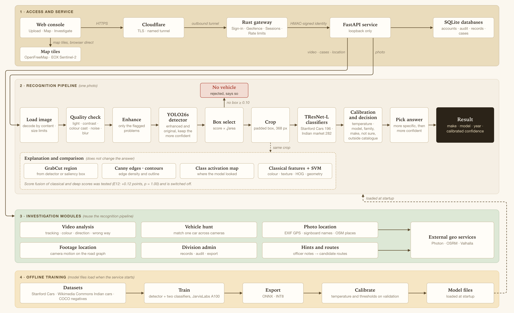
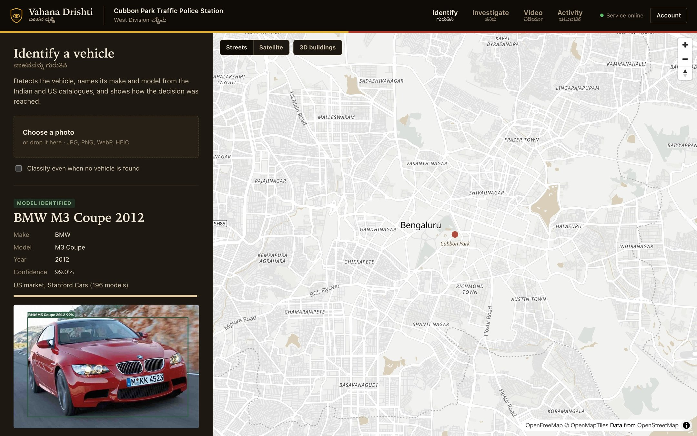
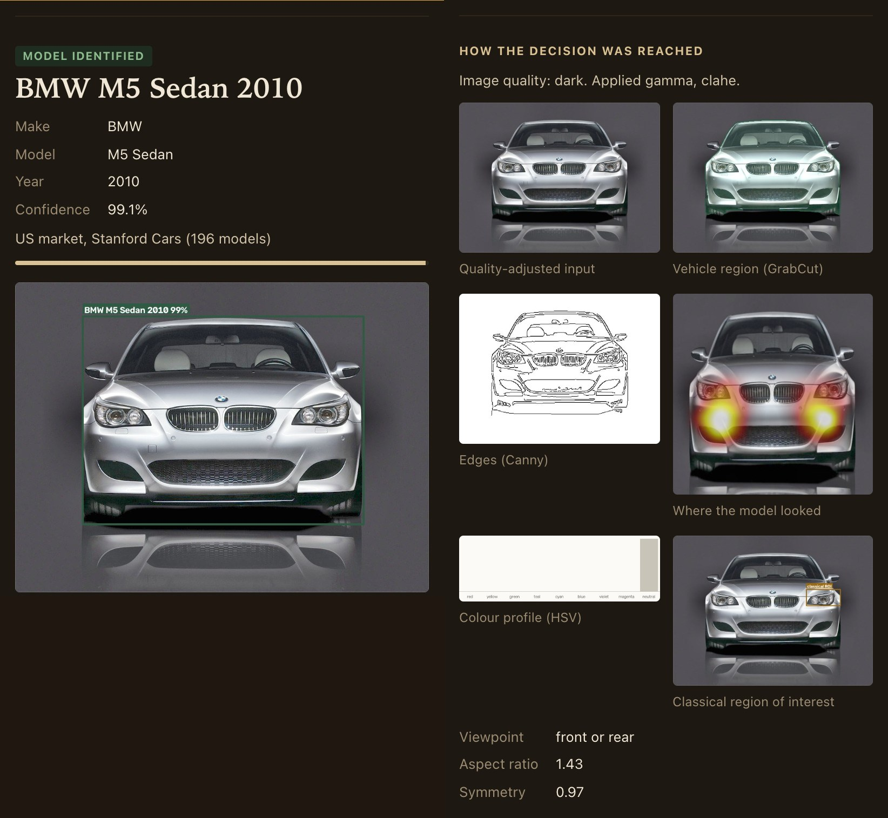
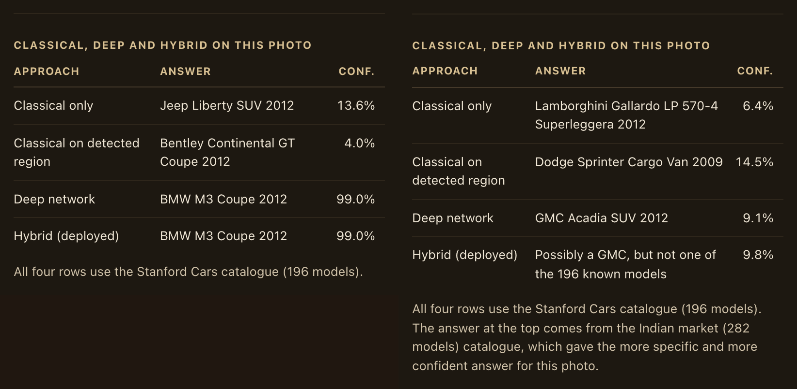
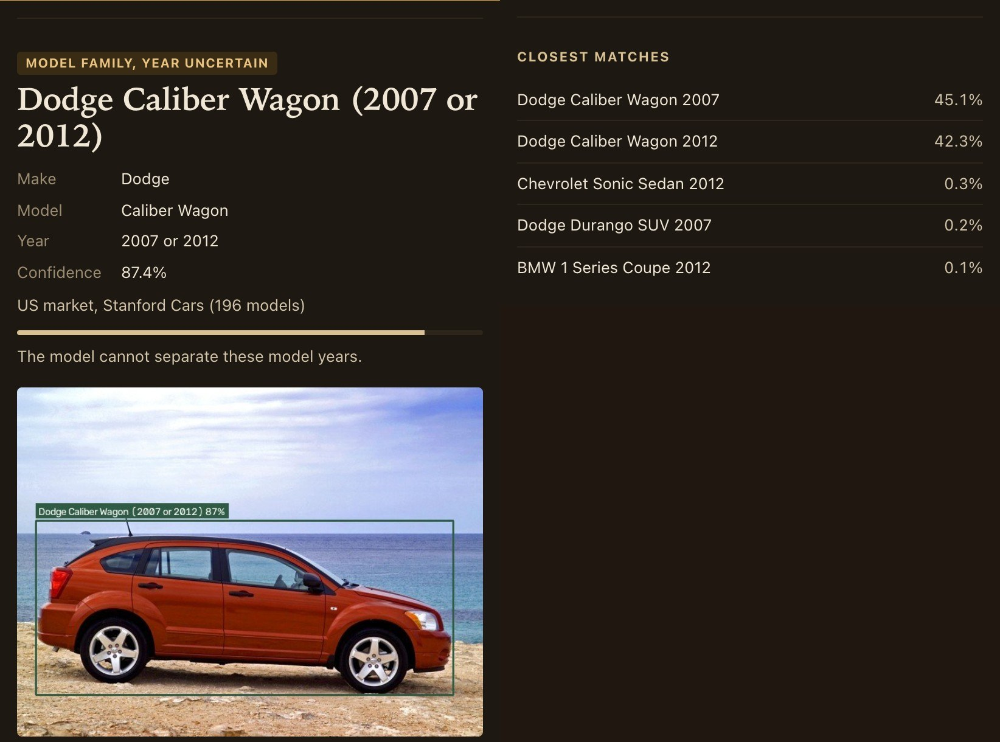
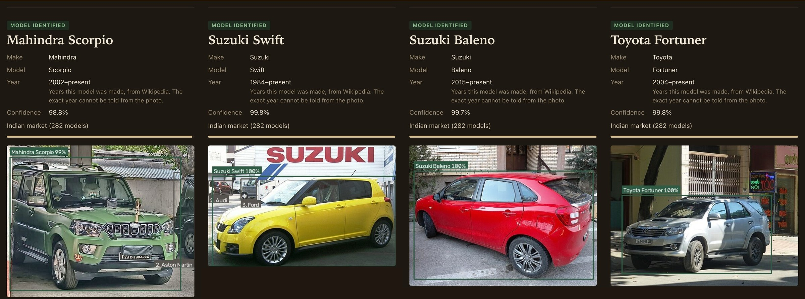
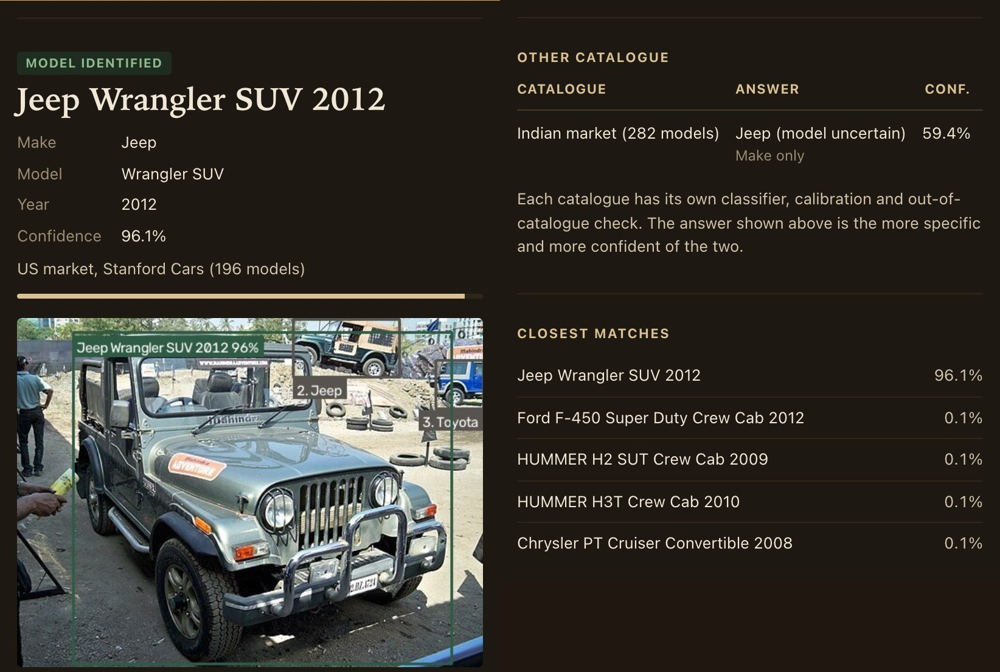
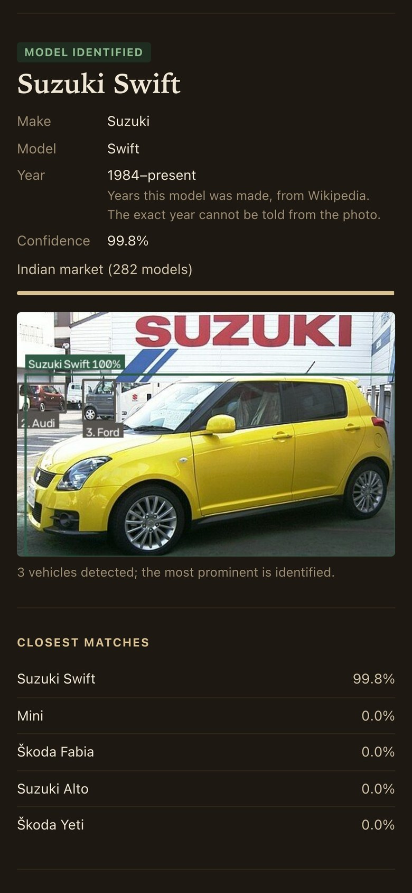

1RUA24CSE0216,1RUA24CSE0228,1RUA24CSE0229,1RUA24CSE0275,1RUA24CSE0244

# Hackathon Technical Solution Report

| Field | Details |
| :--- | :--- |
| **Problem ID** | P5 |
| **Problem Title** | Intelligent Fine-Grained Vehicle Recognition and Analysis System |
| **Team Name** | ATLAS (Team ID T55) |
| **Team Members** | Kushal S (1RUA24CSE0216)<br>M Dhanya (1RUA24CSE0228)<br>M M Havish (1RUA24CSE0229)<br>Manusmita Mishra (1RUA24CSE0244)<br>Navtej Chakravarty (1RUA24CSE0275) |
| **GitHub Repository** | https://github.com/kushal-script/CV_Hakcathon_P5<br>Commit evaluated: `8832b782e0e6fee9cfb6ea9620d1b09bf8909866` (later commits change only documentation) |
| **Live Demo / Deployment** | https://www.vahanadrishti.in |

---

## 1. Problem Understanding & Solution Strategy

* **Core Technical Challenge:** Telling a car from a truck is easy. Telling a 2007 Dodge Caliber from a 2012 one, or an Audi S5 Coupe from an A5 Coupe, is not. Stanford Cars has 196 classes, and many of them differ only in a grille, a bumper, a badge or the model year. The photos are taken from every angle and distance, often in poor light and with other cars in the frame, and at inference time nothing tells the system where the car is. The brief also asks for a confidence score that can be trusted and for sensible handling of low-confidence inputs, so the system has to recognise when it does not know: a car outside the 196 classes, two model years it cannot separate, or a photo with no vehicle in it. We added three constraints of our own. An answer has to come back on a CPU in about a second, because the console runs on a rented CPU machine and judges may upload from a phone. Every threshold has to be fitted on validation data or recorded as a hand-set value, and the test split is read once. And the console has to show its working, so that an officer can check why a car was named instead of taking it on trust.

* **Proposed Methodology:** A fine-tuned YOLO26s finds the vehicle, a fine-tuned TResNet-L names it from a 368 px crop, and temperature scaling plus a decision policy fitted on validation data decide how specific the answer may be: make, model and year, model with a range of years, make only, not sure, or outside the catalogue. Classical image processing measures every photo and corrects only the problems it finds (darkness, colour cast, noise, low contrast), and the detector then keeps whichever of the original and corrected photo it is more confident about, so a correction survives only when it helps the detector. We chose this over a fixed preprocessing chain because applying every correction to every photo lost accuracy in some conditions (low light at severity 3 fell from 58.5% to 51.9%), while the per-photo choice kept those cases and still recovered noisy and low-contrast photos.

---

## 2. Technical Architecture & Implementation

Figure 1 shows the system as it runs at https://www.vahanadrishti.in. The browser reaches it through Cloudflare. A Rust gateway (`gateway/`) handles sign-in and passes each request, with an identity it has signed, to a FastAPI service (`app/server.py`) that runs the models with ONNX Runtime. The recognition code is the Python package `src/p5`, and the folders named below are inside it.



*Figure 1. Architecture of the deployed system. The explanation and comparison branch works on the same crop as the classifier but does not change the answer.*

### 2.1 Classical Algorithmic Baseline

* **Algorithms Utilized:** Everything classical lives in `src/p5/classical/`.
  * **Quality analysis** (`quality.py`) runs on a copy no wider than 512 px. It measures mean luma, RMS contrast, colour cast (the largest gap between one channel's mean and the mean of all three, relative to that mean), noise with Immerkær's Laplacian estimator [13] and sharpness as the variance of the Laplacian.
  * **Enhancement** (`preprocess.py`) has four steps: Gray World white balance [11], auto-gamma, Non-Local Means denoising [12] and CLAHE [10] on the L channel of CIELAB.
  * **Region of interest** (`saliency.py`, `refine.py`): a spectral residual saliency map [7] on a 128 × 128 grey copy, an Otsu threshold, a 15 × 15 morphological closing and the box of the largest contour. If that region covers less than 2% of the frame, the central 80% of the image is used instead. GrabCut [8] (5 iterations, box padded by 5%) then turns the box, or the detector's box when there is one, into a vehicle mask.
  * **Edges and contours:** Canny [9] on the blurred grey crop, with the two thresholds at 0.67 and 1.33 times the median intensity, so they follow the brightness of each photo. The vehicle outline is the largest external contour of the GrabCut mask after a 3 × 3 opening, and the Canny map gives the edge density features and the edges panel.
  * **Features** (`features.py`), 3,989 numbers per vehicle: an 8 × 4 × 4 HSV histogram inside the GrabCut mask (128), colour moments in CIELAB (9), uniform LBP histograms at radius 1 and 2 [14] (28), HOG [15] with 9 orientations and 16 px cells (3,780), an 8 × 4 grid of edge densities plus the overall density (33), and 11 geometry values: aspect ratio, extent, solidity, left-right symmetry and seven log Hu moments [23].
  * **Classifier** (`svm.py`): standardisation, PCA to 256 whitened components and a linear SVM. The regularisation constant was picked on validation from four values (0.005 won), and a temperature fitted on validation turns its scores into the confidence shown in the console.

  On its own this baseline reaches 2.96% top-1 on the test set, and 14.74% when it is given the detector's box. That is far too weak for 196 fine-grained classes, so the classical classifier stays as the baseline row of the comparison and as an aid to explanation. It does not vote on the final answer (Section 2.3).

* **Adaptive Selection Logic:** Each enhancement step runs only for the problem it fixes, and two of them take their strength from the photo itself.
  * Colour cast above 0.12: Gray World white balance.
  * Mean luma below 0.30: auto-gamma with γ = log 0.45 / log(mean luma), clipped to [0.3, 1.0], so a very dark photo is lifted more than a slightly dark one.
  * Noise sigma above 0.035: Non-Local Means with filter strength h = 0.8 × σ × 255, kept between 3 and 30, so the smoothing follows the measured noise. The noise is measured again after gamma, because brightening a dark photo also brightens its noise.
  * Dark, or RMS contrast below 0.12: CLAHE on an 8 × 8 grid, with clip limit 1.5 for dark photos and 2.0 otherwise.
  * Blur (Laplacian variance below 60) is reported but not corrected.

  The limits are hand-set values kept in `configs/app.yaml` and listed as such in `docs/PARAMETERS.md`. We did not fit them. What changes from photo to photo is which steps run and how strongly. The last word goes to the detector: when any step has run, YOLO26s scores both the original and the corrected photo, and the version whose best box is more confident is used for everything after that, with the original winning ties. On the dark BMW in Figure 3, gamma and CLAHE ran and were kept.

### 2.2 Deep Learning Pipeline

* **Model Architecture:** Detection uses YOLO26s [2] (`src/p5/detection/`), retrained as a detector with a single "vehicle" class. With COCO's car, bus and truck classes and no fine-tuning it already reached a mean IoU of 0.912 on the test set, so we kept the small model instead of spending CPU time on a larger one. Fine-tuning on the Stanford Cars boxes lifted that to 0.949. The vehicle to classify is the box with the highest score × √area, which prefers the large car in front over a confidently detected small one behind it.

  Classification uses TResNet-L [3] (`src/p5/classification/`), pretrained on ImageNet-1k (`tresnet_l.miil_in1k_448` in timm [4]), with a new 196-way head, on a crop of the padded detector box resized to 368 px. We chose it on validation after also fine-tuning an I-JEPA ViT-H/14 [5], which has about ten times as many parameters: 92.64% top-1 against 95.34% for TResNet-L. The test set, read later, agrees (92.53% against 94.53% on detector crops). The deployed classifier is exported to ONNX and quantised to INT8 (static, per channel), which takes it from 206.1 MB to 52.9 MB.

  A second classifier with the same architecture covers 282 car models sold or made in India. Stanford Cars has almost none of the cars on Bengaluru's roads: on Indian photos, the Stanford model named a specific model only 8.2% of the time. Both classifiers run on every crop, each with its own calibration and out-of-catalogue check, and the console shows the more specific answer (then the more confident one) with the other answer beside it.

* **Loss Functions & Training:** The classifier was trained with cross-entropy and label smoothing of 0.1, using AdamW with one learning rate for the pretrained backbone (2 × 10⁻⁴) and a ten times higher one for the new head (2 × 10⁻³), weight decay 0.05 (none on normalisation layers and biases), two warm-up epochs and then a cosine schedule, for 40 epochs at batch size 32 on a JarvisLabs A100. The augmentations each imitate something we expected from real uploads: horizontal flips (p = 0.5), RandAugment [16] with 2 operations at magnitude 7, shrinking and re-enlarging the crop by a factor of 0.25 to 0.75 to imitate low resolution (p = 0.2), random CLAHE or gamma to imitate bad light (p = 0.2), random erasing [17] to imitate partial occlusion (p = 0.25), and jitter of the crop box (±10% in size, ±5% in position) so that the classifier does not depend on a perfect box.

  The detector was fine-tuned for 30 epochs at 640 px, batch 32. Stanford Cars labels one car per image, so training on those boxes alone would teach the detector to ignore every other car in the frame. We added 3,373 pseudo-labelled background cars on 1,817 training images (zero-shot boxes with a score of at least 0.5 and an IoU below 0.3 with the labelled car) and 500 COCO [21] images with no vehicle, so that it learns to keep secondary cars and to stay silent on empty scenes.

  **Data.** Stanford Cars [1] has 8,144 training and 8,041 test images. We held out 815 training images as a validation split covering all 196 classes and trained on the other 7,329. Every threshold, temperature and model choice was made on those 815 images. The test split was read only by `scripts/eval_test.py`, and each read is logged in `experiments/test_log.csv`.

  The Indian catalogue comes from 27,382 free-licensed Wikimedia Commons photos of 282 models. The models were listed from Wikidata and from Wikipedia articles on the Indian car industry, and the photos were fetched through the Commons API by `scripts/build_india_dataset.py`. A photo was kept only if the COCO detector found a car or truck covering at least 18% of the frame and no second large vehicle. Near-duplicates were removed, and the split (18,585 training, 4,499 validation, 4,298 test) keeps each photographer in one split, so the test photos come from people the model has never seen. This classifier started from the Stanford Cars weights with a new head and was trained for 25 epochs with square-root class balancing.

### 2.3 Hybrid Integration & Adaptive Mechanism

* **Fusion Strategy:** The classical side and the networks meet at three points.
  1. **Before detection.** Classical quality analysis picks the corrections, and the detector decides whether to keep them (Section 2.1). This is where classical processing changes what the networks see, and on damaged photos it changes the result: under Gaussian noise at severity 1 the detector found the car in 45% of photos as they were, and in 97% after the selective correction.
  2. **After detection.** The detector's box feeds the classical branch: GrabCut, edges, colour and geometry are all computed inside it. With that box the classical classifier goes from 2.96% to 14.74% top-1.
  3. **In the console.** On the same crop, the console shows the classical, deep and hybrid answers side by side (Figure 4), with the class activation map of the deep model and the classical panels (Figure 3).

  We also tried score-level fusion: adding β · log p(SVM) to the deep logits, with β fitted on validation (experiment E12). It gained 0.12 points of top-1 on validation, and McNemar's test [18] gave p = 1.00. We switched it off (`fusion: false`, `beta = 0`) because a component with no measurable effect only adds latency and one more thing to explain.

* **Decision Logic:** Logits are divided by a temperature fitted on validation [6] (T = 0.769 for the Stanford model). T came out below one, which means the raw probabilities were too cautious, and label smoothing is the likely cause. The policy in `src/p5/confidence/policy.py` then works from the top, with every threshold set on the 815 validation images:
  * If the largest raw logit is below τ_ood = 2.475 (the value that 95% of in-catalogue validation cars exceed), the car is treated as outside the 196 models. When the make still has probability of at least τ_make, the console says "Possibly a ⟨make⟩, but not one of the 196 known models".
  * Otherwise, if the top class has probability of at least τ_hi = 0.74, the console names make, model and year.
  * If not, and the probability of the model family (the same model in different years) is at least τ_fam = 0.57, it names the model and the possible years.
  * If not, and the make has probability of at least τ_make = 0.05, it names the make only. Otherwise it says it is not sure.

  τ_hi and τ_fam are the lowest confidences at which validation accuracy reaches 97%, and τ_make the lowest at which it reaches 95% [20]. Detection has its own two limits, fitted in E06: with no box above 0.10 the console reports that there is no vehicle, and a best box between 0.10 and 0.25 is still classified but marked as a possible vehicle with low detector confidence. If the user ticks "Classify even when no vehicle is found", the classical region is classified and the answer carries the note "Forced classification: no vehicle was detected, so this answer is unreliable." When both catalogues answer, the more specific level wins, then the higher confidence, and on a tie the Indian answer is preferred because the console serves Bengaluru.

---

## 3. Experimental Benchmarks & Evaluation

All numbers are on the Stanford Cars test split (n = 8,041) unless marked val. The models, thresholds and enhancement rule were frozen before the test labels were read. The tables follow the metric order of the problem statement, and `scripts/make_tables.py` rebuilds every one of them from the logged experiment outputs. One record per experiment is kept in `experiments/INDEX.md`.

### 3.1 Quantitative Benchmarks

**Classification: Top-1 and Top-5**

| Approach / Model Variant | Input | Top-1 (%) ↑ | Top-5 (%) ↑ | Make Top-1 (%) ↑ | Family Top-1 (%) ↑ |
| :--- | :---: | :---: | :---: | :---: | :---: |
| **Classical Baseline** (HOG, colour, LBP, edges, geometry → linear SVM) | saliency box | 2.96 | 8.73 | 7.66 | 3.01 |
| Classical on the detector's box | YOLO crop | 14.74 | 33.27 | 23.38 | 15.04 |
| **Deep Learning Only** (TResNet-L, no detector) | full image | 91.88 | 97.66 | 95.88 | 92.34 |
| Deep on the detector crop, FP32 | YOLO crop | 94.53 | 98.67 | 98.22 | 94.96 |
| Deep on the detector crop, INT8 | YOLO crop | 94.49 | 98.68 | 98.22 | 94.93 |
| **Proposed Hybrid System** (deployed, INT8) | raw upload | **94.69** | **98.94** | **98.37** | **95.15** |
| Deep on the ground-truth box (upper bound for localisation) | GT crop | 95.21 | 99.22 | 98.77 | 95.63 |
| I-JEPA ViT-H/14, fine-tuned (research row) | YOLO crop | 92.53 | 98.53 | 97.15 | 93.11 |
| I-JEPA ViT-H/14, frozen linear probe (research row) | GT crop | 66.24 | 87.49 | 76.88 | 66.92 |

Between visually similar classes, the deployed system's confusion rate is 6.4% for year twins (one model in two model years) and 10.0% for rebadged twins (one vehicle sold under two brands).

**Object localisation: IoU**

| Detector | Mean IoU ↑ | IoU ≥ 0.5 (%) ↑ | IoU ≥ 0.75 (%) ↑ |
| :--- | :---: | :---: | :---: |
| YOLO26s, COCO weights, no fine-tuning (car, bus, truck) | 0.9124 | 95.51 | 94.71 |
| **YOLO26s, fine-tuned (deployed)** | **0.9493** | **99.03** | **98.45** |

**Object detection: mAP**

| Detector | mAP@0.5 ↑ | mAP@0.75 ↑ | mAP@0.5:0.95 ↑ |
| :--- | :---: | :---: | :---: |
| YOLO26s, no fine-tuning | 0.9321 | 0.9234 | 0.8696 |
| **YOLO26s, fine-tuned (deployed)** | **0.9758** | **0.9727** | **0.9261** |

On 100 held-out COCO test images with no vehicle, 99 correctly return "no vehicle". On the Stanford Cars test set, 0.34% of images get no detection.

**Model efficiency: size and inference time**

| Classifier | Size (MB) ↓ | Val Top-1 (%) | Test Top-1, detector crop (%) | Latency p50, 2 threads, AMD EPYC 7542 | Latency p50, 2 threads, Apple M3 |
| :--- | :---: | :---: | :---: | :---: | :---: |
| FP32 | 206.1 | 95.34 | 94.53 | 354 ms | 316 ms |
| **INT8 (static, QDQ, per channel)** | **52.9** | 94.97 | 94.49 | 434 ms | **100 ms** |

The detector is a 38 MB ONNX file. INT8 makes the classifier 3.9 times smaller and 3.2 times faster on CPUs that have integer dot-product instructions (ARM, or x86 with VNNI). The AMD EPYC 7542 we first measured on has no VNNI, and there INT8 was slower than FP32, which we would not have guessed without measuring.

End-to-end time for the full console pipeline, including every panel and comparison row, on 40 test images, 2 threads, Apple M3:

| Stage | INT8 p50 (ms) | INT8 p95 (ms) | FP32 p50 (ms) | FP32 p95 (ms) |
| :--- | :---: | :---: | :---: | :---: |
| Reading the upload | 1 | 27 | 1 | 27 |
| Quality analysis | 4 | 7 | 4 | 7 |
| Enhancement | 0 | 5 | 0 | 5 |
| Detection | 126 | 251 | 125 | 251 |
| Classification | 100 | 296 | 316 | 1178 |
| Classical branch (GrabCut, features, SVM) | 160 | 337 | 158 | 311 |
| Comparison rows | 145 | 494 | 136 | 338 |
| Panels | 8 | 20 | 8 | 19 |
| **Total** | **590** | **1097** | 787 | 1824 |

**Robustness: performance under varying conditions**

1,960 random test images, end-to-end Top-1 (%). "Deployed" applies the classical corrections and keeps whichever of the original and corrected photo gives the more confident detection, a rule chosen on validation. Speckle noise and Gaussian blur were never used for tuning. The corruptions are our own implementations in `src/p5/data/corrupt.py`, modelled on the ImageNet-C types [22] with a five-step severity scale (steps 1, 3 and 5 are reported), plus low light with shot noise, occlusion and reduced resolution.

| Condition | Raw | Always enhance | **Deployed** | GT crop | Detection rate, raw → deployed |
| :--- | :---: | :---: | :---: | :---: | :---: |
| clean | 94.6 | 94.4 | **94.5** | 95.4 | 100% → 100% |
| contrast, s1 | 94.5 | 94.2 | **94.5** | 94.9 | 100% → 100% |
| contrast, s3 | 93.6 | 94.3 | **94.1** | 94.2 | 99% → 99% |
| contrast, s5 | 83.9 | 91.7 | **91.2** | 90.3 | 51% → 95% |
| defocus blur, s1 | 85.9 | 85.7 | **86.0** | 86.2 | 100% → 100% |
| defocus blur, s3 | 33.6 | 33.2 | **33.4** | 31.8 | 99% → 99% |
| defocus blur, s5 | 6.9 | 6.7 | **6.8** | 6.8 | 93% → 94% |
| fog, s1 | 94.5 | 94.5 | **94.6** | 95.1 | 100% → 100% |
| fog, s3 | 94.3 | 94.3 | **94.2** | 94.8 | 100% → 100% |
| fog, s5 | 93.3 | 92.5 | **92.8** | 93.6 | 99% → 100% |
| Gaussian blur, s1 | 93.4 | 93.4 | **93.4** | 93.8 | 100% → 100% |
| Gaussian blur, s3 | 33.9 | 33.1 | **33.2** | 31.9 | 100% → 100% |
| Gaussian blur, s5 | 2.9 | 3.0 | **3.0** | 2.9 | 86% → 89% |
| Gaussian noise, s1 | 81.9 | 90.4 | **90.9** | 92.6 | 45% → 97% |
| Gaussian noise, s3 | 75.4 | 77.6 | **78.3** | 83.2 | 0% → 81% |
| Gaussian noise, s5 | 38.1 | 42.2 | **38.0** | 40.1 | 0% → 0% |
| JPEG compression, s1 | 93.3 | 93.3 | **93.4** | 93.5 | 100% → 100% |
| JPEG compression, s3 | 91.9 | 91.9 | **92.1** | 93.1 | 100% → 100% |
| JPEG compression, s5 | 82.5 | 82.0 | **82.3** | 87.0 | 94% → 94% |
| low light, s1 | 89.8 | 89.1 | **92.1** | 93.1 | 93% → 96% |
| low light, s3 | 58.5 | 51.9 | **58.4** | 66.8 | 29% → 30% |
| low light, s5 | 13.3 | 11.1 | **13.3** | 15.4 | 0% → 0% |
| motion blur, s1 | 93.5 | 93.4 | **93.5** | 94.1 | 100% → 100% |
| motion blur, s3 | 62.6 | 61.9 | **62.3** | 61.4 | 99% → 99% |
| motion blur, s5 | 22.1 | 22.2 | **22.3** | 21.5 | 94% → 94% |
| occlusion, 10% | 93.1 | 93.1 | **93.1** | 94.8 | 100% → 100% |
| occlusion, 25% | 84.9 | 84.8 | **84.9** | 93.0 | 100% → 100% |
| occlusion, 50% | 42.8 | 43.3 | **43.0** | 84.2 | 98% → 98% |
| pixelate, s1 | 92.7 | 92.6 | **92.7** | 93.5 | 100% → 100% |
| pixelate, s3 | 85.9 | 85.7 | **85.9** | 86.7 | 94% → 94% |
| pixelate, s5 | 61.1 | 60.8 | **61.1** | 58.8 | 34% → 34% |
| resolution, 112 px | 92.1 | 92.1 | **92.1** | 93.0 | 100% → 100% |
| resolution, 56 px | 53.3 | 53.5 | **53.3** | 54.2 | 100% → 100% |
| resolution, 28 px | 3.4 | 3.5 | **3.5** | 3.5 | 97% → 98% |
| speckle noise, s1 | 85.0 | 92.6 | **92.7** | 93.9 | 83% → 99% |
| speckle noise, s3 | 78.9 | 88.4 | **88.3** | 88.7 | 14% → 100% |
| speckle noise, s5 | 69.1 | 75.4 | **75.2** | 78.4 | 1% → 85% |

Two rows are worth a second look. Under 50% occlusion the deployed system scores 43.0% but the same classifier on the ground-truth box scores 84.2%, so most of that loss comes from the detector's box, which most likely covers only the visible part of the car. And under heavy noise the classifier is not the weak point: at speckle severity 3 the detector found the car in 14% of the raw photos and in 100% after denoising.

**Confidence and threshold analysis**

* Temperature T = 0.769, fitted on validation for the deployed INT8 model on detector crops.
* Expected calibration error on test: 10.36% before temperature scaling, **1.13%** after.
* Area under the risk-coverage curve 0.0200 [20]. Accuracy when answering only the most confident 80%, 90%, 95% and 100% of photos: 98.21%, 97.68%, 96.79% and 94.47%.
* Thresholds fitted on validation, with 95% bootstrap intervals: τ_hi = 0.740 [0.46, 0.96], τ_fam = 0.570 [0.18, 0.94], τ_make = 0.050 [0.05, 0.05], τ_ood = 2.475 [1.95, 2.93]. Detector: τ_lo = 0.10, τ_det = 0.25.

| Decision level (deployed, test) | Share of images | Correct at that level |
| :--- | :---: | :---: |
| Make, model and year | 93.46% | 97.22% |
| Model family, year uncertain | 1.31% | 71.43% |
| Make only | 0.36% | 93.10% |
| Possibly ⟨make⟩, not one of the 196 models | 4.54% | 81.10% |
| No vehicle detected | 0.34% | not applicable |

Across all levels, 95.81% of test images receive an answer that is correct at the level it is given.

**Indian-market catalogue (extension, experiment E18).** Test split of 4,298 photos covering 282 models, read once by `scripts/eval_india.py`.

| Model (INT8, single view) | Top-1 (%) | 95% CI | Top-5 (%) | Macro Top-1 (%) | Make Top-1 (%) | ECE after temperature (%) |
| :--- | :---: | :---: | :---: | :---: | :---: | :---: |
| TResNet-L, started from the Stanford Cars model (deployed) | **84.32** | 83.18 to 85.32 | 93.65 | 82.73 | 89.95 | 1.42 |
| TResNet-L, started from ImageNet | 83.18 | 82.11 to 84.34 | 92.35 | 82.00 | 89.11 | 1.28 |

Starting from the Stanford Cars weights was right on 170 photos where the ImageNet start was wrong, and wrong on 125 where it was right (McNemar p = 0.01). On these Indian photos the Stanford Cars model named a specific model only 8.2% of the time and flagged 91.3% as outside its catalogue. On the 3,043 photos whose make also exists in Stanford Cars it named the make correctly 29.0% of the time, against 90.1% for the Indian model. With thresholds fitted on validation, the Indian catalogue names a model for 72.4% of test photos and is right 97.5% of the time when it does.

* **Analysis:** Classifying the detector's crop instead of the whole photo is worth 2.65 points, and the rest of the hybrid (selective correction and calibrated back-off) adds 0.20 points on clean test photos but far more on damaged ones: 8.9 points under Gaussian noise at severity 1 and 7.3 under strong contrast loss. INT8 costs 0.04 points on test (0.37 on validation) for a classifier 3.9 times smaller and 3.2 times faster on a CPU with integer dot-product instructions. Where the system still fails badly (strong blur, very low light, cars only 28 px wide) none of the corrections help, and blur in particular is detected but not corrected.

### 3.2 Visual Outputs & Intermediate Representations

All screenshots were taken from the console running locally at commit `e5b4b6b`, which has the same recognition code as the evaluated commit. The only later code change adds the demo accounts of Section 5. The Stanford Cars photos are test images that were never used for training or tuning, and the Indian photos come from the held-out test split of the Indian catalogue.



*Figure 2. The console after identifying Stanford Cars test image 00103, named BMW M3 Coupe 2012 at 99.0%. The detector's box and label are drawn on the photo, and the map stays on the signed-in station's part of Bengaluru.*



*Figure 3. Intermediate outputs for test image 00193, which the quality check flagged as dark. Gamma and CLAHE were applied and kept, because the detector was more confident on the corrected photo, and the car was named BMW M5 Sedan 2010 at 99.1%. Right: the corrected input, the GrabCut vehicle region, Canny edges, the class activation map, the HSV colour profile and the saliency box, with geometry from the GrabCut mask.*

Two details in Figure 3 say a lot about the two halves of the system. The activation map sits on the lower air intakes and fog lamps, which is where the M5's bumper differs from an ordinary 5 Series. The saliency box, on the other hand, has settled on one headlight: spectral residual saliency picks out the most unusual texture in the frame, which is often a lamp or a badge rather than the whole car. That is one reason the classical-only row scores 2.96%, and why the classical branch uses the detector's box whenever there is one.



*Figure 4. Classical, deep and hybrid answers on two photos, all from the Stanford Cars catalogue. Left, the BMW M3 from Figure 2: both classical rows are wrong, while the deep network and the deployed system agree at 99.0%. Right, an Indian Army Mahindra Scorpio, a model Stanford Cars does not contain: the deep network on its own names a GMC Acadia at 9.1%, while the deployed policy says only that it may be a GMC and is not one of the 196 models. The answer at the top of the console came from the Indian catalogue (Figure 6). Scorpio photo by MotuPagalSingh, CC BY-SA 4.0, Wikimedia Commons.*



*Figure 5. Low-confidence handling. Test image 00653 is labelled Dodge Caliber Wagon 2007. The model gives 45.1% to 2007 and 42.3% to 2012, two years of the same generation, so the policy names the model with both years and 87.4% for the pair instead of guessing one year.*



*Figure 6. Cars sold in India, from the held-out test split of the Indian catalogue: Mahindra Scorpio (98.8%), Suzuki Swift (99.8%), Suzuki Baleno (99.7%) and Toyota Fortuner (99.8%). Commons photos carry no model year, so the year line gives the production years from Wikipedia and says that the exact year cannot be told from the photo. Photos from Wikimedia Commons by MotuPagalSingh (CC BY-SA 4.0), S-8500 (CC BY-SA 3.0), ГП (CC BY-SA 4.0) and Vmenkov (CC BY-SA 4.0).*

### 3.3 Ablation Study

Each row changes one thing and keeps the rest fixed. Validation rows were settled before any test run, and paired comparisons use McNemar's test, with Holm's correction [19] where several were tested together.

| Factor (one change at a time) | Split | Top-1 with | Top-1 without | Δ | Significance |
| :--- | :---: | :---: | :---: | :---: | :--- |
| Detection crop vs full image (TResNet-M, 15 epochs) | val | 93.25 | 91.04 | +2.21 | McNemar p = 0.013 (Holm) |
| Robustness augmentation bundle | val | 93.25 | 92.39 | +0.86 | p = 0.167, not significant on clean images |
| Detection crop vs full image (TResNet-L, deployed model) | test | 94.53 | 91.88 | +2.65 | |
| Fine-tuned vs zero-shot detector (mean IoU) | test | 0.9493 | 0.9124 | +0.0369 | |
| Classical score fusion (β = 0.05) | val | 94.97 | 94.85 | +0.12 | McNemar p = 1.00, rejected |
| INT8 quantisation | val | 94.97 | 95.34 | −0.37 | 3.9 times smaller |
| Classical correction with detector selection, Gaussian noise s1 | test subset | 90.9 | 81.9 | +8.9 | n = 1,960 |
| Classical correction with detector selection, speckle noise s3 | test subset | 88.3 | 78.9 | +9.4 | n = 1,960 |
| Classical correction with detector selection, contrast s5 | test subset | 91.2 | 83.9 | +7.3 | n = 1,960 |
| Classical correction with detector selection, low light s1 | test subset | 92.1 | 89.8 | +2.3 | n = 1,960 |
| Classical features: HOG block | val | 15.21 | 9.33 | +5.89 | shape carries most of the classical signal |
| Classical features: HSV colour block | val | 15.21 | 13.50 | +1.72 | |

* Cropping to the detected car is the clearest gain: +2.21 points on validation with a smaller model and +2.65 with the deployed one on test.
* The robustness augmentations make no significant difference on clean validation photos, which is what we expected. They are there for damaged photos, and the corruption rows above are where the selective correction earns its place.
* Test-time flipping was also tried and left out: it gained 0.37 points on validation, 3 of 815 images, for twice the classifier time.
* Inside the classical model, removing HOG costs 5.89 of its 15.21 points on validation, while removing colour costs 1.72. Make and model are told apart by shape far more than by paint.

---

## 4. Failure Modes & Limitations

* **Observed Failure Case:**

  

  *Figure 7. A held-out test photo of a first-generation Mahindra Thar in Mumbai. The Stanford Cars classifier names it Jeep Wrangler SUV 2012 at 96.1%. The Indian classifier is sure only of the make, and gets that wrong too ("Jeep", 59.4%), so the more specific Stanford answer is shown at the top. Photo by Ask27, CC BY-SA 3.0, Wikimedia Commons.*

  This is the failure we would show a judge first, because it is confident, plausible and wrong. We saw the same pattern on the live site with a white European hatchback that neither catalogue contains (it looks like a 1990s Opel Corsa): it was named Plymouth Neon Coupe 1999 at 80.5%.

  On the Stanford Cars test set, 430 of 8,041 images (5.35%) are wrong at top-1:

  | Category | Images |
  | :--- | :---: |
  | Same make, different model | 256 |
  | Different make | 70 |
  | Rebadged twin | 39 |
  | Same model, different year | 38 |
  | No vehicle found, or input rejected | 27 |

  | True class | Predicted as | Count |
  | :--- | :--- | :---: |
  | Chevrolet Express Van 2007 | Chevrolet Express Cargo Van 2007 | 13 |
  | Audi TTS Coupe 2012 | Audi TT Hatchback 2011 | 13 |
  | Audi S5 Coupe 2012 | Audi A5 Coupe 2012 | 11 |
  | Dodge Caliber Wagon 2007 | Dodge Caliber Wagon 2012 | 11 |
  | Audi V8 Sedan 1994 | Audi 100 Sedan 1994 | 11 |
  | Dodge Caliber Wagon 2012 | Dodge Caliber Wagon 2007 | 10 |
  | Dodge Sprinter Cargo Van 2009 | Mercedes-Benz Sprinter Van 2012 | 8 |
  | BMW 6 Series Convertible 2007 | BMW M6 Convertible 2010 | 8 |
  | Audi TT Hatchback 2011 | Audi TTS Coupe 2012 | 8 |
  | Bentley Continental GT Coupe 2012 | Bentley Continental GT Coupe 2007 | 7 |

  We looked at five of these errors closely. Their images are in `experiments/2026-11-06_16-31-27/figures/`.
  1. **Trim twin.** A windowless Express Cargo Van was called an Express Van at 100%. The activation map sits on the front, which is identical on both, and ignores the side windows, the only part that differs.
  2. **Year twin.** A 2007 Dodge Caliber was called a 2012 one. Both years belong to one generation, and the family back-off of Figure 5 is the right answer for this pair.
  3. **Probable label error.** An image labelled HUMMER H3T was predicted as a GMC Canyon at 96%. The truck carries a Chevrolet Z71 badge: it is a Colorado, which shares its platform with both the Canyon and the H3T.
  4. **Missed detection in clutter.** A Lamborghini on a show stand behind a crowd: the photo holds three small cars and the detector found none of them.
  5. **Rejected input.** Six test images smaller than 64 px were refused by the input check. The check has since been lowered to 32 px, and the numbers above keep the original limit.

* **Root Cause & Mitigation:**
  * **Confident answers for cars outside the catalogue (Figure 7, the hatchback).** The out-of-catalogue check is a single threshold on the largest logit, set so that 95% of in-catalogue validation cars pass, and no out-of-catalogue photos were used to set it. A car shaped like one known class gives that class a large logit and passes. The first-generation Thar keeps the body of the classic CJ Jeep that Mahindra built under licence for decades, so to both classifiers it simply looks like a Jeep. *Mitigation:* refit τ_ood with negatives (the 4,298 held-out Indian photos are a ready source), show the answer as uncertain when the two catalogues disagree on the make instead of picking the more specific one, and add more photos of the first-generation Thar and other Jeep-derived Mahindras to the Indian catalogue.
  * **Trim and year twins.** The classes differ by details that are hidden or tiny in many photos, and some pairs have no visible difference at all. *Mitigation:* the family back-off already handles same-generation years (Figure 5). Beyond that: train with twin pairs as hard negatives, add attention to the grille, badge and side-window regions, or merge classes that cannot be told apart.
  * **Label noise.** Some test labels are wrong (the HUMMER case). We report these images instead of changing test labels. *Mitigation:* review high-confidence disagreements with the label before trusting a score on them.
  * **Missed detections and tiny cars.** Cars that are small, partly hidden or behind people are missed, and below about 60 px they are not named reliably. *Mitigation:* run the detector on tiles of crowded photos at higher resolution, and add crowded scenes to its training data.
  * **Heavy blur and very low light.** Gaussian blur at severity 3 leaves 33.2% top-1, and at low light severity 3 the detector finds the car in only 30% of photos. No step in the pipeline removes blur. *Mitigation:* train with stronger blur augmentation or add a deblurring step, and use a low-light method that also suppresses noise for very dark photos.

**Limitations and responsible use**

* Stanford Cars covers mostly US-market cars up to 2012. The Indian catalogue adds 282 models, but 59 candidate models had fewer than 15 usable free photos and are missing, among them the Tata Punch, Tiago and Harrier, the Mahindra XUV700 and XUV300 and the Hyundai Exter. These can only get a make-level or "not a known model" answer.
* The Indian catalogue was trained and tested on enthusiasts' photos, mostly in daylight. Its accuracy on night-time traffic camera crops has not been measured and is likely to be lower.
* The out-of-catalogue threshold was set on in-catalogue validation data only, which is the root of the failures above.
* The system names vehicle models. It does not read number plates and does not identify people. Its answers are leads for an officer to check, not evidence: Figure 7 shows how a confident answer can still be wrong.
* The live console is limited to police station and division accounts, with sign-in from Karnataka. Every sign-in and prediction is recorded, and a station sees only its own records. The four shared demo accounts of Section 5 cannot change their passwords, and the demo administrators cannot change any data.

---

## 5. Deployment & Quickstart Guide

* **Live deployment:** https://www.vahanadrishti.in (also https://vahanadrishti.in)
* **Source code:** https://github.com/kushal-script/CV_Hakcathon_P5

To try the live console, open the link, let the browser share its location (sign-in works from inside Karnataka) and sign in with one of the demo accounts below. Identify is the first tab: choose a photo, and the answer, the boxes and the panels of Section 3.2 appear within a few seconds.

| Account | Username | Password | What it shows |
| :--- | :--- | :--- | :--- |
| Demo division administrator 1 | `demo-admin-1` | `My2W-Eayp-LH5L` | Every division: all stations, records, cases, accounts, charts and the audit log. Read only, so nothing can be changed or deleted |
| Demo division administrator 2 | `demo-admin-2` | `QRHy-M5sh-Nsyg` | The same all-division view as administrator 1 |
| Demo police station 1 | `demo-station-1` | `W6jG-VLNb-3Wry` | A station near MG Road, Central division: identify photos, analyse video, open cases and investigate |
| Demo police station 2 | `demo-station-2` | `bnKG-rt3k-M6VR` | A station in Koramangala, South division, with the same features |

The demo passwords cannot be changed, and failed sign-ins cannot lock these accounts for everyone. The two demo stations are not real police stations, and the demo administrators can look at every division but cannot change anything.



*Figure 8. The same console on a phone, 390 px wide, after identifying the Suzuki Swift of Figure 6.*

### Quickstart Commands

```bash
# 1. Clone the repository and install dependencies
git clone https://github.com/kushal-script/CV_Hakcathon_P5.git
cd CV_Hakcathon_P5
python3 -m venv .venv
.venv/bin/pip install -r requirements-app.txt

# 2. Run inference on a folder of .jpg photos (one JSON line per photo)
.venv/bin/python scripts/run_pipeline.py --images ./samples --out ./results/predictions.jsonl

# 3. Or run the whole console (gateway, API and models) in one container
docker build -t vahana-drishti .
docker run -d --name vahana -p 127.0.0.1:8080:8080 -v "$PWD/state:/app/state" -v "$PWD/cases:/app/data" --read-only --tmpfs /tmp --cap-drop ALL --security-opt no-new-privileges vahana-drishti
docker exec vahana vahana-gateway provision --stations /app/assets/bengaluru/police_stations.json --credentials /app/state/credentials.csv
```

The packaged models (192 MB of ONNX, calibration and taxonomy files in `models/`) are not stored in git. Steps 2 and 3 need that folder in place: it is rebuilt by the training, calibration and packaging commands listed under Reproduction in the README, or copied from the team. `provision` creates one account per police station and one per division and writes their one-time passwords to a file readable only by its owner.

### Deployment Format

* **Packaging:** one Docker image holding a Rust gateway (axum, Argon2id passwords, server-side sessions, rate limits, a strict content security policy) and a Python FastAPI service that runs the INT8 ONNX models with ONNX Runtime on the CPU. The container runs as a non-root user on a read-only filesystem with every Linux capability dropped.
* **Hosting:** a JarvisLabs CPU machine (8 vCPU, 32 GB) in Chennai. Cloudflare serves the domain over HTTPS through an outbound tunnel, so the machine has no open web ports. Systemd timers back up both SQLite databases and the case files every 6 hours and restart the container if its health check keeps failing, and a scheduled GitHub job resumes the machine if the provider pauses it.
* **Front end:** a web console in plain HTML, CSS and JavaScript, with MapLibre and OpenStreetMap data for the Bengaluru map. Around the recognition core it also offers video analysis, a vehicle hunt across camera feeds, route reconstruction and a division administrator's view. Section 5 of `docs/DESIGN.md` describes these.

---

### Student Submission Checklist
- [x] Working GitHub repository link included with an updated `README.md`.
- [x] No raw code pasted into this report.
- [x] All table metrics match test runs reproducible via the repository.
- [x] All team member details accurately recorded.

---

### References

1. J. Krause, M. Stark, J. Deng and L. Fei-Fei. 3D Object Representations for Fine-Grained Categorization. ICCV Workshop on 3D Representation and Recognition, 2013.
2. Ultralytics. YOLO26 documentation. https://docs.ultralytics.com
3. T. Ridnik, H. Lawen, A. Noy, E. Ben Baruch, G. Sharir and I. Friedman. TResNet: High Performance GPU-Dedicated Architecture. WACV, 2021.
4. R. Wightman. PyTorch Image Models (timm). https://github.com/huggingface/pytorch-image-models
5. M. Assran et al. Self-Supervised Learning from Images with a Joint-Embedding Predictive Architecture. CVPR, 2023.
6. C. Guo, G. Pleiss, Y. Sun and K. Q. Weinberger. On Calibration of Modern Neural Networks. ICML, 2017.
7. X. Hou and L. Zhang. Saliency Detection: A Spectral Residual Approach. CVPR, 2007.
8. C. Rother, V. Kolmogorov and A. Blake. GrabCut: Interactive Foreground Extraction Using Iterated Graph Cuts. ACM Transactions on Graphics (SIGGRAPH), 2004.
9. J. Canny. A Computational Approach to Edge Detection. IEEE TPAMI, 1986.
10. K. Zuiderveld. Contrast Limited Adaptive Histogram Equalization. Graphics Gems IV, 1994.
11. G. Buchsbaum. A Spatial Processor Model for Object Colour Perception. Journal of the Franklin Institute, 1980.
12. A. Buades, B. Coll and J.-M. Morel. A Non-Local Algorithm for Image Denoising. CVPR, 2005.
13. J. Immerkær. Fast Noise Variance Estimation. Computer Vision and Image Understanding, 1996.
14. T. Ojala, M. Pietikäinen and T. Mäenpää. Multiresolution Gray-Scale and Rotation Invariant Texture Classification with Local Binary Patterns. IEEE TPAMI, 2002.
15. N. Dalal and B. Triggs. Histograms of Oriented Gradients for Human Detection. CVPR, 2005.
16. E. D. Cubuk, B. Zoph, J. Shlens and Q. V. Le. RandAugment: Practical Automated Data Augmentation with a Reduced Search Space. CVPR Workshops, 2020.
17. Z. Zhong, L. Zheng, G. Kang, S. Li and Y. Yang. Random Erasing Data Augmentation. AAAI, 2020.
18. Q. McNemar. Note on the Sampling Error of the Difference Between Correlated Proportions or Percentages. Psychometrika, 1947.
19. S. Holm. A Simple Sequentially Rejective Multiple Test Procedure. Scandinavian Journal of Statistics, 1979.
20. Y. Geifman and R. El-Yaniv. Selective Classification for Deep Neural Networks. NeurIPS, 2017.
21. T.-Y. Lin et al. Microsoft COCO: Common Objects in Context. ECCV, 2014.
22. D. Hendrycks and T. Dietterich. Benchmarking Neural Network Robustness to Common Corruptions and Perturbations. ICLR, 2019.
23. M.-K. Hu. Visual Pattern Recognition by Moment Invariants. IRE Transactions on Information Theory, 1962.
